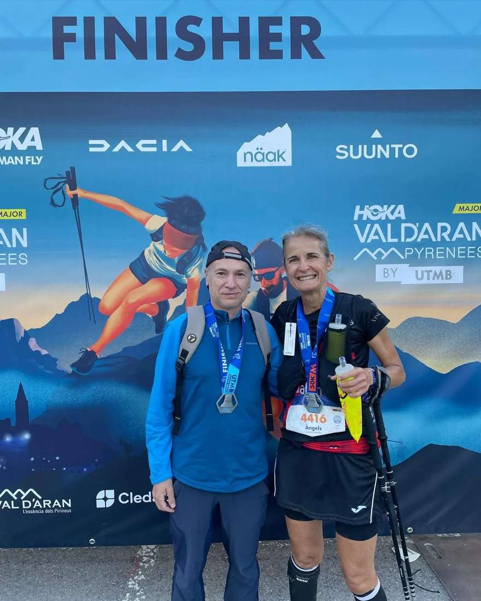

Pep Lluís Gómez i Àngels Vaquer disputaren ahir dijous la PDA de la Val d'Aran by UTMB. Durant 55 quilòmetres transitaren pels paratges d'aquesta àrea del pirineu català.

Pep Lluís Gómez fou el 852è de la general amb un temps de 10:01:34, mentre que Àngels Vaquer es classificà al lloc 1.392 de la general amb una marca de 12:08:13.

Ambdós ens contaren que gaudiren molt d'aquesta prova i del seu recorregut.

Enhorabona!!

