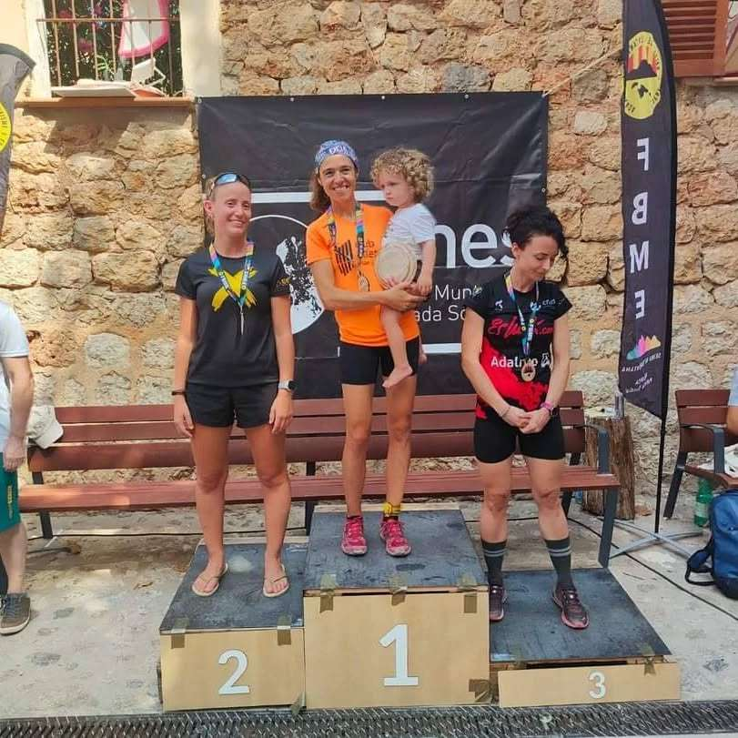
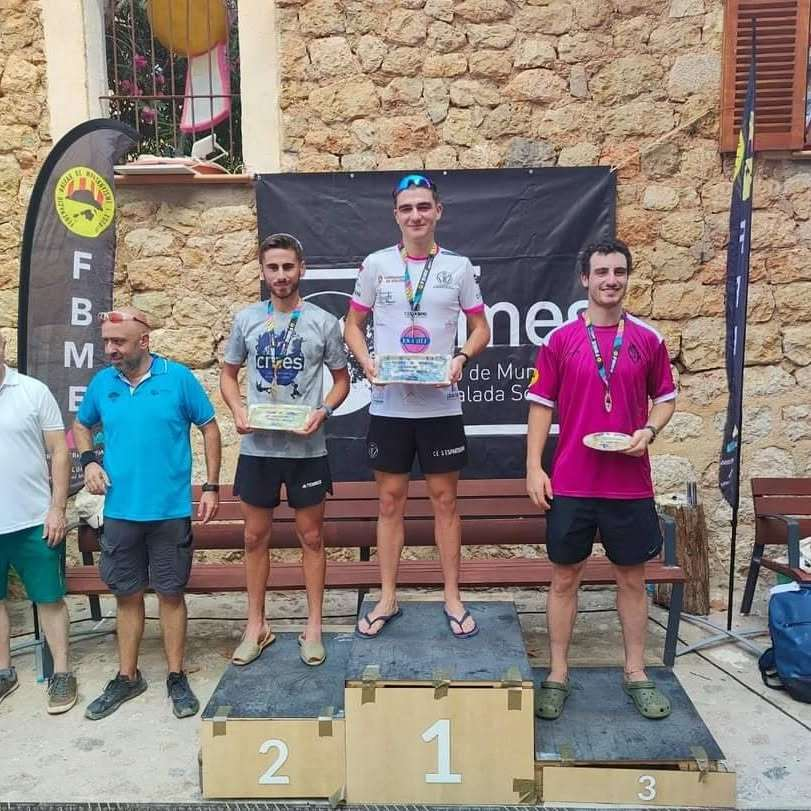
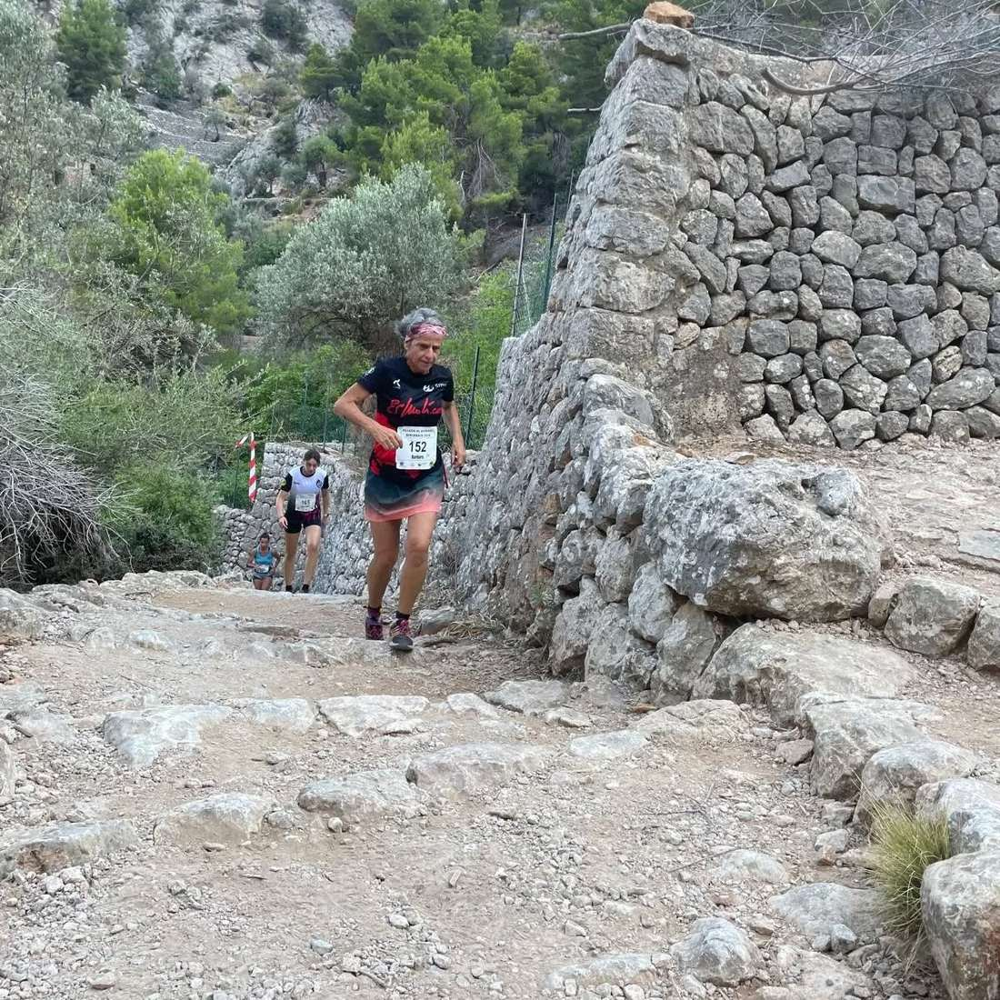
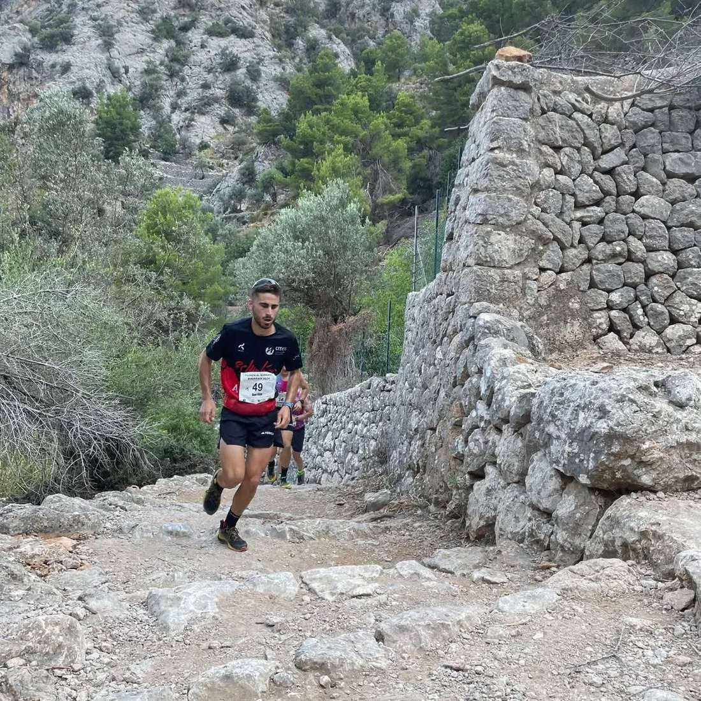
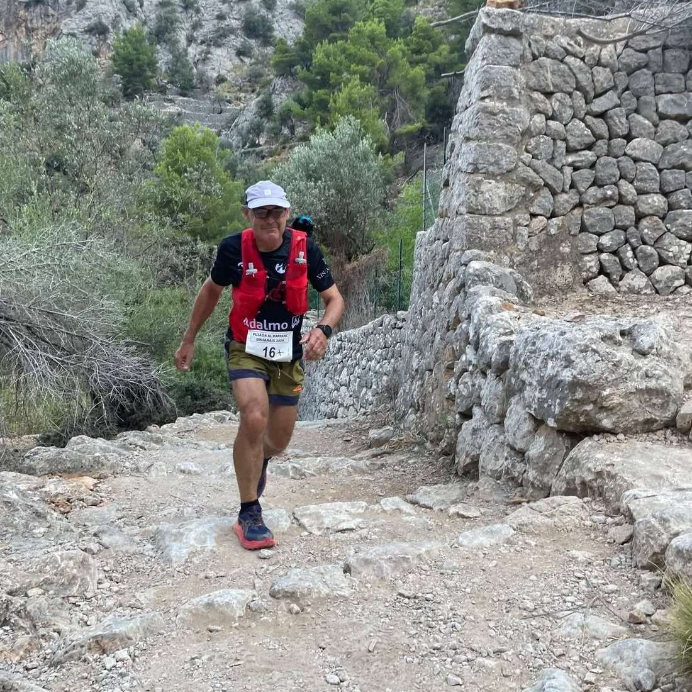
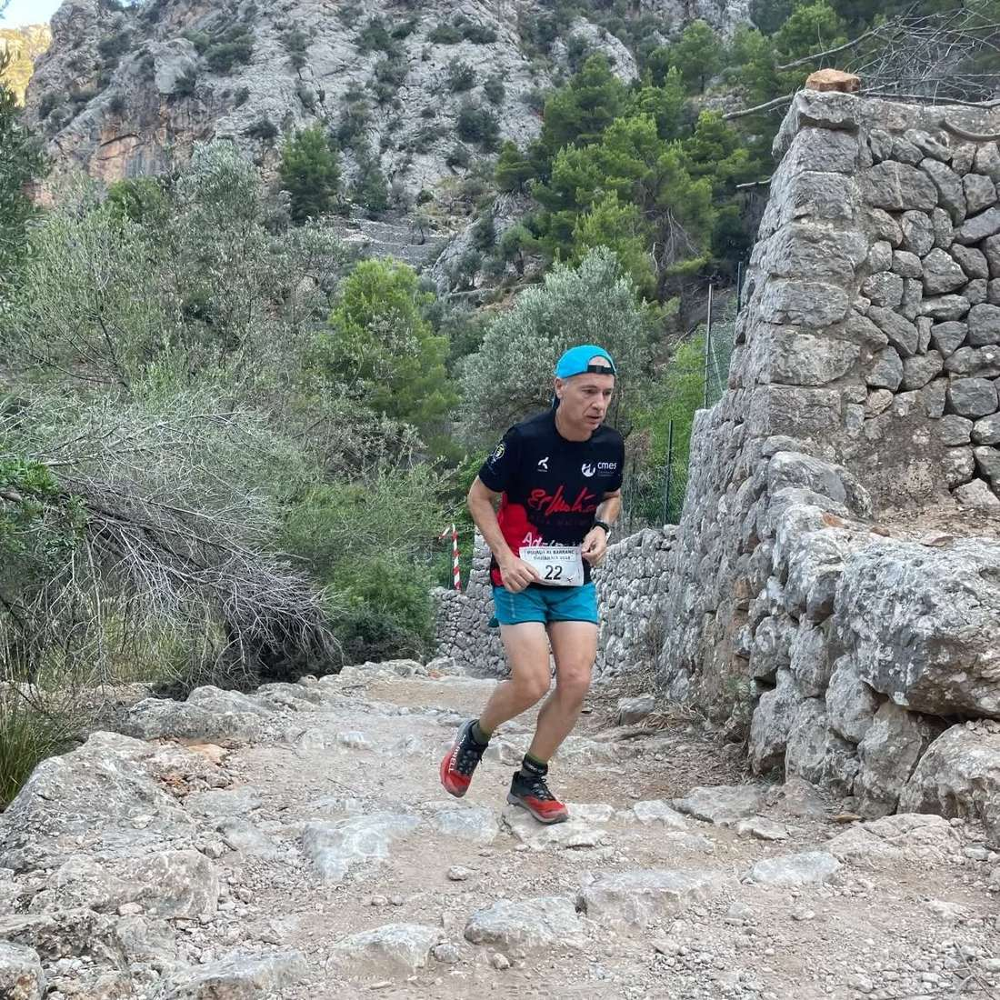

Avui s'ha disputat la nostra estimada Pujada al Barranc de Biniaraix que cada mes d'agost organitza el nostre club.

Els corredors del CMES hi han estat presents en una edició que per tercer any consecutiu ha acollit també el Campionat de Balears de Cronoescalada i Quilòmetre Vertical.

En aquest context, Bàrbara Matt ha aconseguit el campionat autonòmic en la categoria V60 femení, Dani Vidal la segona posició en la categoria Sub 23 i Mónika Gaska la tercera en la categoria Sènior Femení.

Enhorabona a ells i a tots els corredors que hi han participat!!

