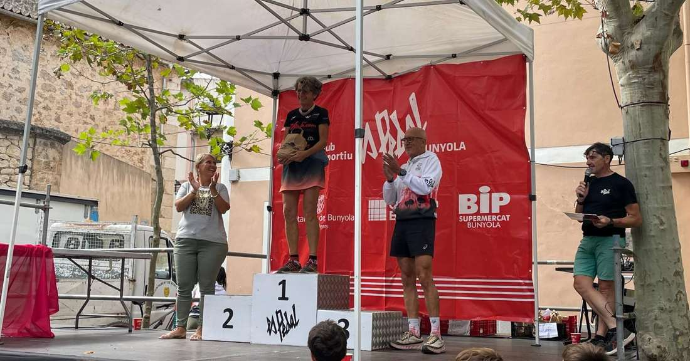
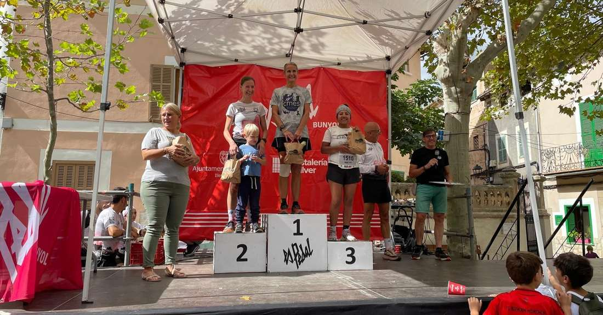

Ahir vàrem ser presents a la Bunyola Trail Xtrem, nova cursa puntuable per a la Copa Balear de Curses per Muntanya on els nostres corredors aconseguiren uns grans resultats.

Xim Borràs va ser el tercer classificat de la general de la prova més curta, mentre que Bàrbara Matt i Àngels Vaquer foren primeres en les seves categories d'edat de la cursa de 20 quilòmetres.

Aquests foren els resultats aconseguits pels nostres representants:

🔴Cursa 10 km🔴

▪️3.- Xim Borràs 47:49

🔴Cursa 20 km🔴

▪️70.- Pep Lluís Gómez 2:16:01

▪️108.- Bàrbara Matt 2:35:13 🥇F60

▪️113.- Àngels Vaquer 2:40:16 🥇F50

▪️118.- Isidro Marín 2:43:40

▪️119.- Salvador Martí 2:43:41

▪️122.- Xisca Coll 2:47:55

▪️126.- Juan Pedro Isern 2:48:01

Enhorabona a tots!!

