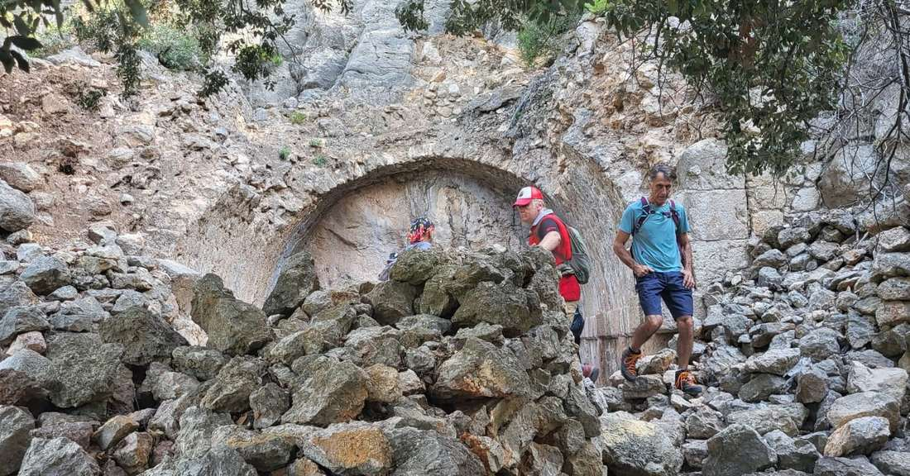
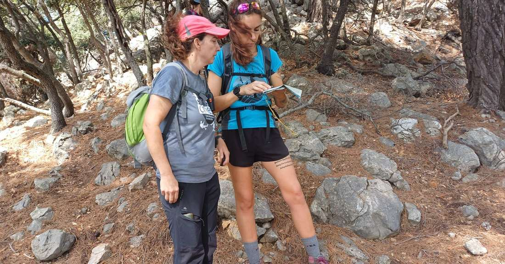
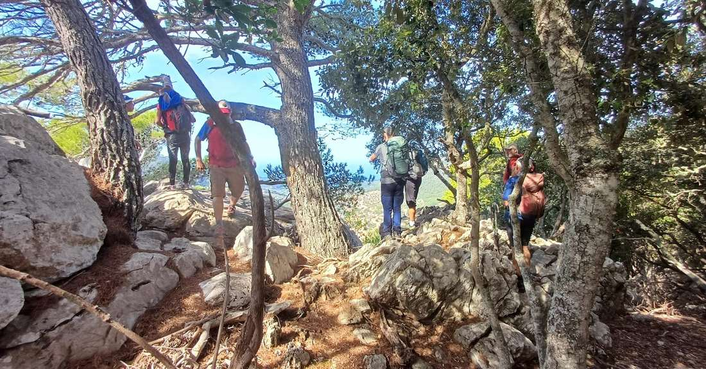
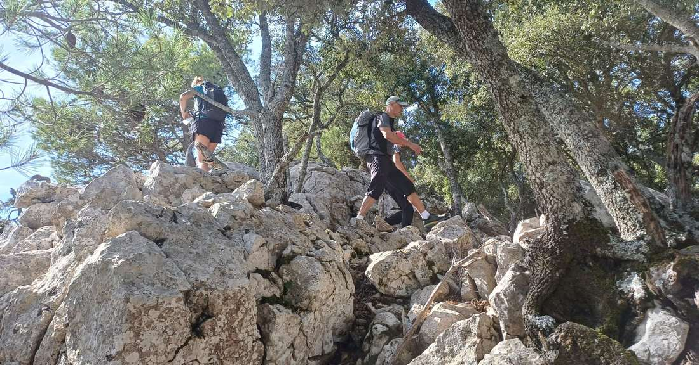
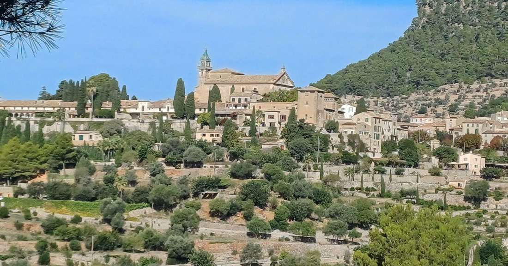

La secció de Senderisme ha aprofitat la jornada d'avui diumenge per realitzar una sortida cultural per l'entorn de la Moleta de Pastoritx, a Valldemossa.

A través de la casa de neu dels Frares, Son Viscós, el Mirabó i la font de Son Verí s'han assolit els 763 metres de la Moleta de Pastoritx.

A continuació, la quinzena d'integrants del grup ha transitat cap al pla dels Xots, el racó del Colomer i la coma de Ses Sitges. Per acabar, s'ha passat per Pastoritx i s'ha arribat a Valldemossa pel camí reial.

