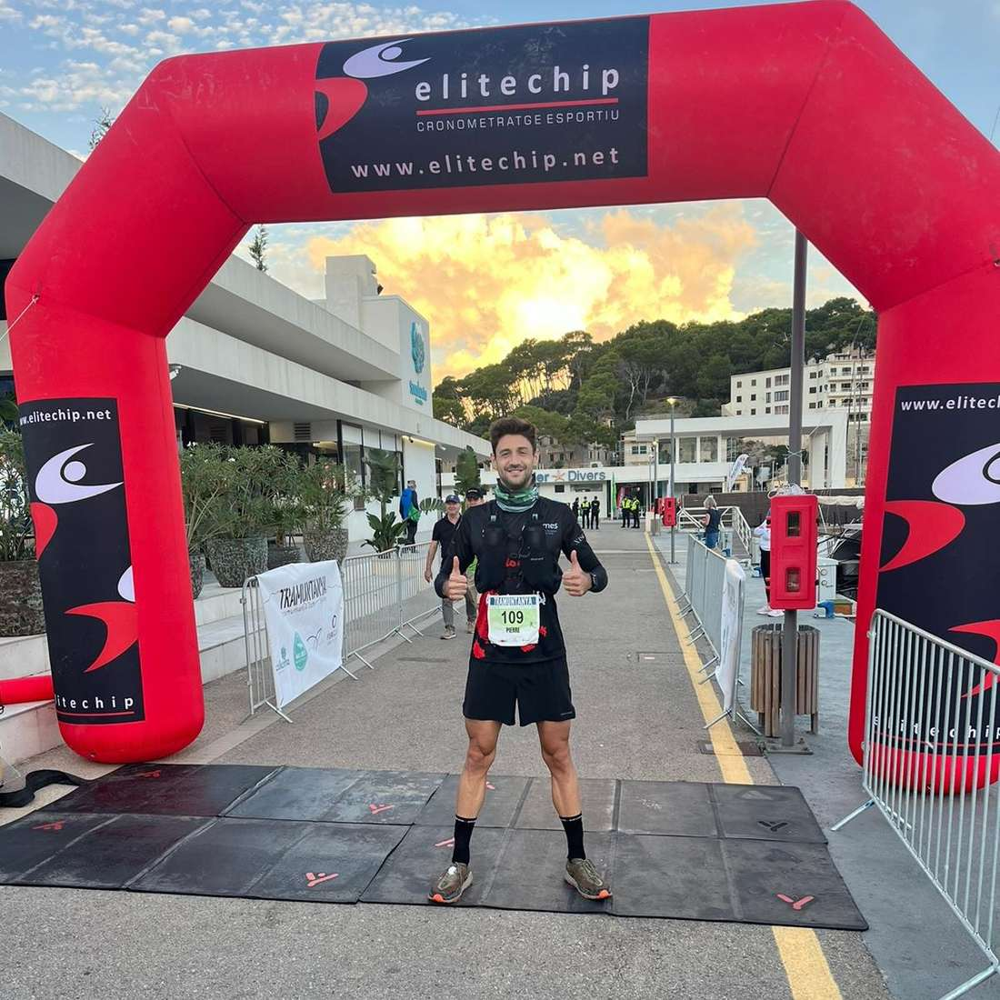
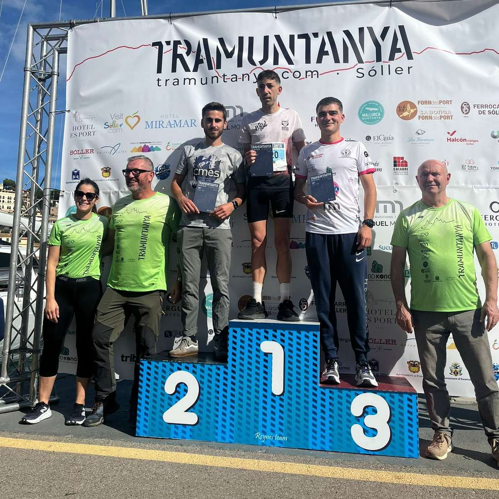

Ahir vàrem tenir una nova oportunitat de córrer a casa. Vàrem ser presents a les curses de la Tramuntanya Winter on els corredors del CMES aconseguiren creuar la línia d'arribada del Port de Sóller amb grans resultats.

A la modalitat més llarga, Pierre Mariotto va completar els 31 quilòmetres a la onzena posició de la general.

A la cursa de 16 quilòmetres, Dani Vidal va ser cinquè i va pujar al podi de corredors locals. Pere Albertí també es va mantenir entre els primers i es va classificar en setena posició.

I en la modalitat d'11 quilòmetres, Albert Salvà va ser el representant dels corredors del CMES en aquesta cursa més explosiva. Es va classificar a la posició 39.

Aquesta fou la classificació de tots els nostres corredors:

▶️ Tramuntanya Winter Long - 31 quilòmetres ◀️

▪11.- Pierre Mariotto 3:15:34

▶️ Tramuntana Winter Short - 16 quilòmetres ◀️

▪5.- Dani Vidal 1:13:35

▪7.- Pere Albertí 1:14:26

▪56.- Fabián Puigrós 1:41:40

▪59.- Isidro Marín 1:43:15

▪72.- Salvador Martí 1:45:58

▪83.- Sergi Salvà 1:53:34

▶️ Tramuntanya Winter Sprint - 11 quilòmetres ◀️

▪39.- Albert Salvà 1:16:01

Enhorabona a tots!!

