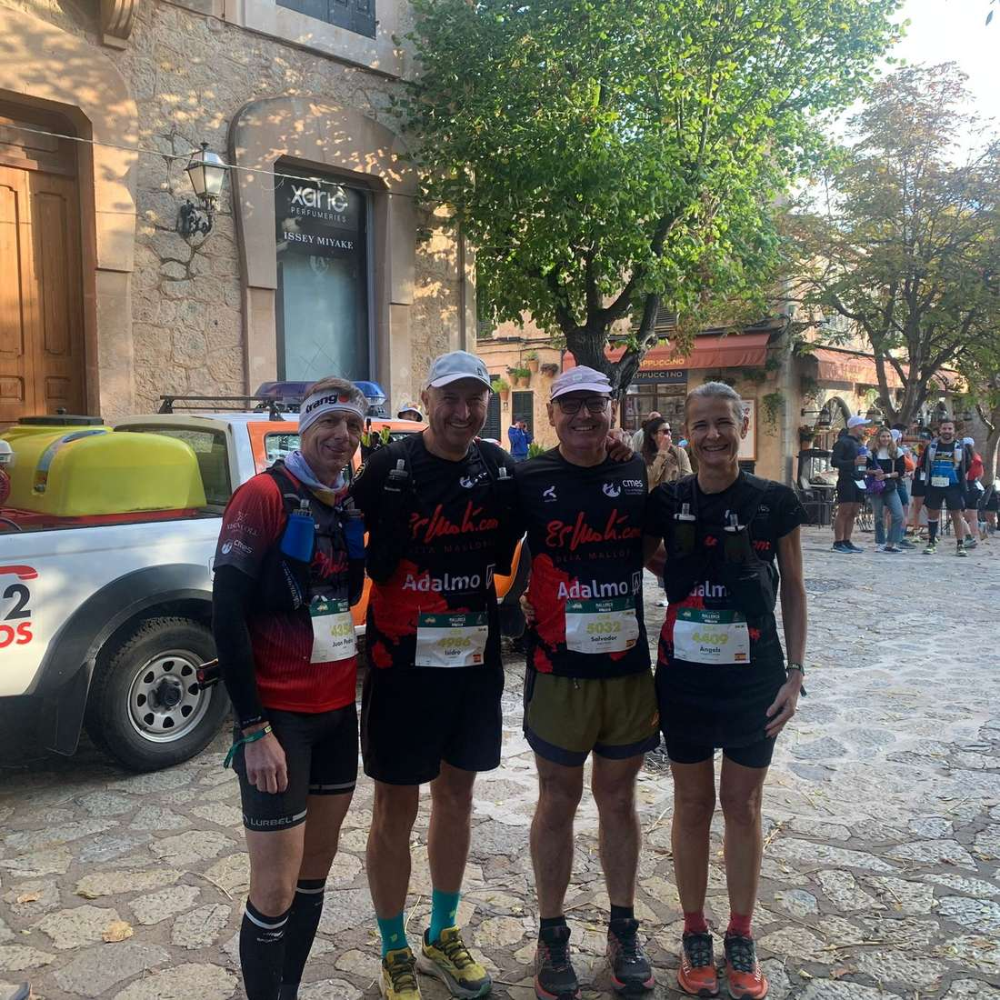
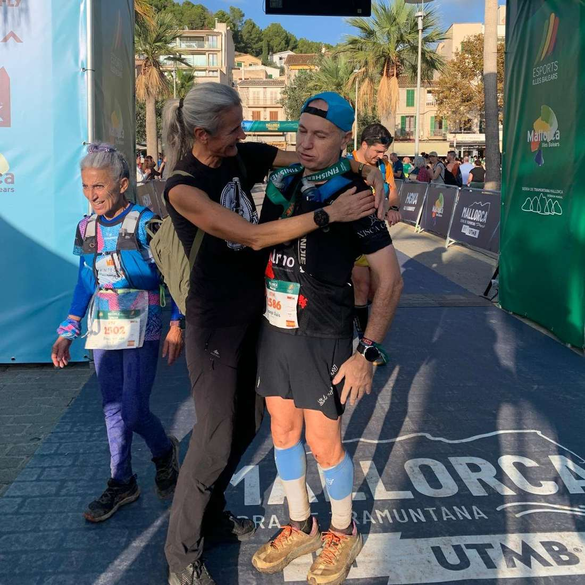
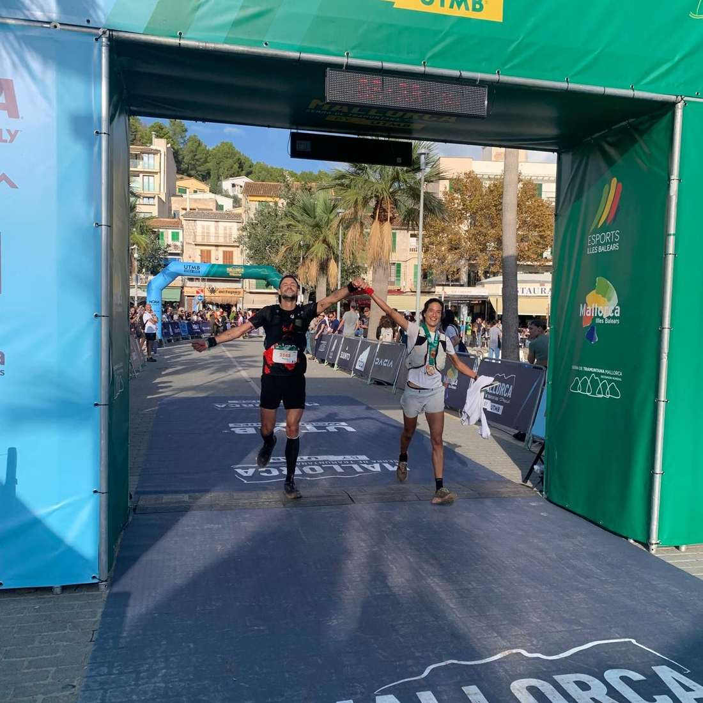
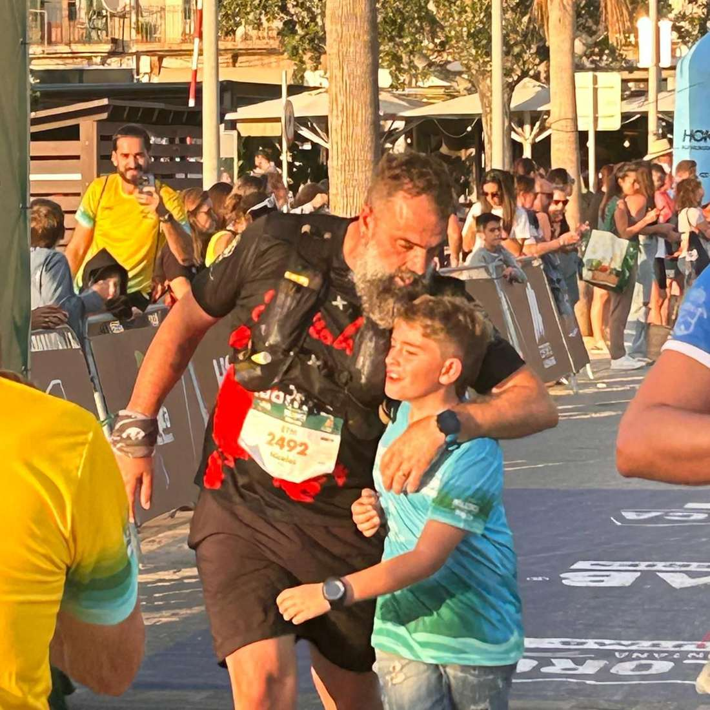
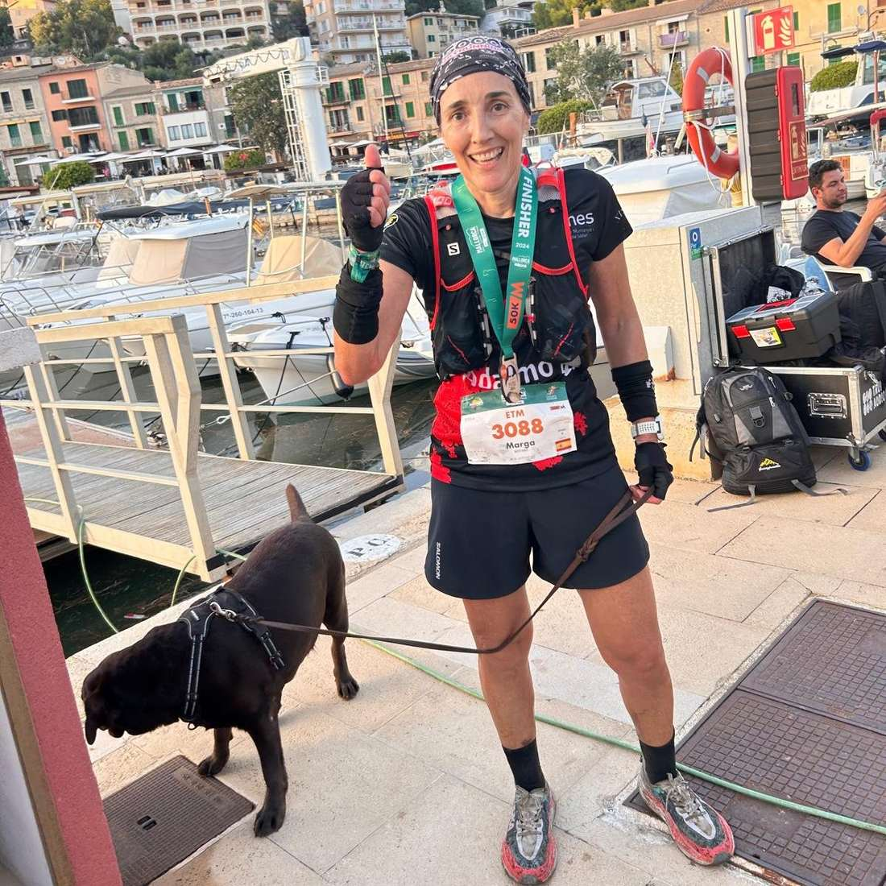
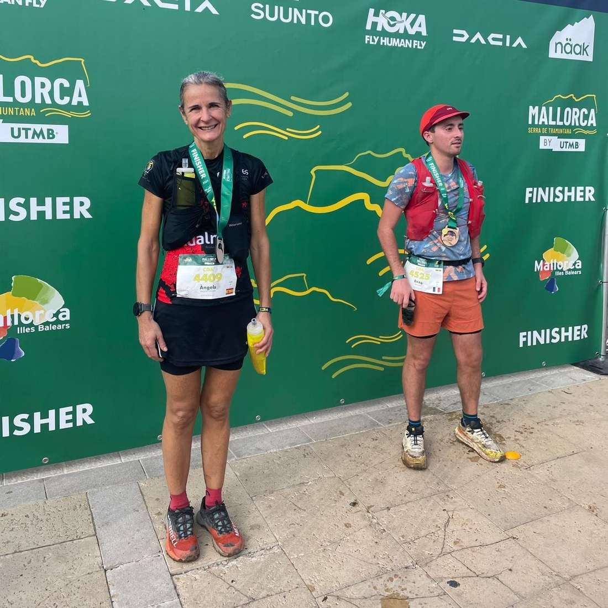
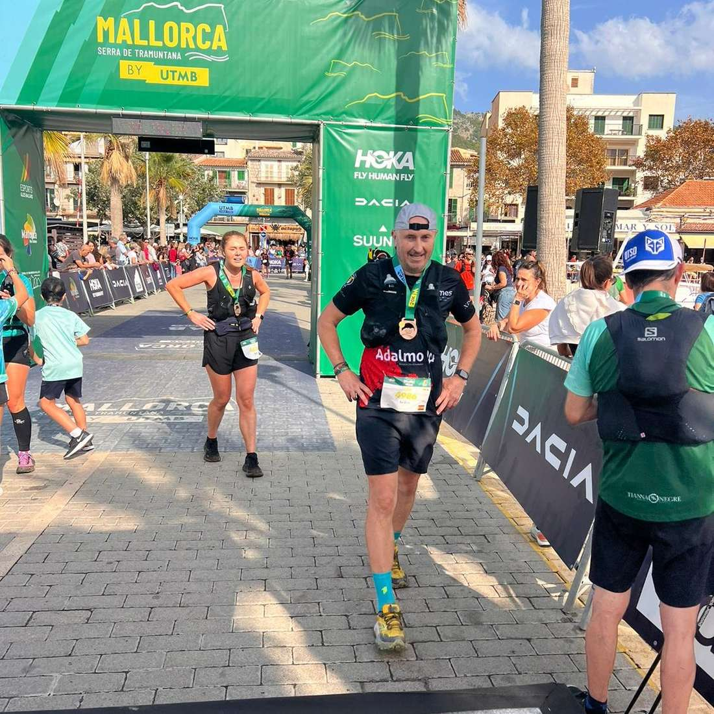
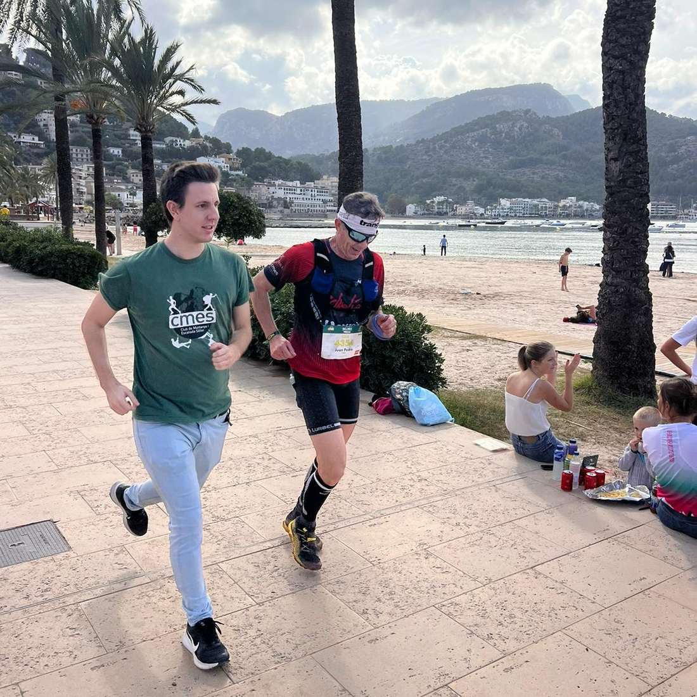
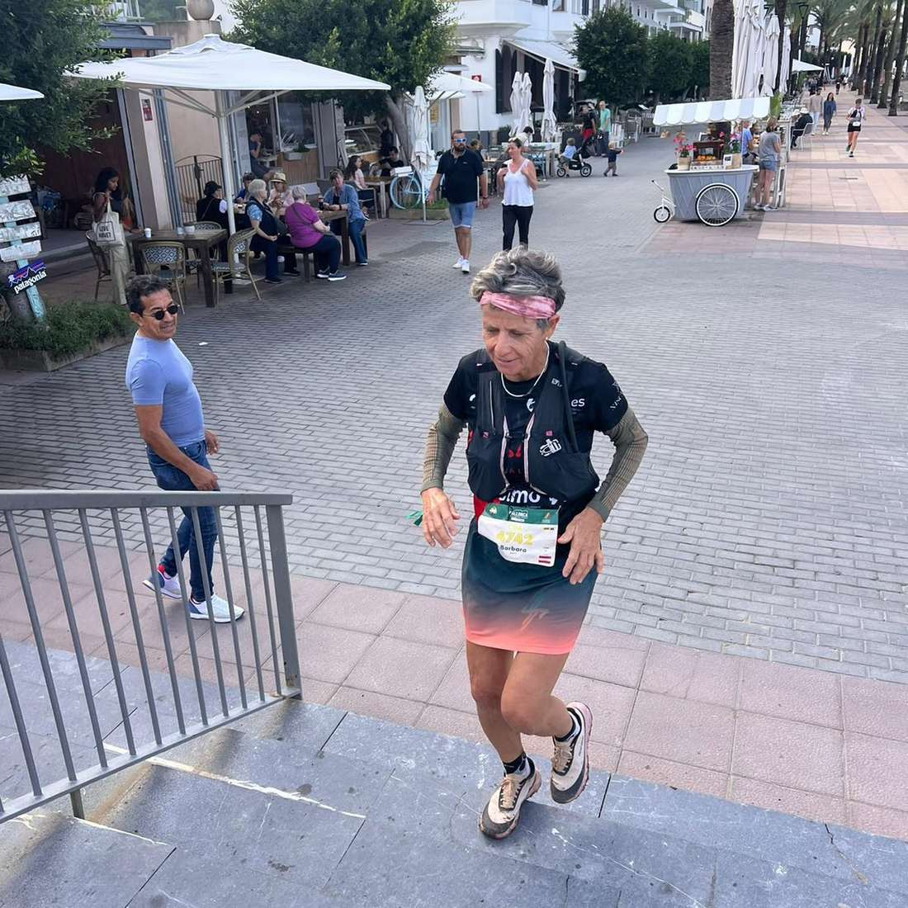

Cap de setmana de @mallorcabyutmb a la nostra vall. I com no podia ser d'una altra manera, els corredors del CMES hi han estat presents amb la seva participació a les curses.

Ahir, a la cursa Els Tres Mils (ETM) Pierre Mariotto, Pep Lluís Gómez, Nico Coll i Marga Bestard aconseguiren els seus objectius de creuar la línia d'arribada del Port de Sóller després d'un recorregut de 47 quilòmetres.

Avui diumenge ha estat el torn de la Camins de s'Arxiduc (CDA) on Pere Estarelles, Bàrbara Matt, Àngels Vaquer, Juan Pedro Isern, Isidro Marín i Salvador Martí han finalitzat l'itinerari entre Valldemossa i el Port de Sóller.

Aquests han estat els resultats dels corredors del CMES:

▶Els Tres Mils (ETM)◀

▪ 455.- Pierre Mariotto 8:38:36

▪ 554.- Pep Lluís Gómez 9:12:20

▪ 687.- Nico Coll 10:01:33

▪ 721.- Marga Bestard 10:13:14

▶Camins de s'Arxiduc (CDA)◀

▪ 89.- Pere Estarelles 2:49:03

▪ 372.- Bàrbara Matt 3:36:50

▪ 402.- Àngels Vaquer 3:41:16

▪ 555.- Juan Pedro Isern 3:59:22

▪ 566.- Isidro Marín 4:00:47

▪ 623.- Salvador Martí 4:08:46

Enhorabona a tots!!

