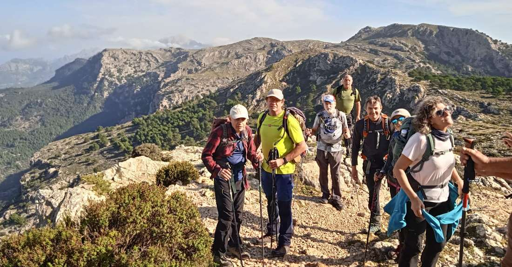
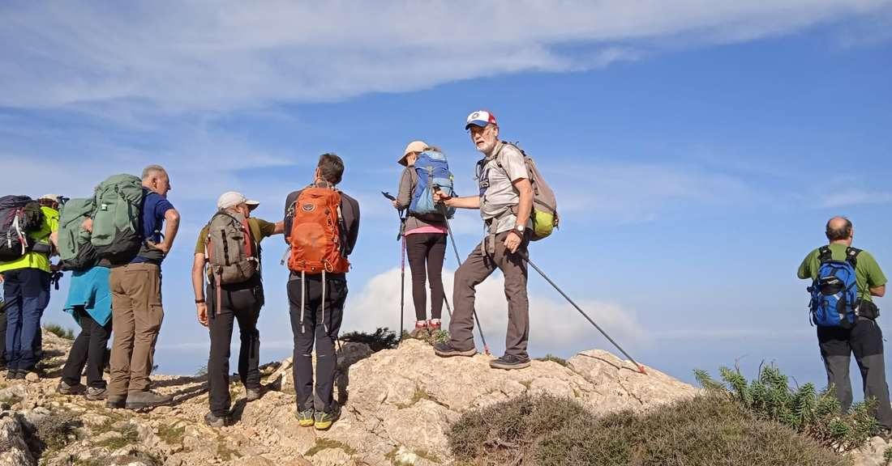
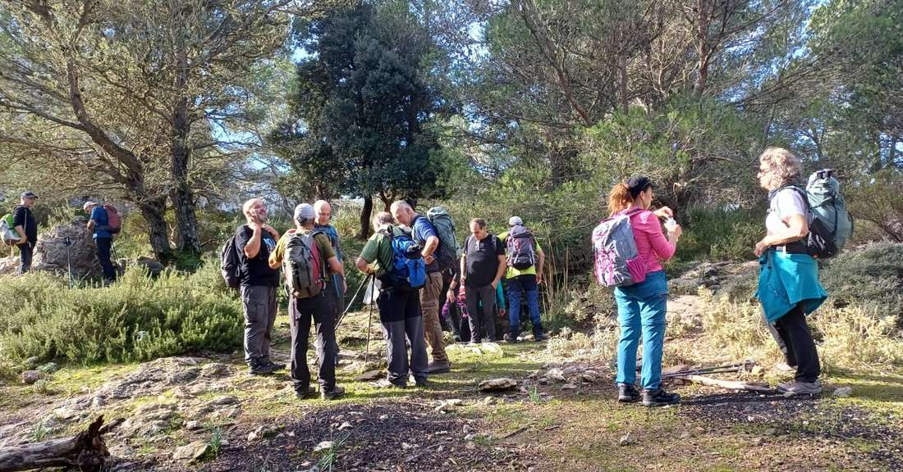
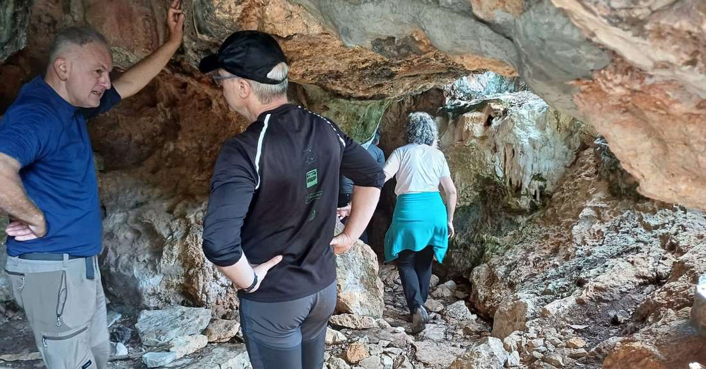
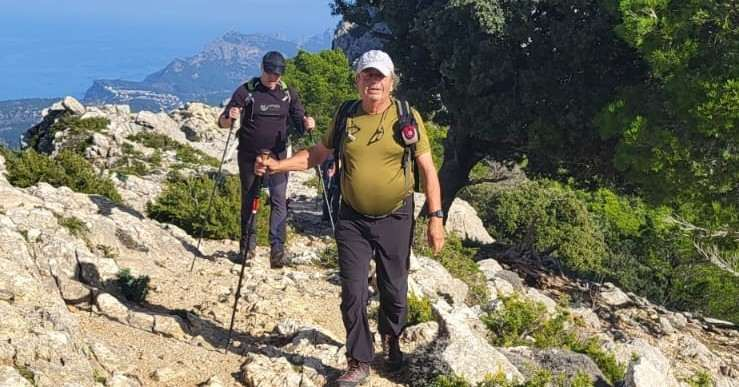
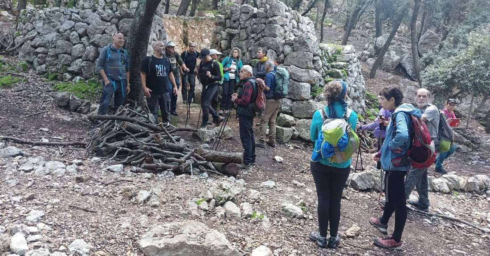
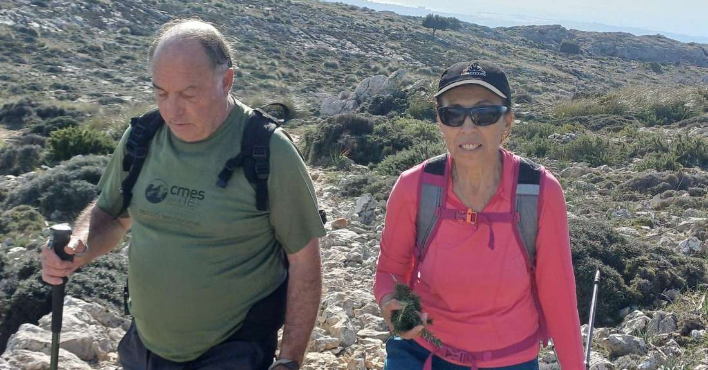

Nova activitat de la secció de Senderisme. Ahir diumenge el grup va transitar pel terme municipal de Valldemossa. Concretament, amb sortida i arribada en el nucli urbà es va recórrer el camí dels Cairats per arribar al Pas de Sa Creu i, posteriorment, a la cova de s'Aigua i al camí de s'Arxiduc. A continuació es va visitar la cova de s'Ermità Guillem i, a través del pas den Miquel i el Camí de Ses Basses, es va arribar novament a Valldemossa.

