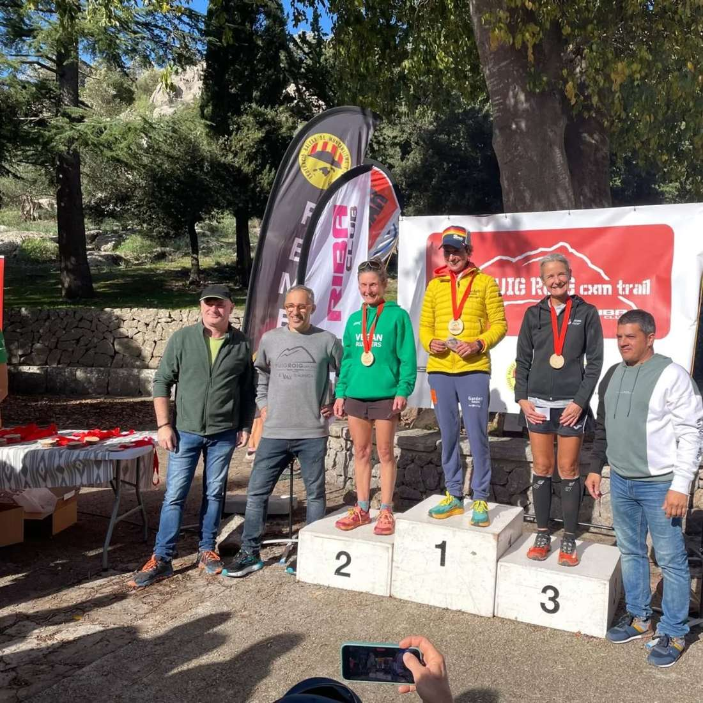

Ahir ens vàrem desplaçar fins a Lluc per participar a les curses del Puig Roig. En una esplèndida jornada dominical, a la cursa La Vall d'Albarca (10 quilòmetres) Pere Albertí va aconseguir una gran sisena posició a la classificació general.

En la modalitat més llarga, la cursa al Puig Roig (22 quilòmetres), Pep Lluís Gómez fou el més ràpid de la representació del CMES. A més, Àngels Vaquer va aconseguir pujar al podi com a tercera classificada de la seva categoria d'edat.

Enhorabona a tots!!

▶Cursa Puig Roig◀

▪ 71.- Pep Lluís Gómez 2:13:20

▪ 162.- Àngels Vaquer 2:42:23 🥉

▪ 163.- Isidro Marín 2:43:18

▪ 164.- Monika Gaska 2:43:52

▪ 169.- Salvador Martí 2:47:18

▪ 188.- Fabiana Peña 2:53:19

▪ 213.- Jana Gibalova 3:05:00

▶Cursa La Vall d'Albarca◀

▪ 6.- Pere Albertí 42:41

