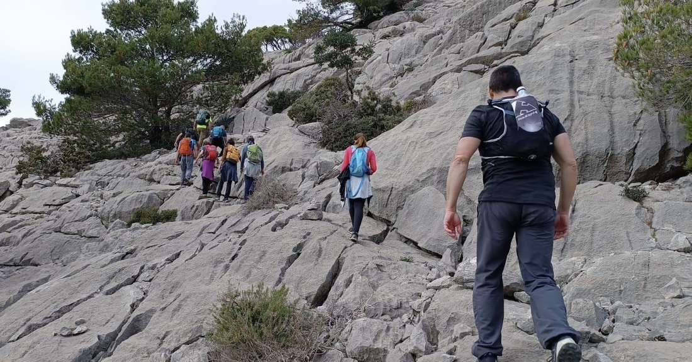
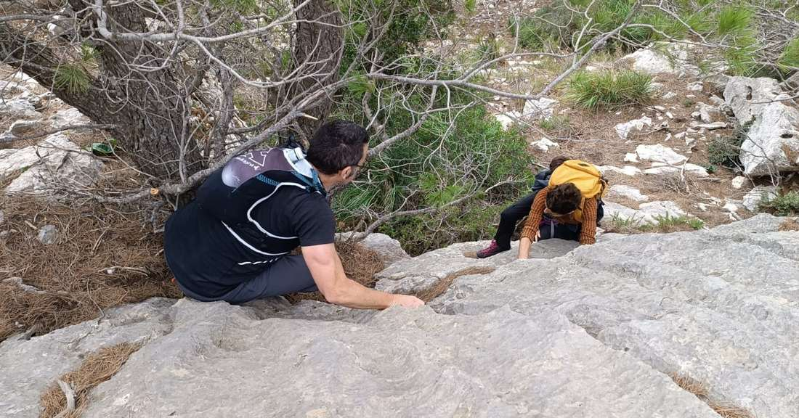
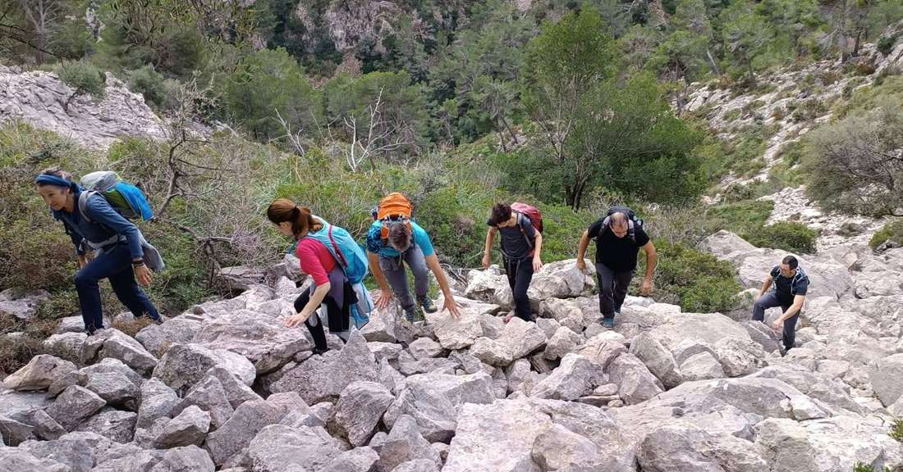

Ahir, sortida de la secció de Senderisme per assolir el puig de n'Alí (1.038 metres) des de Caimari. Ho feren a través de la serra de s'Esquerder, i retornant pel coll de sa Línia i el pas de n'Arbona.

