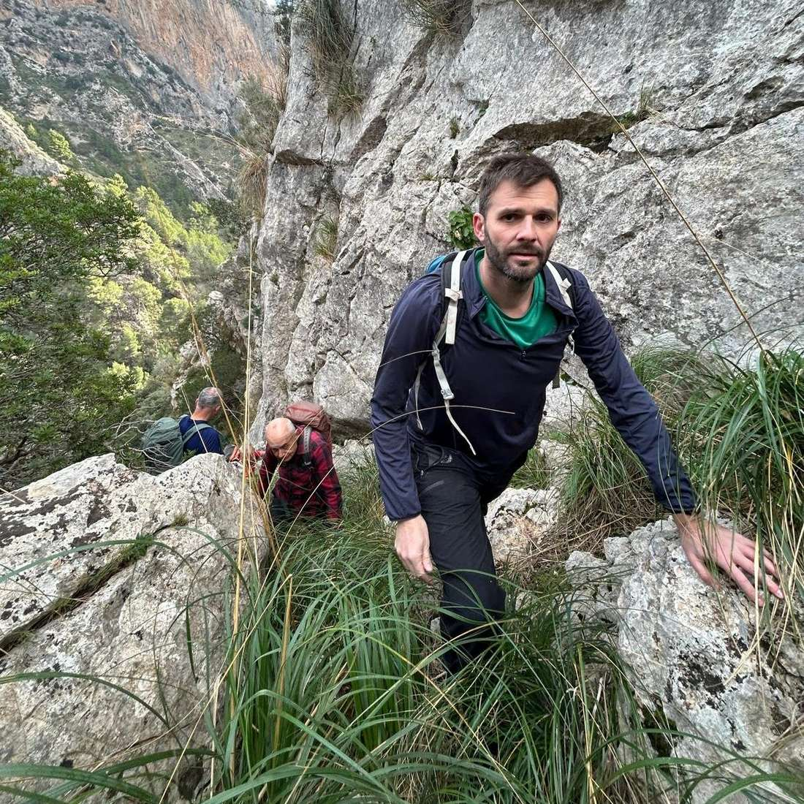
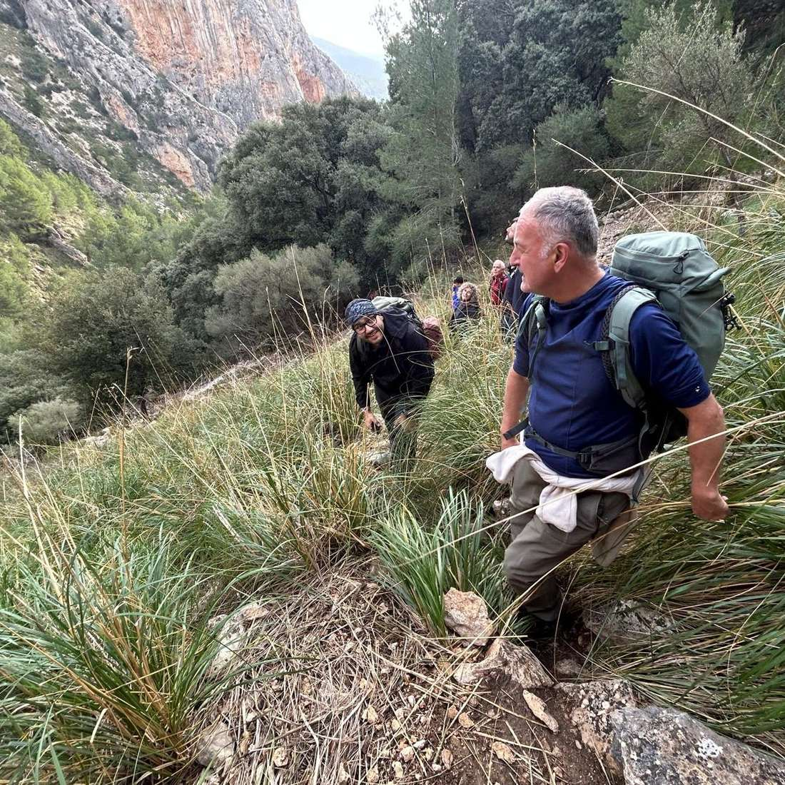
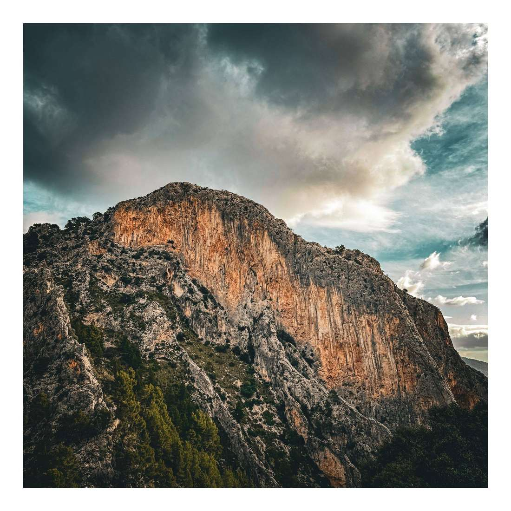
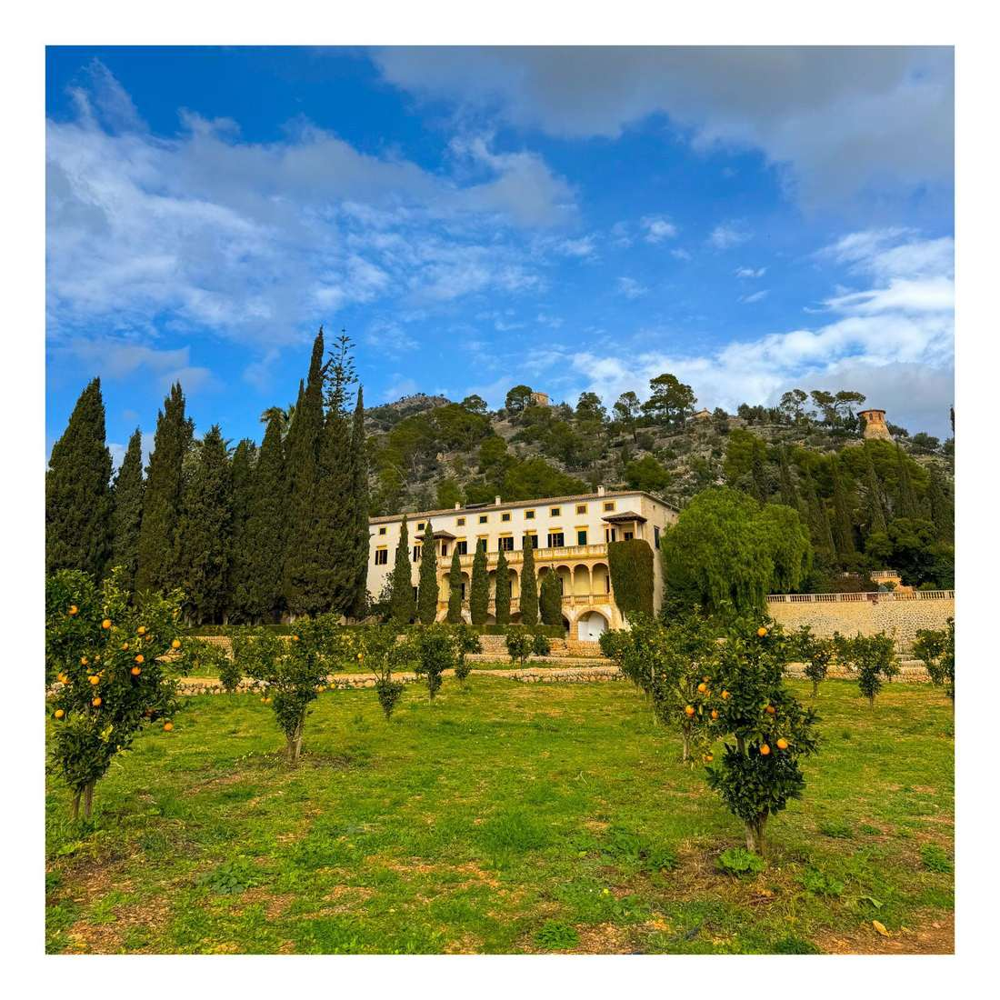
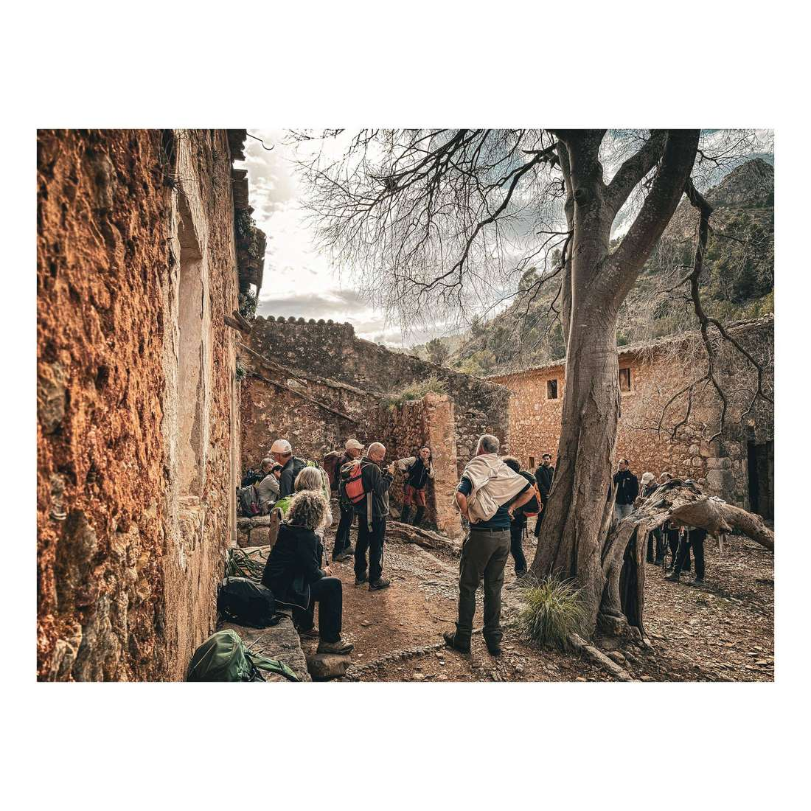
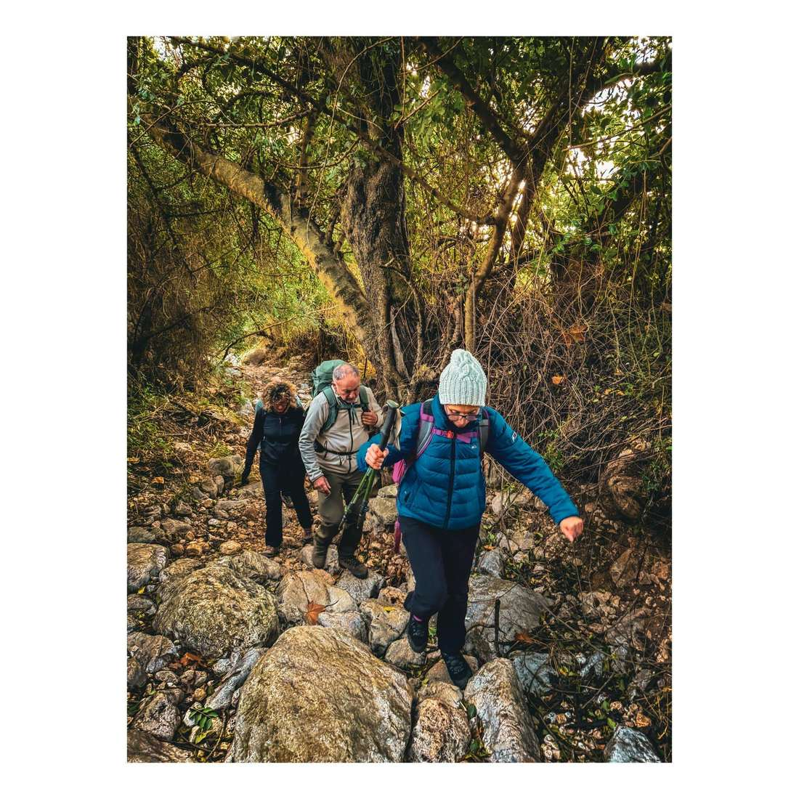
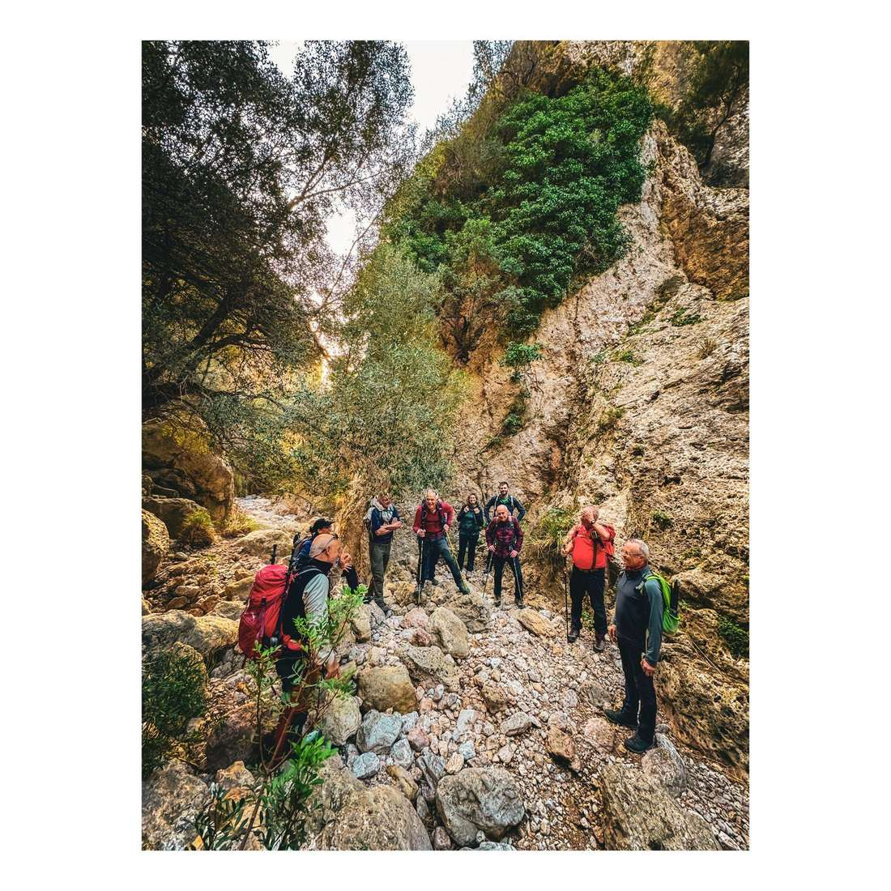
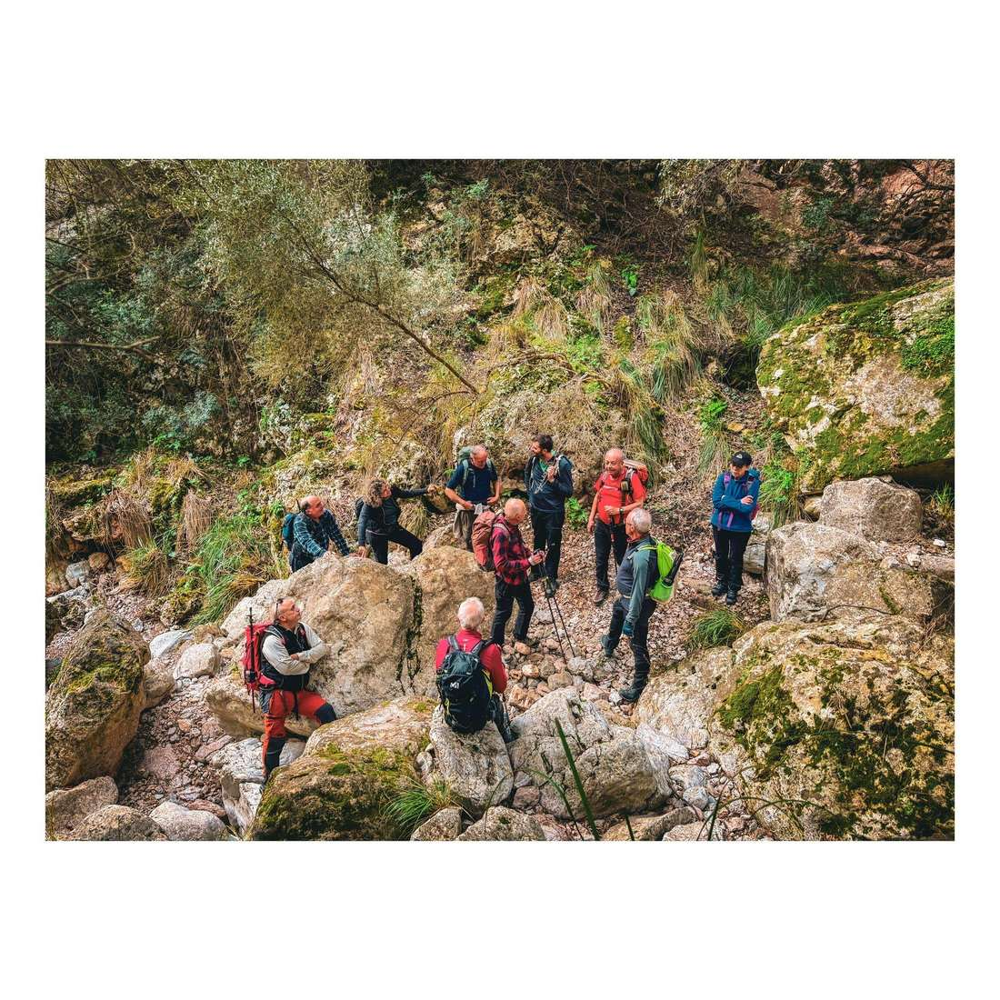

La secció de Senderisme va realitzar ahir dissabte la primera sortida de la nova temporada. El grup es va traslladar fins el terme municipal de Bunyola per recórrer el barranc de Sa Gubia, el coll des Porrasset, Raixeta i Raixa, on el nostre soci Joan Avellaneda va oferir una visita guiada.

