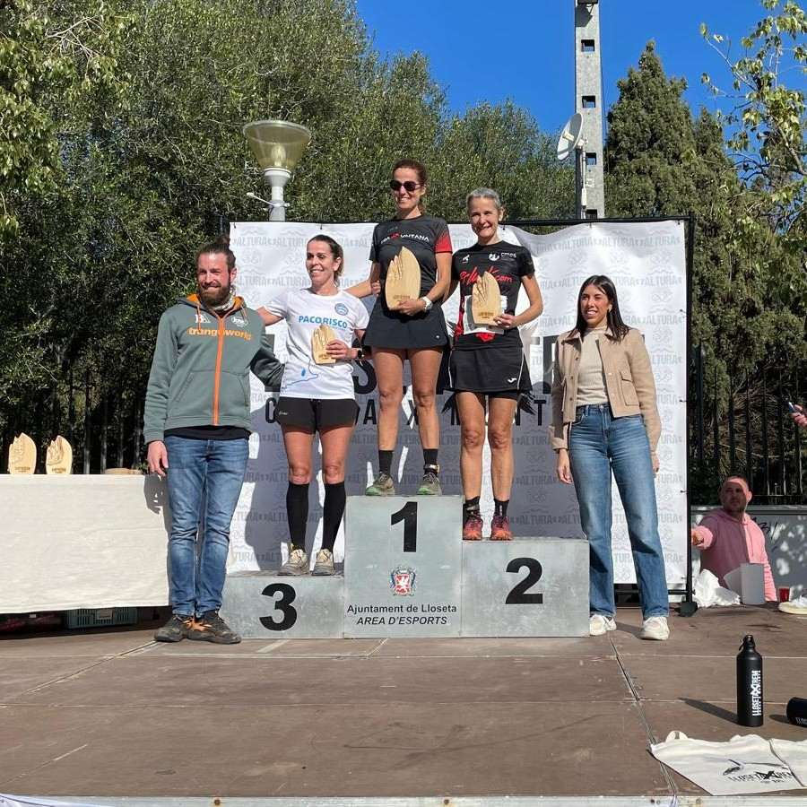
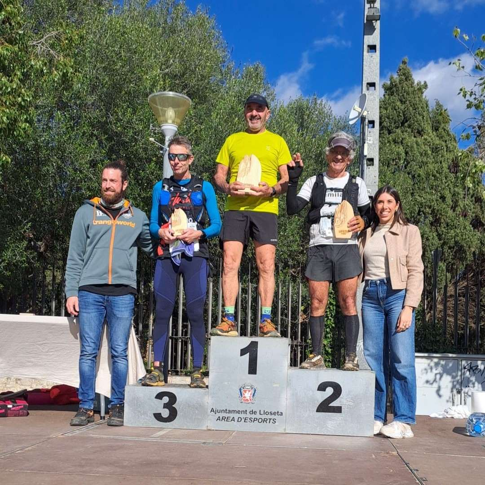

Quatre corredors de la secció de Curses han participat avui a la Lloseta Xtrem. La prova s'ha desenvolupat sobre un dur recorregut de 36 quilòmetres i 1.600 metres de desnivell positi, que tenia el cim del puig de Tossals Verds com a punt més elevat.

Dos dels nostres corredors han aconseguit pujar al podi de la seva categoria d'edat.

Aquests han estat els resultats obtinguts pels representants del CMES:

33.- Pere Estarelles 3:42:06

85.- Pep Lluís Gómez 4:23:58

139.- Àngels Vaquer 5:19:05 🥈

147.- Joan Pere Isern 5:39:43 🥉

