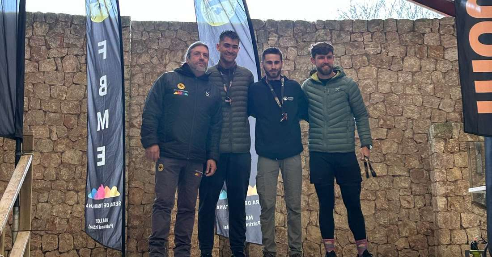
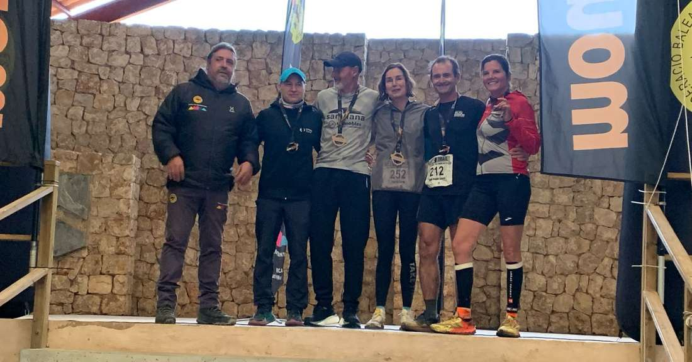
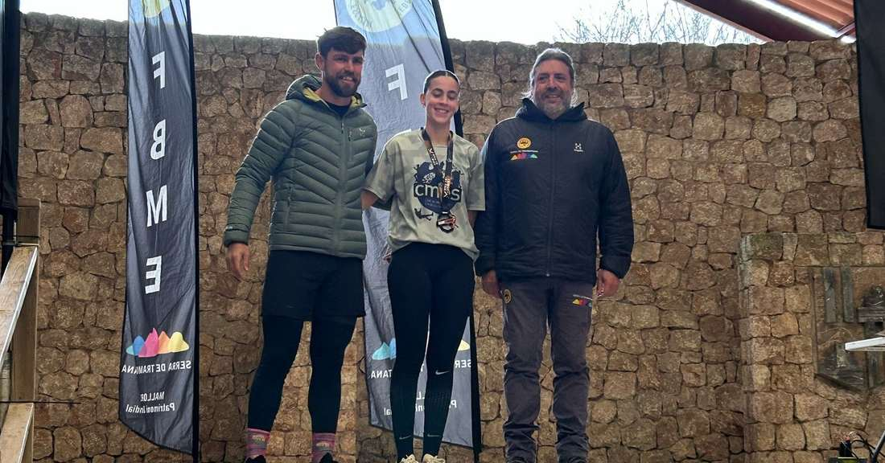
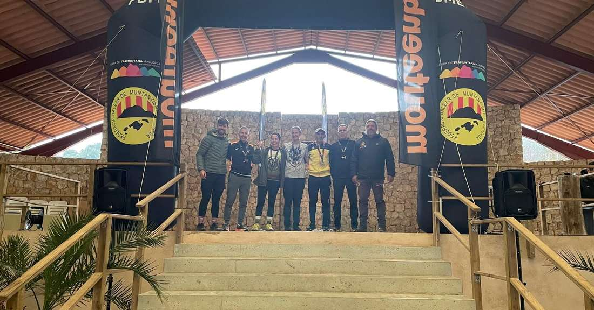
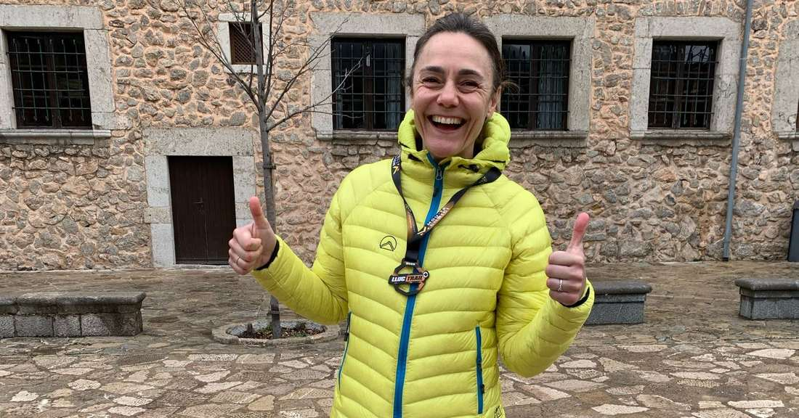
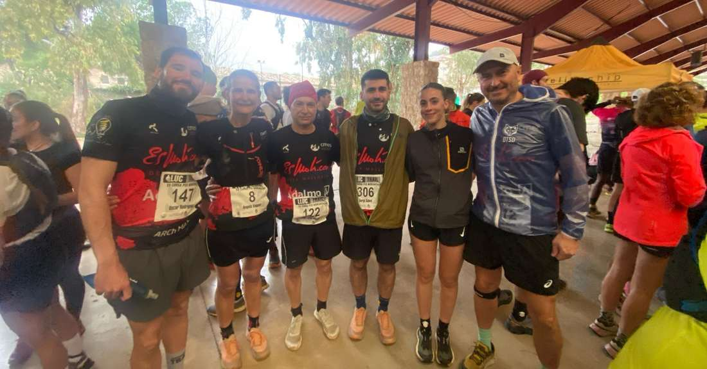

Fins a sis podis han aconseguit avui els corredors del CMES a la Lluc Trail. La cursa escorquina ha congregat un any més centenars de corredors en el clàssic recorregut de 12 quilòmetres que enguany s'ha vist marcat per la pluja.

Xim Borràs, Dani Vidal, Pep Lluís Gómez, Clara López, Àngels Vaquer i Xisca Coll han estat premiats després de classificar-se a les primeres posicions de les seves categories d'edat.

Aquests han estat els resultats dels corredors del CMES:

7.- Xim Borràs 54:38 🥉

14.- Dani Vidal 56:04 🥇

34.- Pere Albertí 1:01:25

87.- Pep Lluís Gómez 1:07:23 🥈

124.- Óscar Rodríguez 1:11:08

197.- Clara López 1:18:54 🥇

201.- Isidro Marín 1:19:14

209.- Àngels Vaquer 1:20:14 🥇

285.- Mar Umbert 1:26:29

306.- Sergi Salvà 1:30:31

323.- Xisca Coll 1:32:19 🥉

339.- Catalina Marroig 1:33:53

365.- Oana Oancea 1:39:30

Enhorabona a tots!!!

