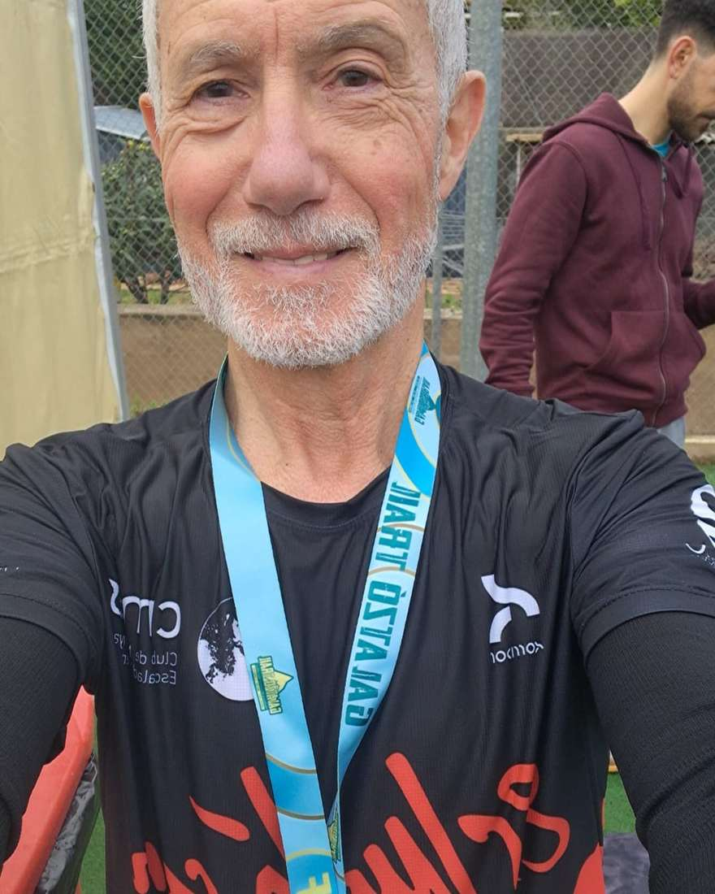
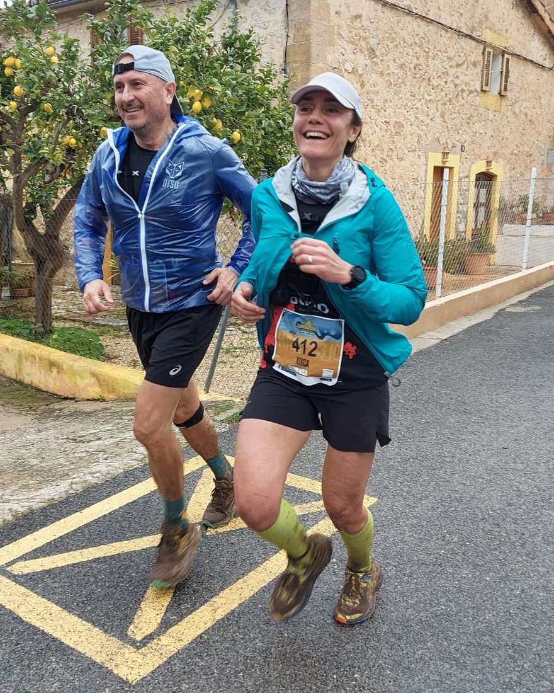
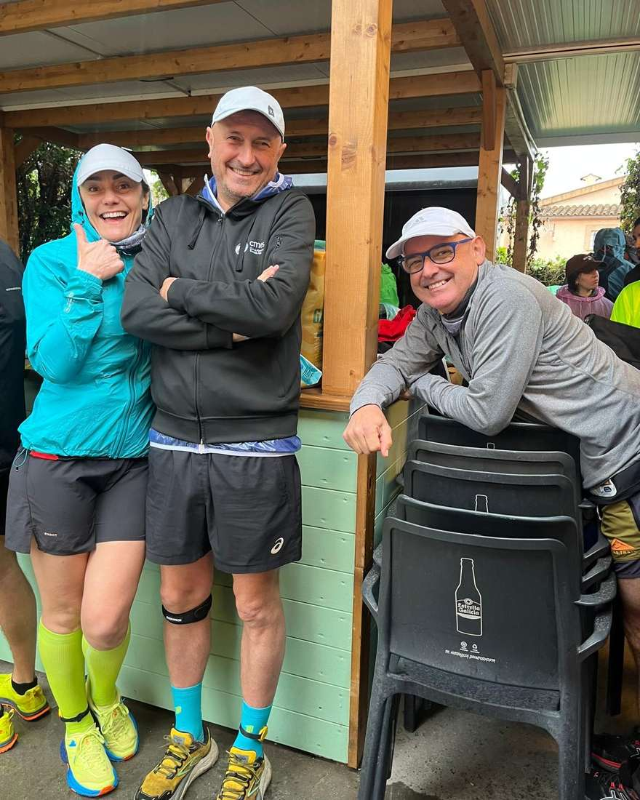

Ahir vàrem viure una edició de la Galatzó Trail marcada per les males condicions meteorològiques. L'aigua i el fang varen ser el denominador comú d'una prova que va ser retallada en dificultat i quilometratge.

En la Galatzó Half, Dani Vidal va ser sisè a la general de la prova després d'una gran actuació. A la Galatzó Legend, per la seva banda, Dani Rodríguez va ser el millor de la representació del CMES.

Aquesta fou la classificació dels nostres representants:

▶GALATZÓ HALF◀

▪ 6.- Dani Vidal 1:46:34

▪ 169.- Pere Mercadal 2:42:18

▪ 223.- Isidro Marín 2:52:45

▪ 224.- Xisca Coll 2:52:45

▪ 231.- Salvador Martí 2:54:47

▶GALATZÓ LEGEND◀

▪ 34.- Dani Rodríguez 4:01:43

▪ 90.- Marga Bestard 5:53:14 🥇 V55

Enhorabona a tots!!

