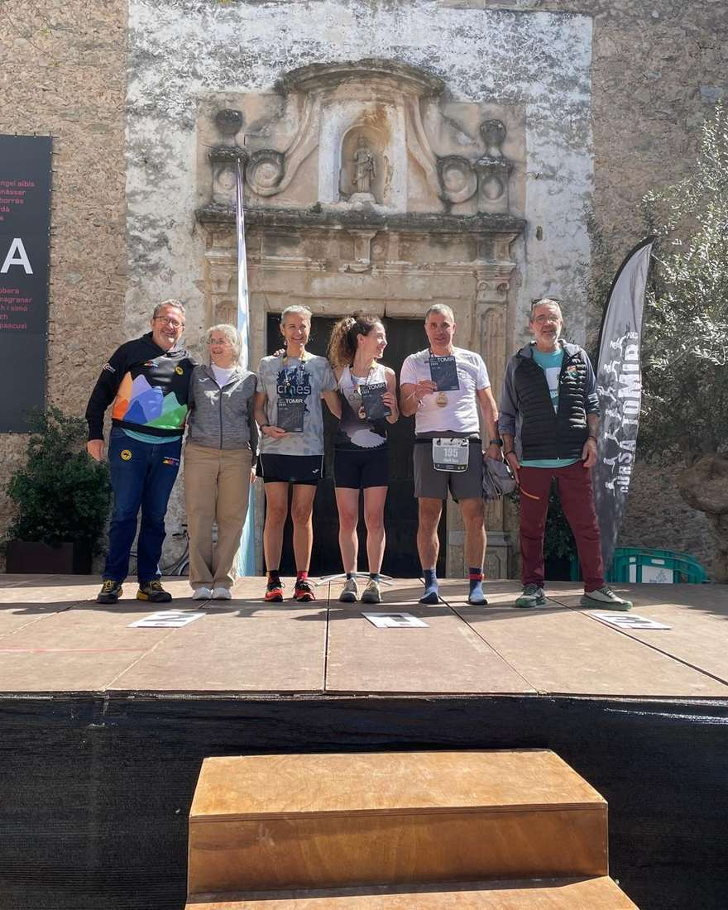
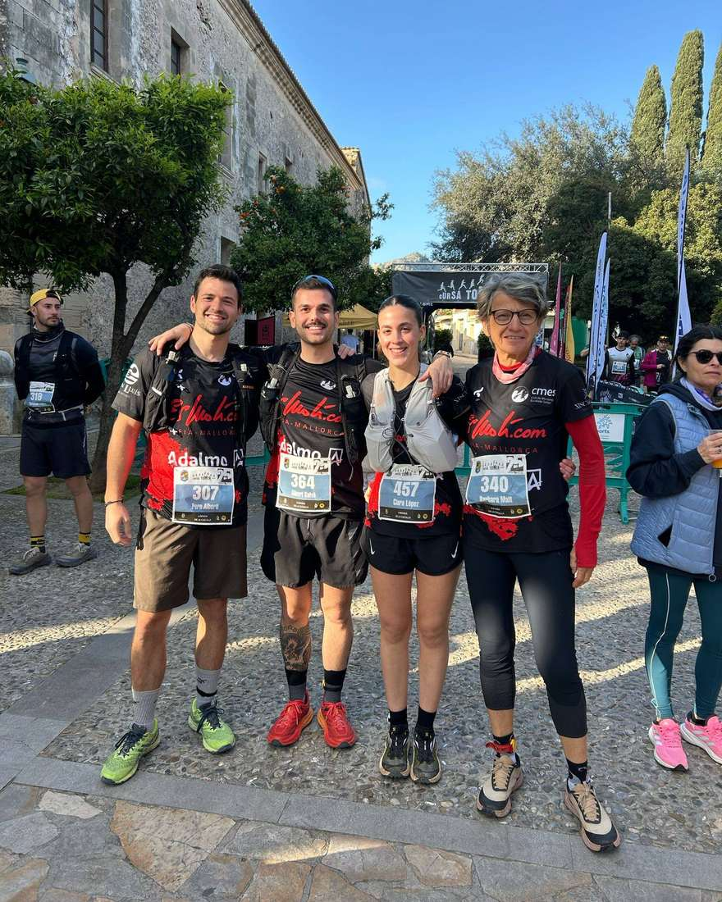
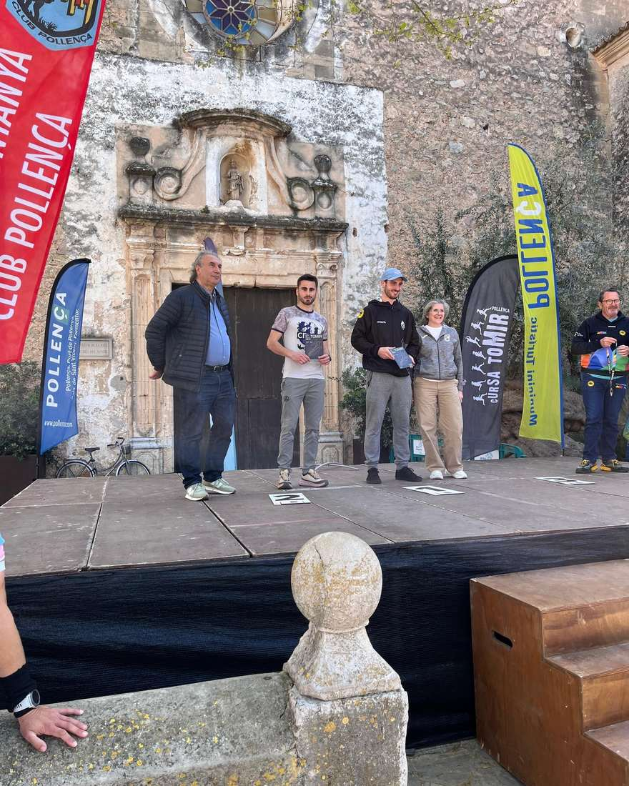

Nou èxit dels corredors del CMES al Campionat de Balears Individual que es va disputar diumenge a la cursa del Tomir. Dani Vidal va aconseguir la tercera posició en la categoria Sub 23 i Àngels Vaquer la segona en la categoria V50 Femení, assolint així les posicions d'honor del campionat autonòmic.

La classificació dels participants del CMES fou la següent:

12.- Dani Vidal 3:24:08 🥉Sub 23

125.- Pep Lluís Gómez 4:29:39

191.- Àngels Vaquer 5:11:11 🥈V50

En la cursa Ronda de la Cuculla, disputada sobre un recorregut d'uns 17 quilòmetres, també es registraren bons resultats per als corredors del CMES, on Clara López i Bàrbara Matt varen ser les primeres classificades en les categories Sub 23 Femení i V55 Femení, respectivament.

21.- Pere Albertí 1:38:25

82.- Clara López 2:07:40 🥇 Sub 23

92.- Bàrbara Matt 2:12:14 🥇 V55

119.- Albert Salvà 2:30.15

Enhorabona a tots!!

