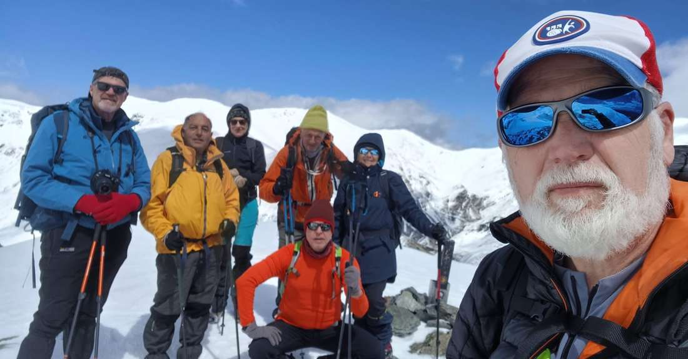
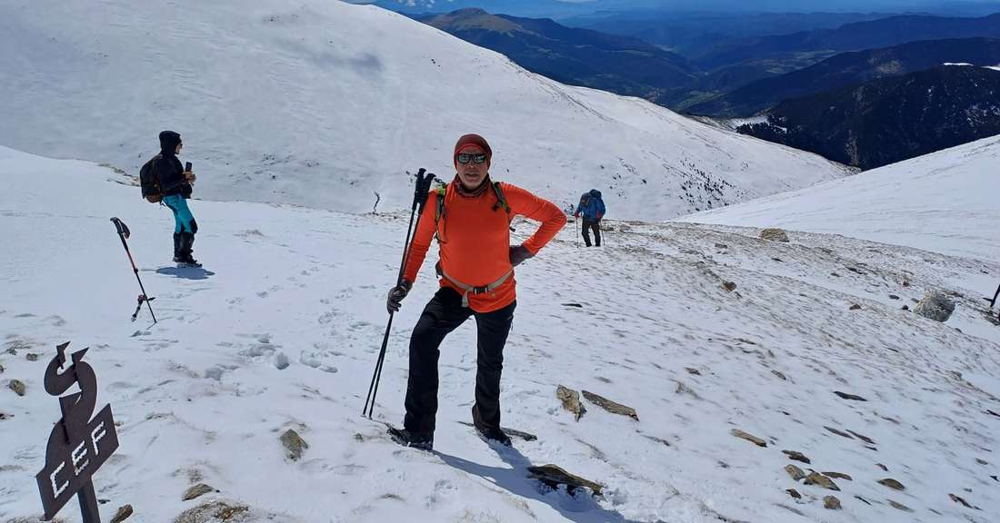
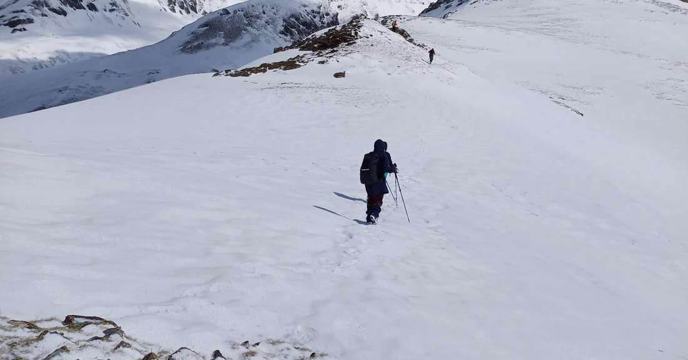
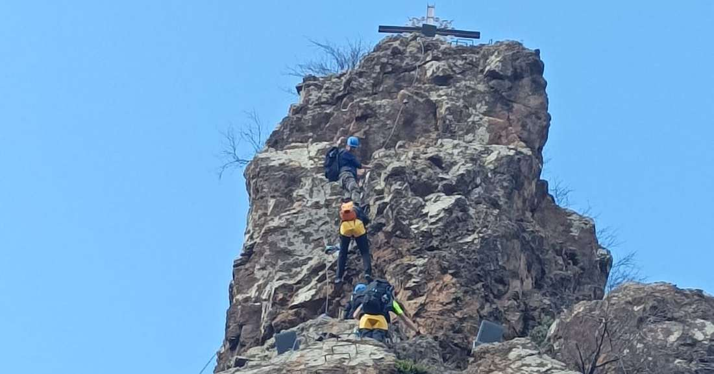
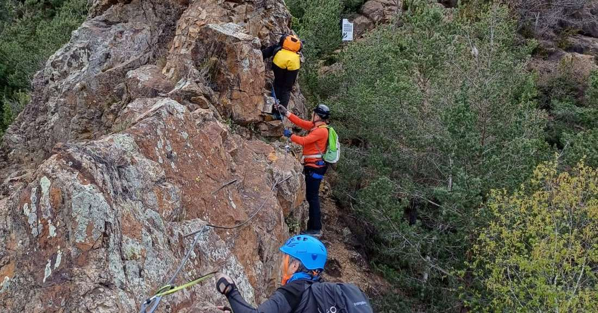

Un grup de socis de la secció de Senderisme ha aprofitat les vacances de Setmana Santa per viatjar fins el pirineu gironí i assolir alguns objectius.

Els expedicionaris del CMES han aconseguit fer cim al pic del Àguila (2.422 metres), han completat la ferrata de Ribes de Freser i han transitat entre Queralbs i el refugi de Coma de Vaca.

Totes les activitats han estat superades amb èxit en uns dies de bon ambient i bona companyia!

