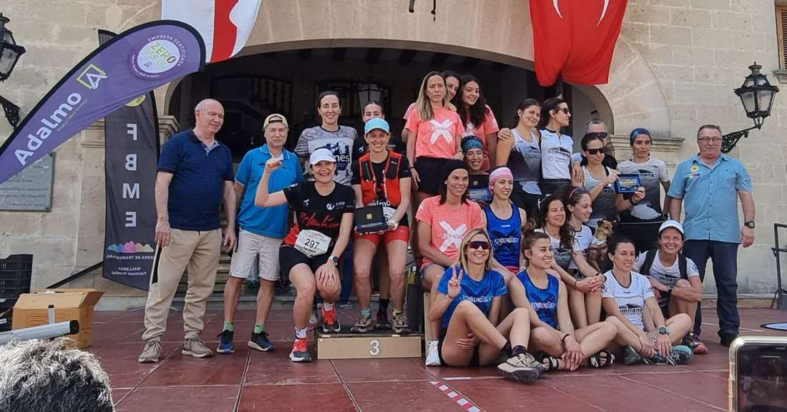
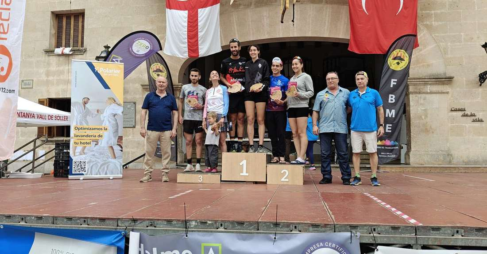

Diumenge d'emocions el que vàrem viure ahir amb la disputa de la @cursa\_valldesoller que organitza el nostre club.

Xim Borràs va repetir la victòria de l'any passat a la Mini Vall de Sóller de 9 quilòmetres i Dani Vidal també va pujar al podi absolut classificant-se a la tercera posició de la cursa.

En la modalitat de 22 quilòmetres, també grans resultats a nivell individual amb la consecució de nombrosos podis de categoria.

I a nivell col.lectiu, cal destacar la tercera posició al Campionat de Balears de Seleccions de Clubs que va aconseguir el CMES de la mà de Clara López, Marga Bestard, Oana Oancea i Catalina Marroig.

Aquests foren els resultats dels corredors del CMES:

▶ Cursa Vall de Sóller - 22 km ◀

▪ 21.- Pere Estarelles 2:15:57

▪ 31.- Andreu López 2:23:51

▪ 122.- Óscar Rodríguez 3:06:37

▪ 145.- Salvador Martí 3:24:08

▪ 150.- Clara López 3:31:16

▪ 153.- Marga Bestard 3:34:24

▪ 155.- Oana Oancea 3:38:28

▪ 157.- Catalina Marroig 3:44:11

▶ Cursa Mini Vall de Sóller - 9 km ◀

▪ 1.- Xim Borràs 43:09

▪ 3.- Dani Vidal 43:36

▪ 14.- Pere Albertí 48:45

▪ 38.- Pep Mora 55:20

▪ 75.- Sergi Salvà 1:03:47

▪ 78.- Mar Umbert 1:04:36

▪ 79.- Diego Peña 1:04:30

▪ 85.- Xisca Coll 1:06:33

▪ 90.- Albert Salvà 1:08:00

▪ 106.- Fabiana Peña 1:11:49

▪ 109.- Maria Antònia Marroig 1:12:24

Enhorabona!!

