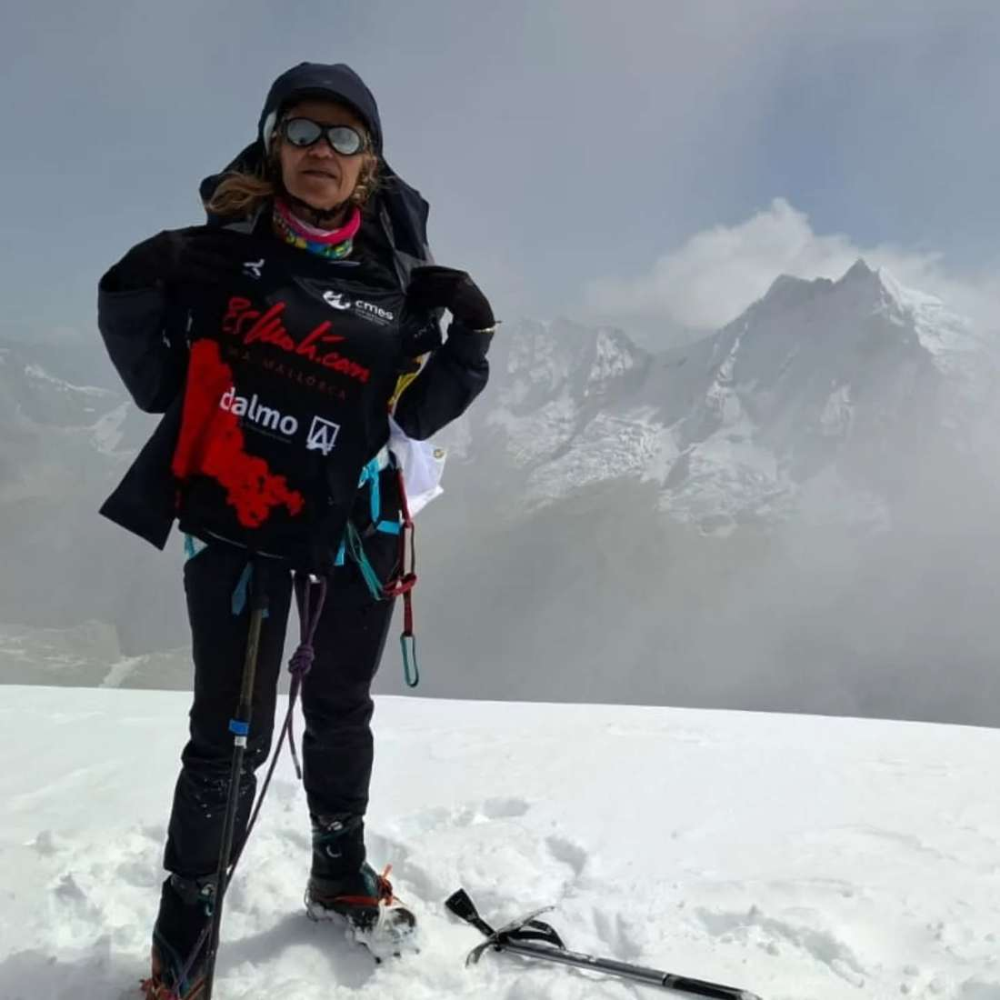
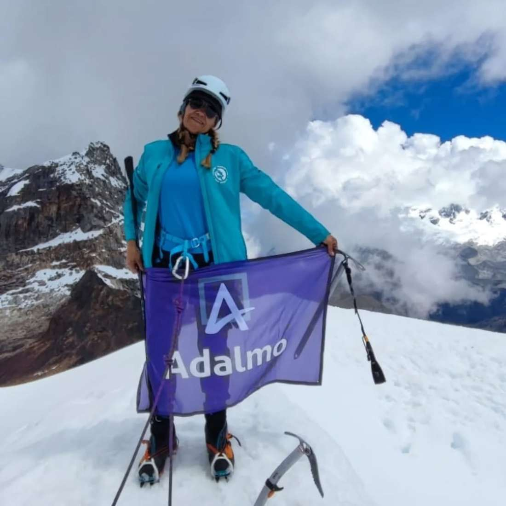
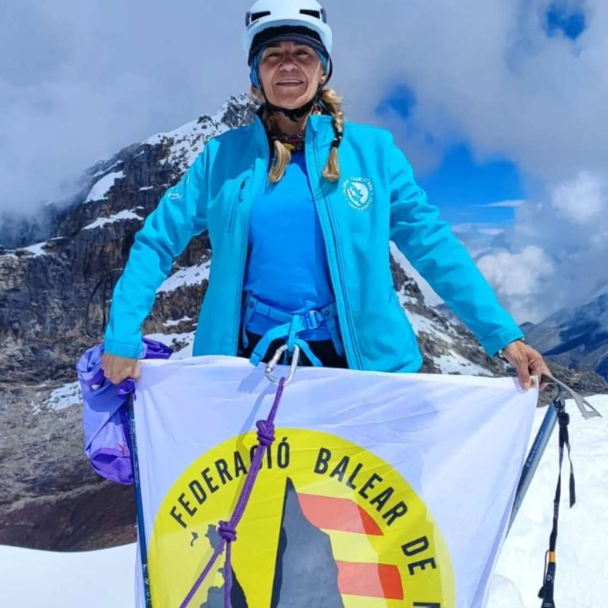
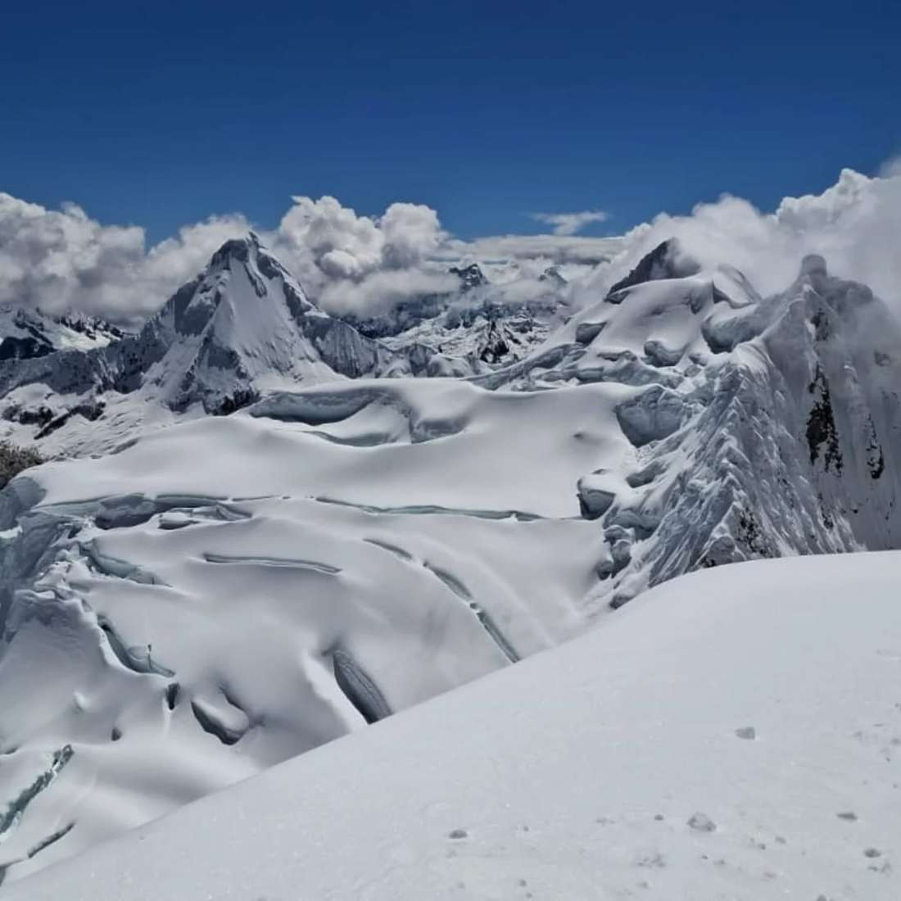
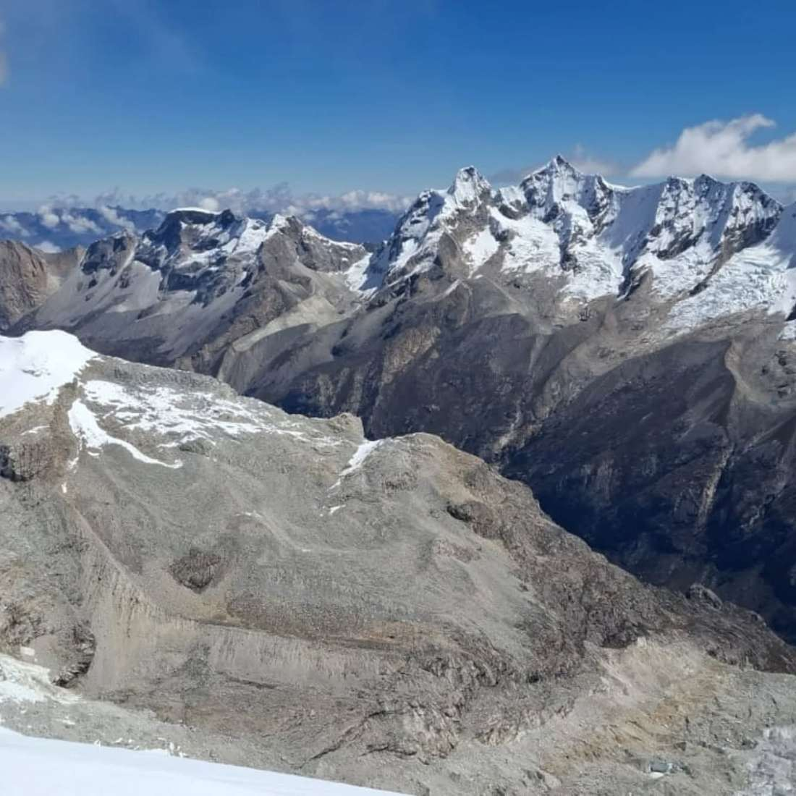

La nostra sòcia Fabiana Peña ha recorregut part de la cordillera Blanca, a Perú.

Cima Nevado Mateo (5.150 metres), Urus (5.495 metres), Ishinca (5.530 metres) i Cima del Pisco (5.752 metres) han estat els cims més elevats que ha assolit.

