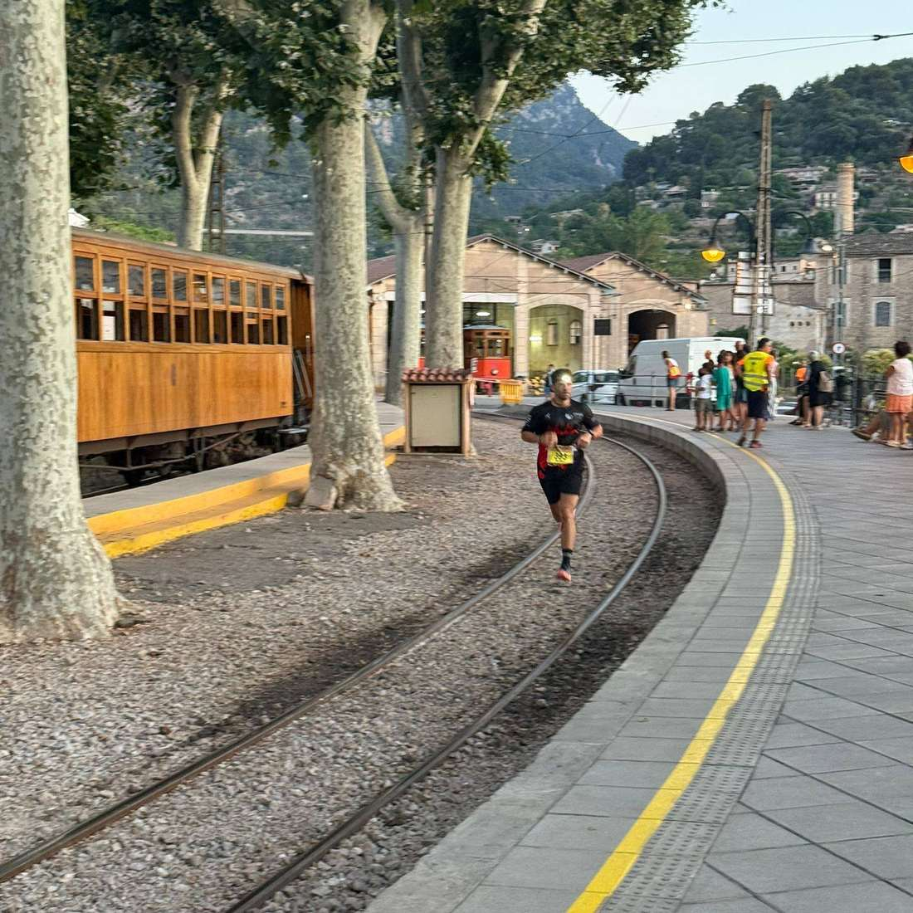
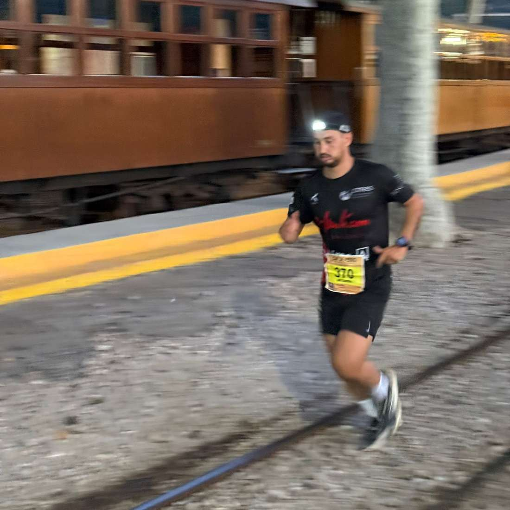
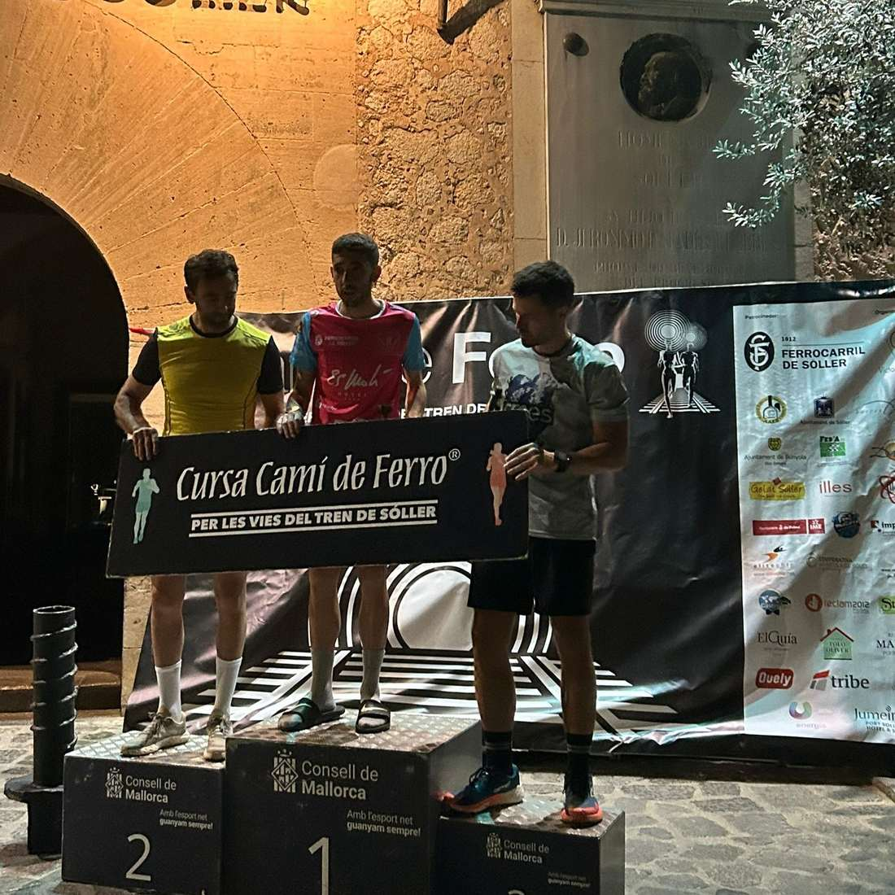
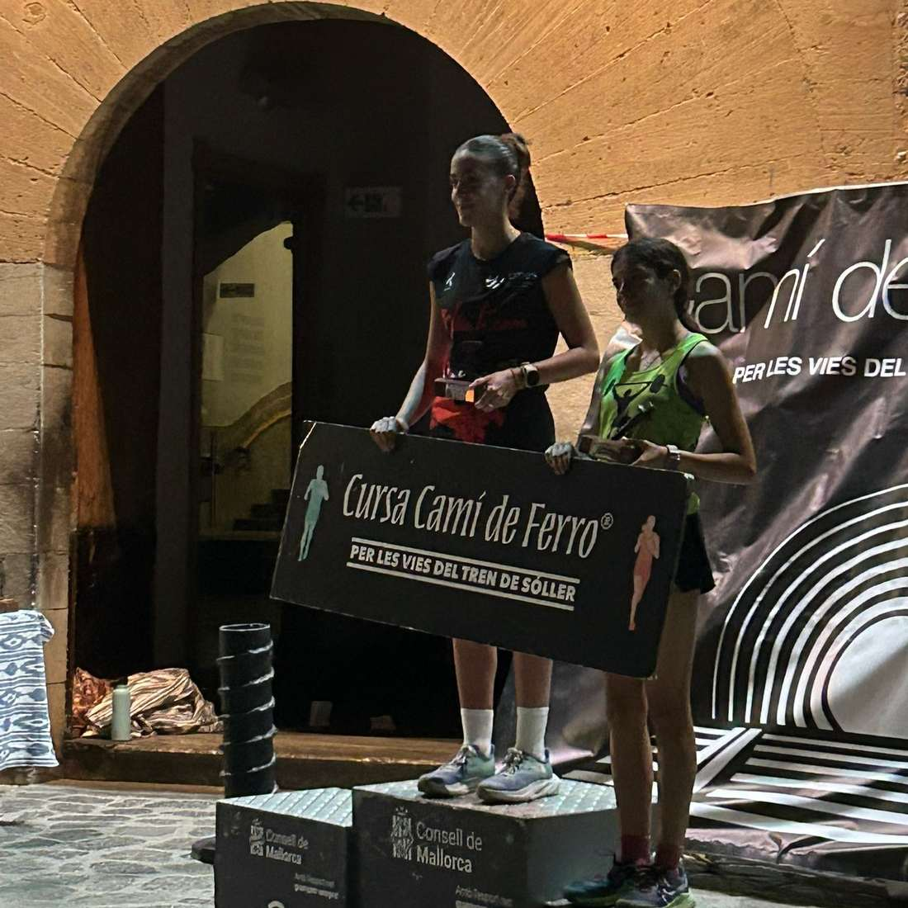
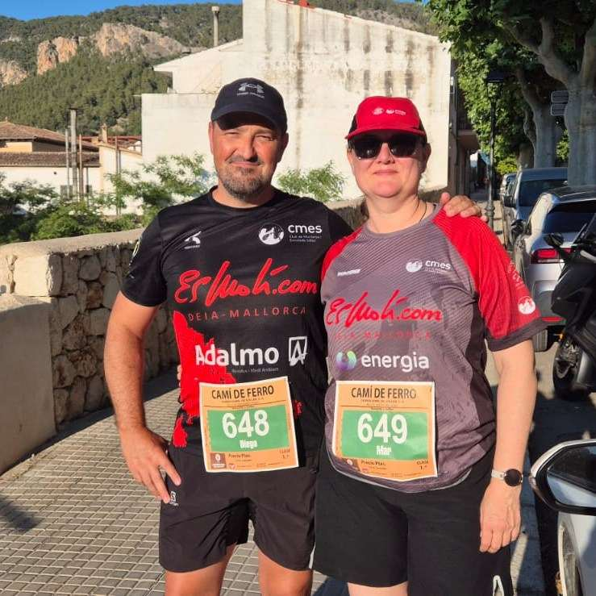

Joan Torrens fou dissabte el segon classificat a la prova del Camí de Ferro disputada entre Bunyola i Sóller (13 quilòmetres). Pere Albertí també va pujar al podi com a tercer classificat de la seva categoria.

Aquests foren els resultats dels corredors del CMES que hi participaren:

2.- Joan Torrens 49:37

7.- Pere Albertí 53:34

39.- Javi Cuartero 1:05:42

47.- Clara López 1:08:55

61.- Diego Peña 1:11:30

75.- Sergi Salvà 1:13:16

A més, també comptàrem amb participants a la caminada no competitiva entre Bunyola i Sóller.

Enhorabona a tots!!

@jooaann\_torrens

@peretalberti

@jvcuartero

@clara\_lopeez\_

@diegopenya

@sergiisalva

@diegodelgadofiol

