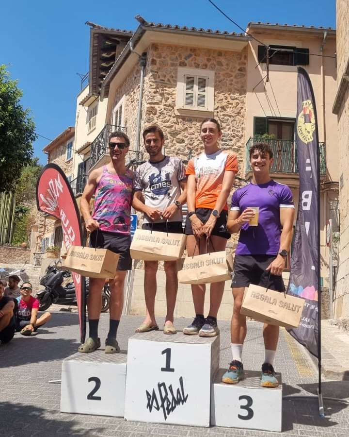
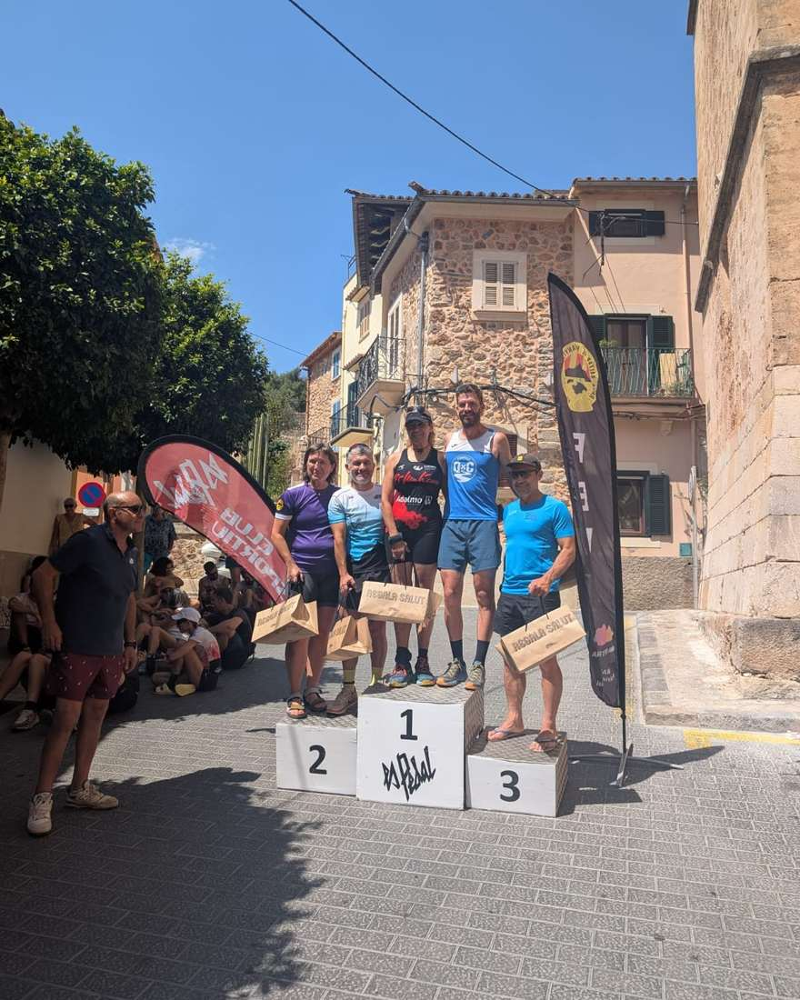

Ahir a Bunyola, nova aturada de la Copa Balear de Cronoescalada i Quilòmetre Vertical amb la cronoescalada a Sa Comuna.

Per part del CMES, Dani Vidal i Fabiana Peña completaren la dura pujada amb bons registres i aconseguiren pujar als podis de les seves respectives categories d'edat.

Dani Vidal fou el novè classificat de la general absoluta i el primer de la categoria Sub 23, mentre que Fabiana Peña fou la 83 de la general i la primera de la categoria F50.

Enhorabona!!

