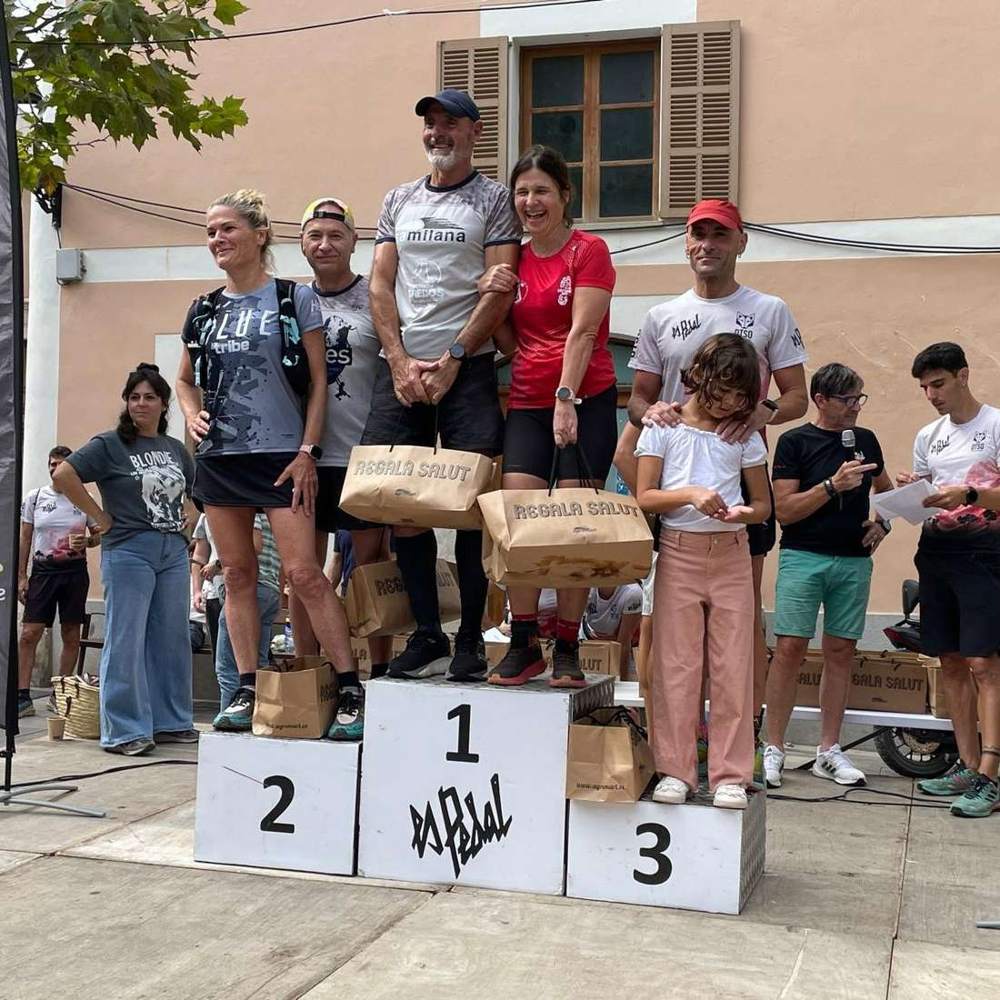
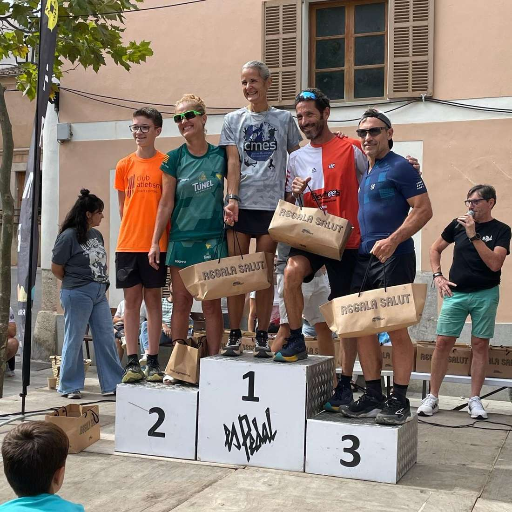
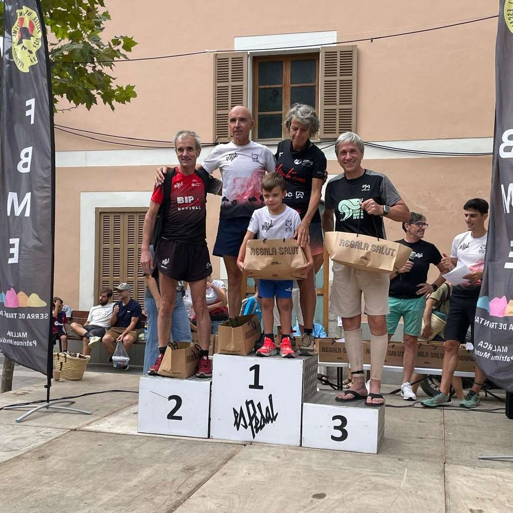
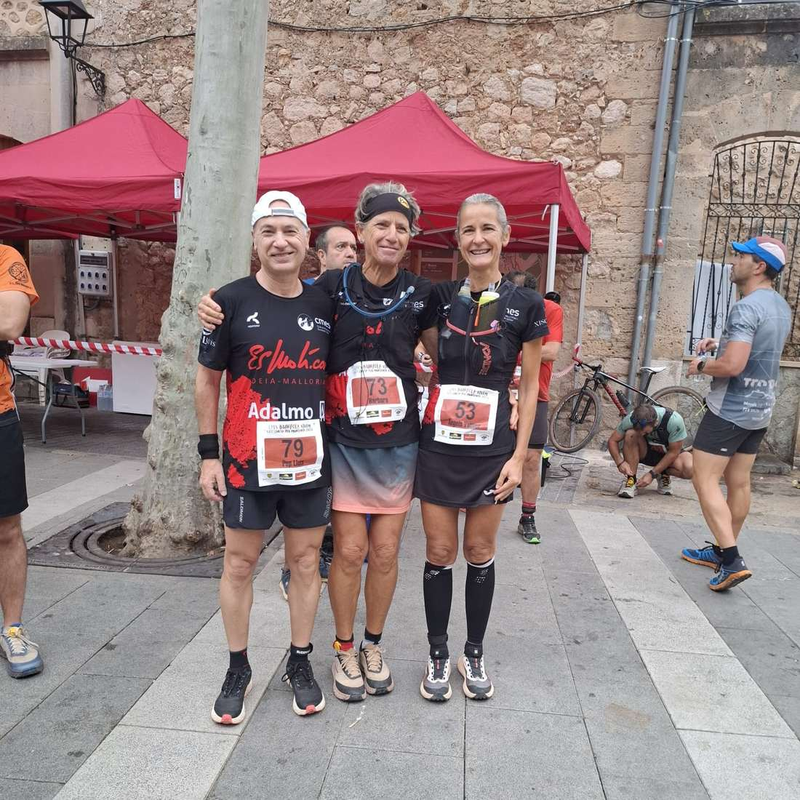
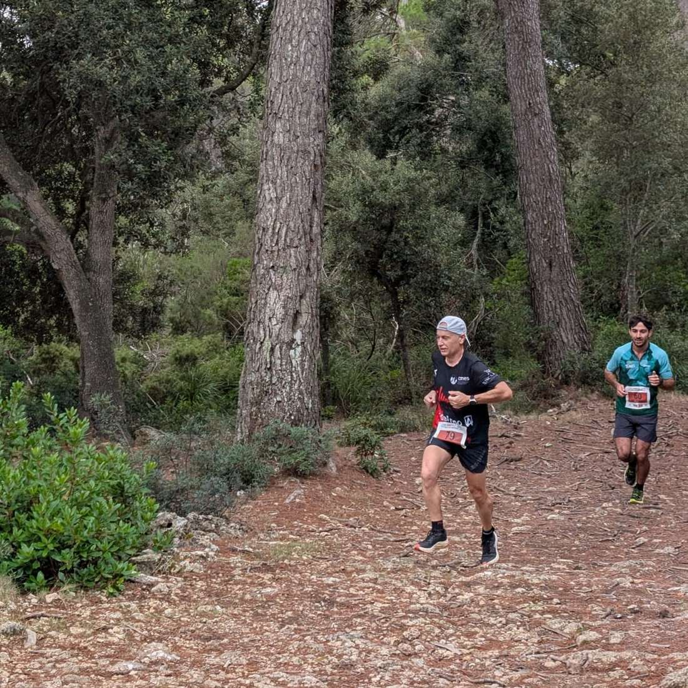
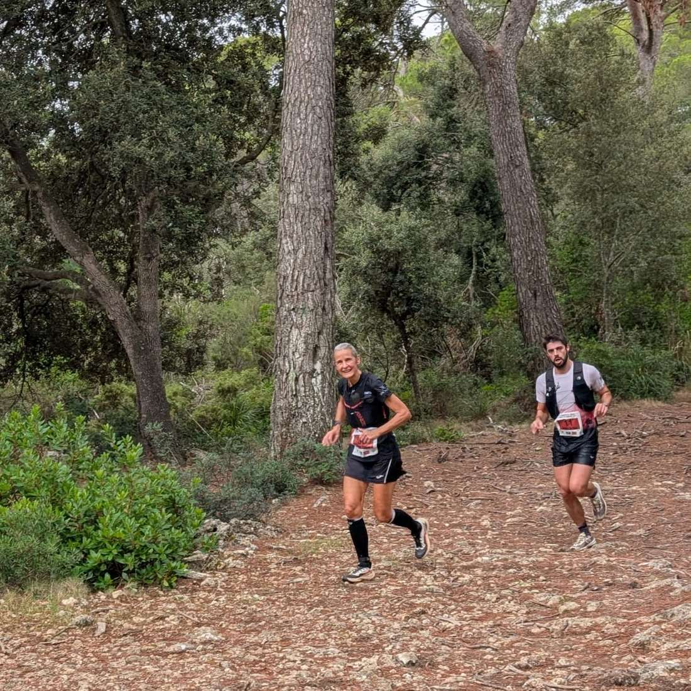
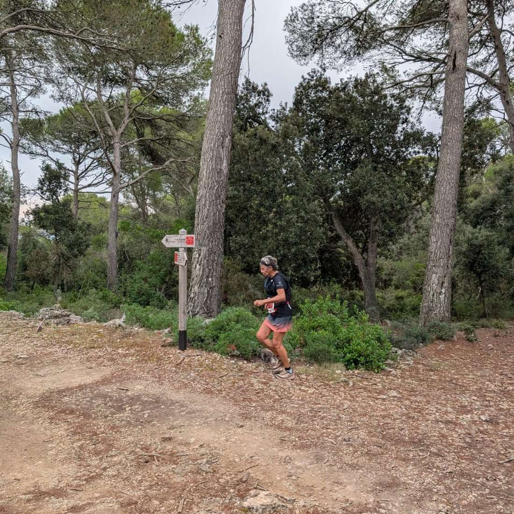

Grans resultats els obtinguts pels corredors del CMES diumenge passat a les curses de la Bunyola Xtrem.

Xim Borràs va guanyar amb autoritat la cursa d'11 quilòmetres, mentre que a la prova més llarga Pep Lluís Gómez, Àngels Vaquer i Bàrbara Matt assoliren plaça de podi a les seves categories d'edat.

Aquests foren els resultats:

🔹Cursa 11 Km🔹

▪ 1.- Xim Borràs 48:49 🥇

🔹Cursa 19 km🔹

▪ 38.- Pep Lluís Gómez 2:08:58 🥈 M55

▪ 90.- Àngels Vaquer 2:36:58 🥇 F50

▪ 102.- Bàrbara Matt 2:44:31 🥇F60

Enhorabona!!

