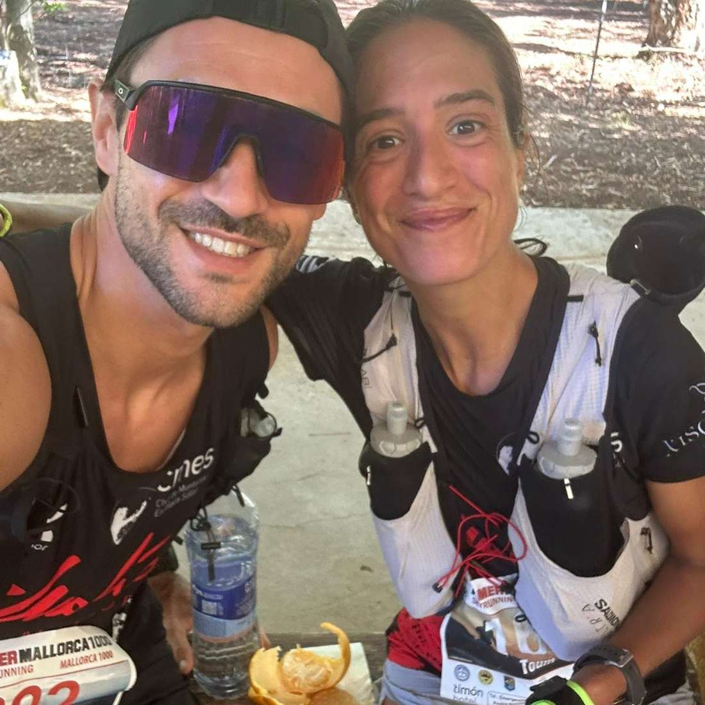
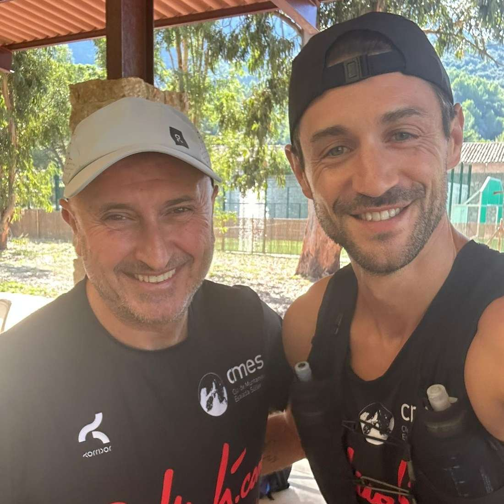
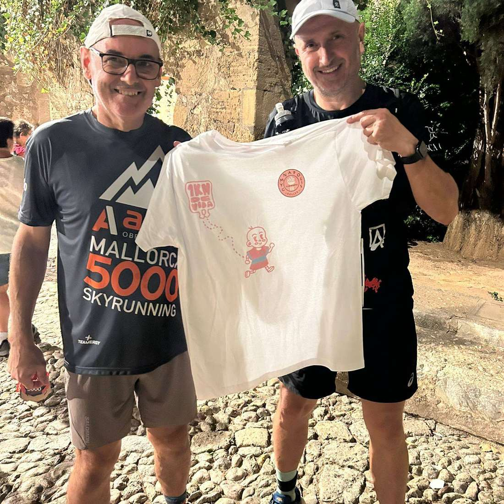

Dissabte vàrem ser presents a una de les proves més esperades del calendari anual: la Mallorca 5.000.

Yael Sprauel va finalitzar els 72 quilòmetres del recorregut entre Sóller i Pollença, classificant-se a la posició 61 de la general i a la segona de la seva categoria d'edat. Ho va fer amb un temps de 14:56:02.

En la modalitat d'equips de relleus, Dani Vidal, juntament amb els seus companys Pere Casasnovas i Pau Noguera, va pujar al segon escaló del podi. El seu equip fou el segon més ràpid amb un temps de 9:02:13.

Isidro Marín, Salvador Martí i Juan Pedro Isern, per la seva banda, completaren els tres relleus de la cursa en un temps de 15:37:52, situant-se a la posició 38 de la general.

I a la cursa Mallorca 1.000, de 24 quilòmetres d'itinerari, Pierre Mariotto va completar la cursa a la posició 33 amb un temps de 3:42:00.

Enhorabona a tots!

