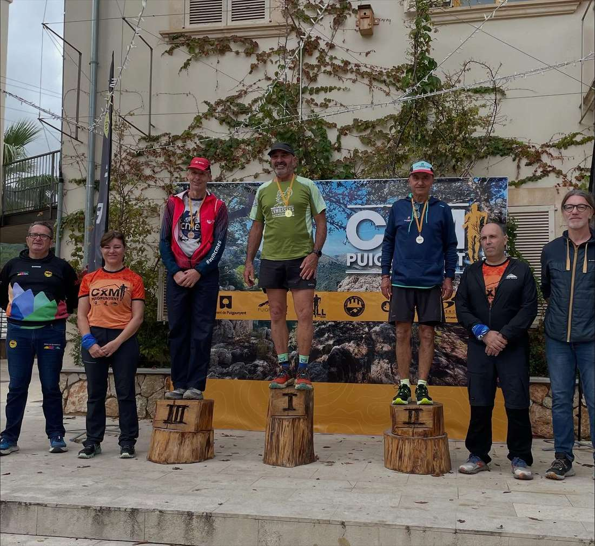
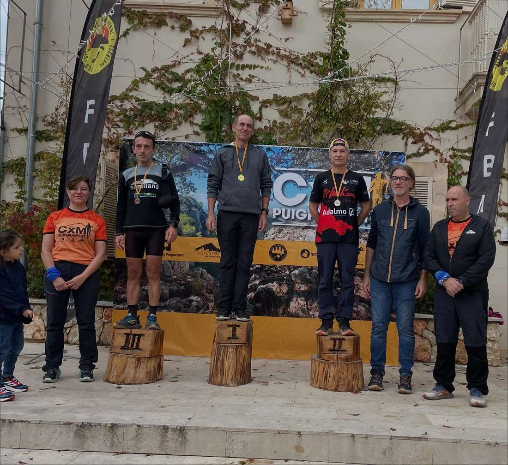
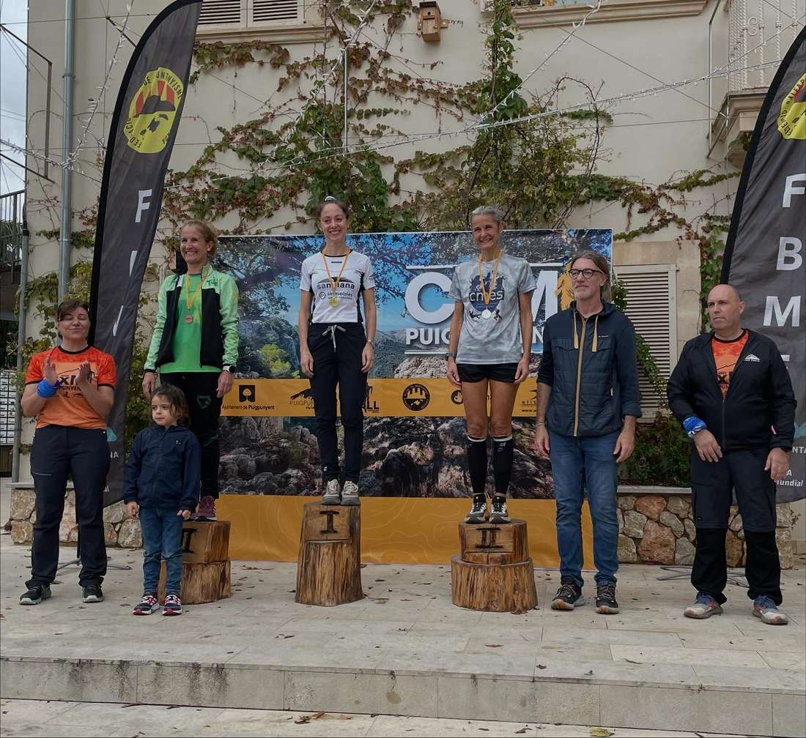

Diumenge va tenir lloc la cursa de muntanya CXM Puigpunyent 2025. El matí va començar un poc gris i ens va caure qualque gota, però poca cosa. Al final el dia se va estirar i vàrem poder gaudir d'un dia perfecte de cursa. Un recorregut muntanyer i tècnic, 16 Km amb quasi 1000 m de desnivell, fent cim al Galatzó. Paratges espectaculars. Molt recomanable. Bona organització per part de l’Associació d’Esportistes de Puigpunyent i Galilea Sa Vall. Un total de 134 corredors varen ser a la sortida de la cursa de Puigpunyent, dels quals vàren acabar 133. Els resultats dels nostres companys varen ser els següents:

22. Pere Albertí, 1:56:06, 17è V30M

57. Pep Lluís Gómez, 2:13:50, segon V55M

91. Àngels Vaquer, 2:34:38, segona V50F

102. Isidro Marin, 2:42:26, 10è V50M

110. Juan Pedro Isern, 2:48:41, tercer V60M

114. Diego Torres, 2:58:39, 37è V30M

116. Fabiana Peña, 3:04:27, quarta V50F. Enhorabona a tothom!

