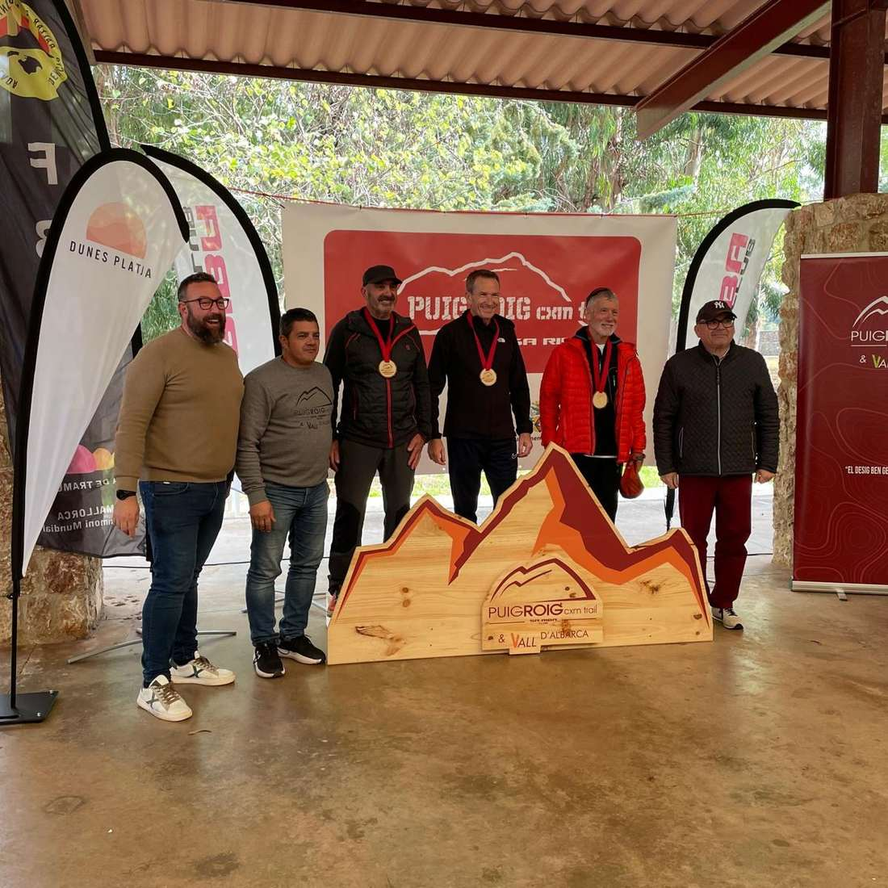
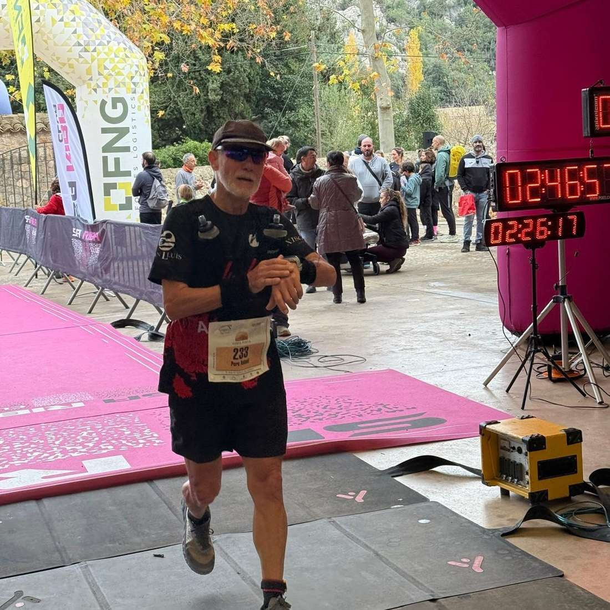
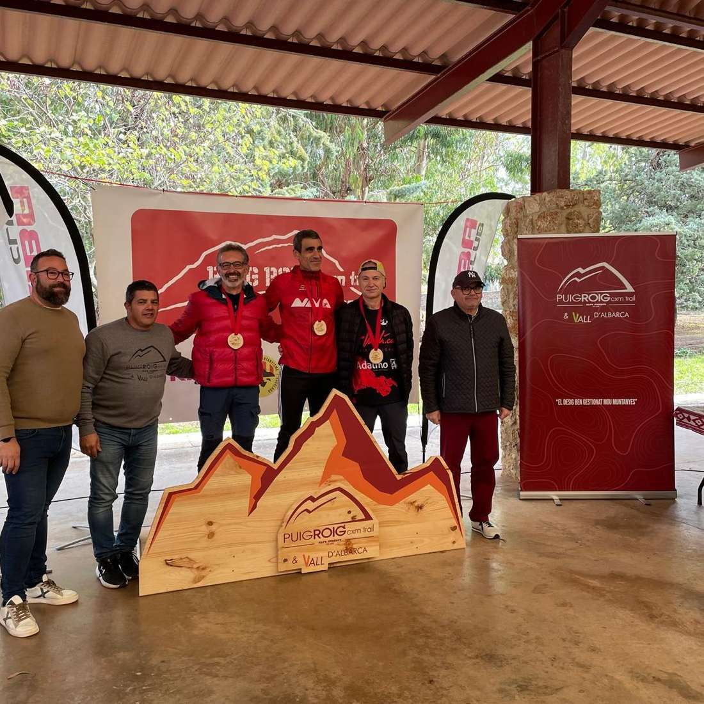
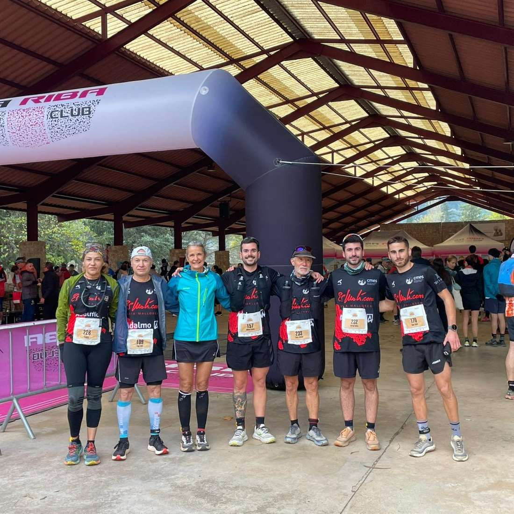
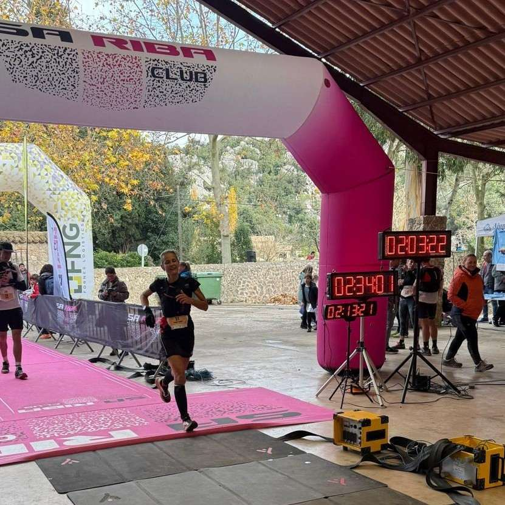
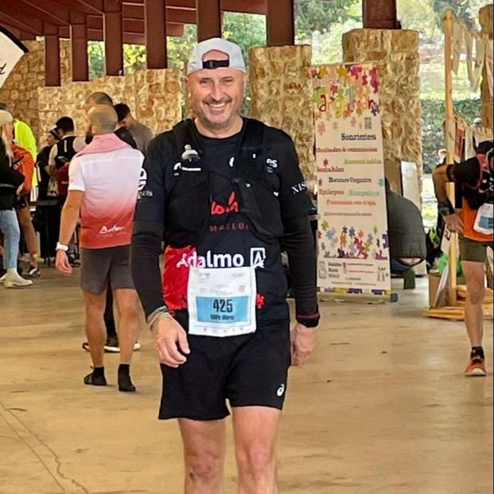

Ahir diumenge a Lluc es va disputar la darrera cursa de la copa balear de la temporada, la CXM Trail Puig Roig. Abans de la sortida hi va haver un homenatge a Guillem Coll, que fa una setmana ens va deixar.

Els resultats de la cursa varen ser aquests:

Distància 16K:

45. Isidro Marin, 1:38:30, 3er V50M

47. Xisca Coll, 1:39:33, 2on V50F

Distància 22K:

5. Dani Vidal, 1:43:55, 1er V23M

75. Pep Lluís Gómez, 2:15:42, 3er V55M

130. Àngels Vaquer, 2:34:00, 3er V50F

163. Pere Antoni Mercadal, 2:46:54, 3er V60M

190. Fabiana Peña, 3:04:51

195. Albert Salvà, 3:10:08

196. Sergi Salvà, 3:10:09

Enhorabona a tots!

