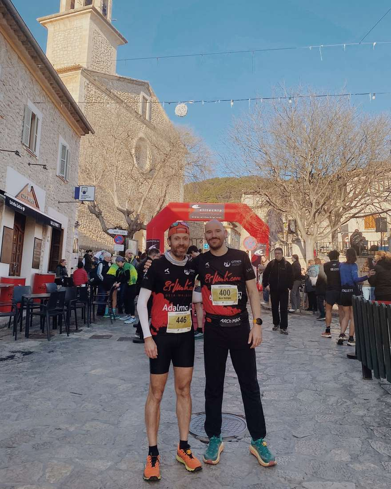

👀Avui diumenge, el CMES ha estat present a la primera cursa de la Copa Balear CxM 2026: la Mancor Xtrem! 🔥

👉🏻 Distància 32K

👏🏻Pere Albertí ha aconseguit la 36a posició absoluta i la 23a en categoria V30M, amb un temps de 3:14:31.

👏🏻Ricardo Albelda ha finalitzat en la 81a posició, amb un temps de 3:38:25.

👉🏻Distància XS (12K)

👏🏻Joan Vicens ha assolit una excel·lent 20a posició absoluta, amb un temps de 1:01:38 .

👏🏻Òscar Rodríguez ha creuat la meta en la 66a posició, amb un temps de 1:14:06 🙌

🎉 Enhorabona a tots els corredors per l’esforç i els resultats! 🫂Orgull CMES

@adalmogestion

@immobiliariaxiscacoll

@hotelesmoli

@canlluisbarrestaurant

