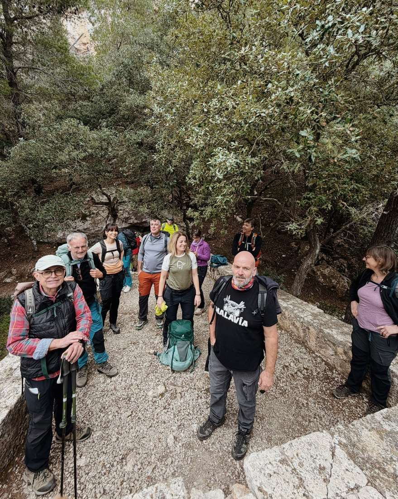
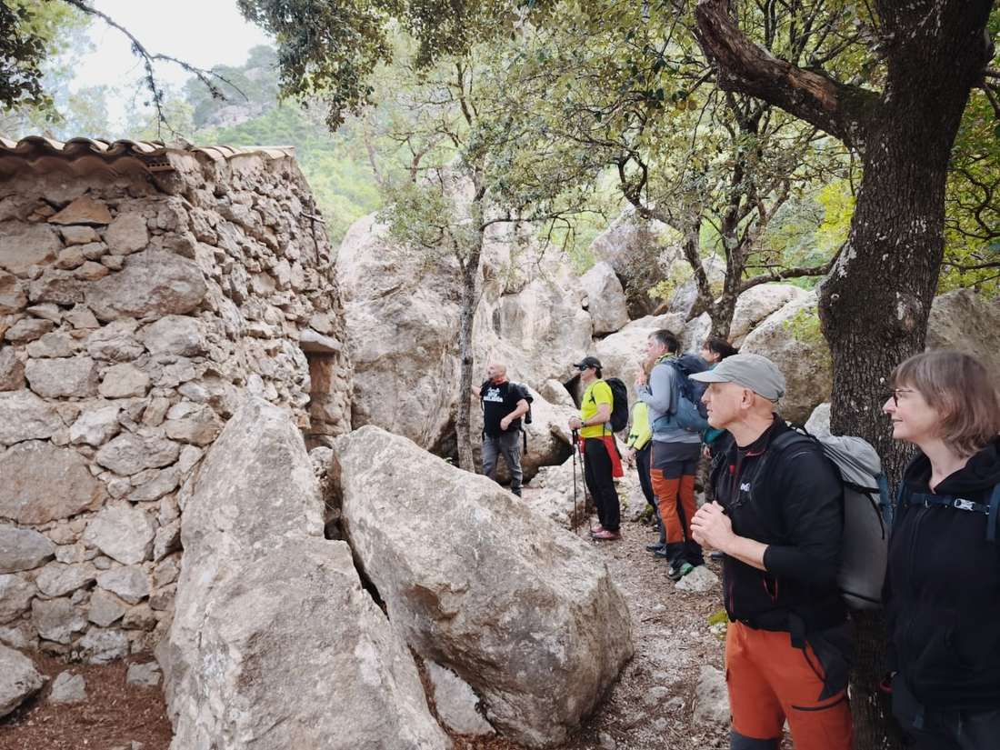
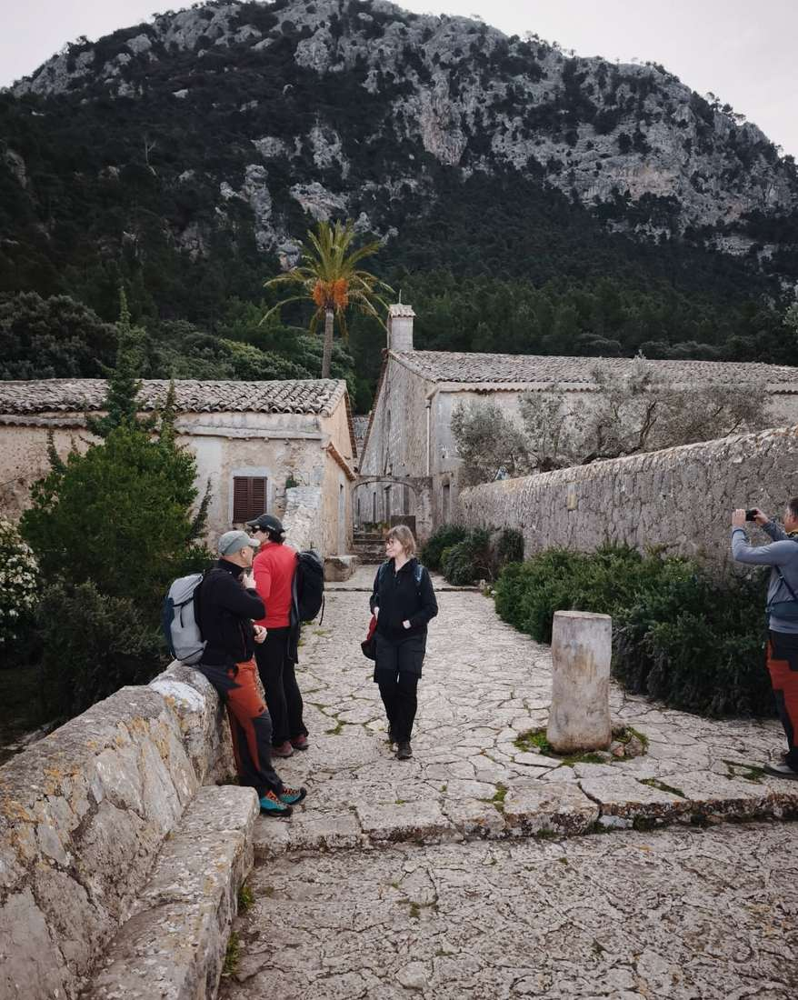
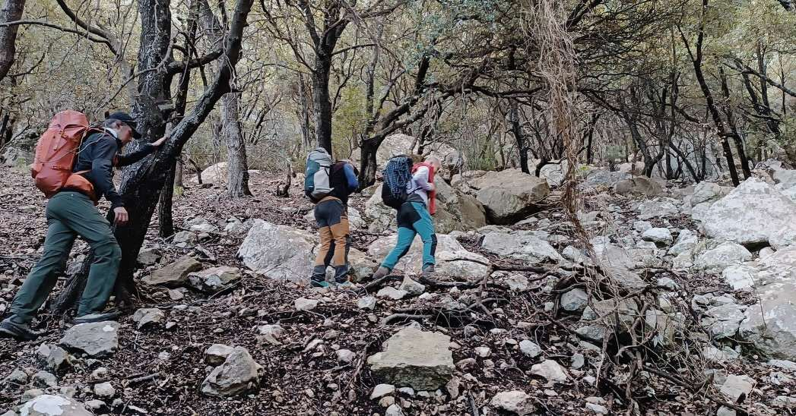
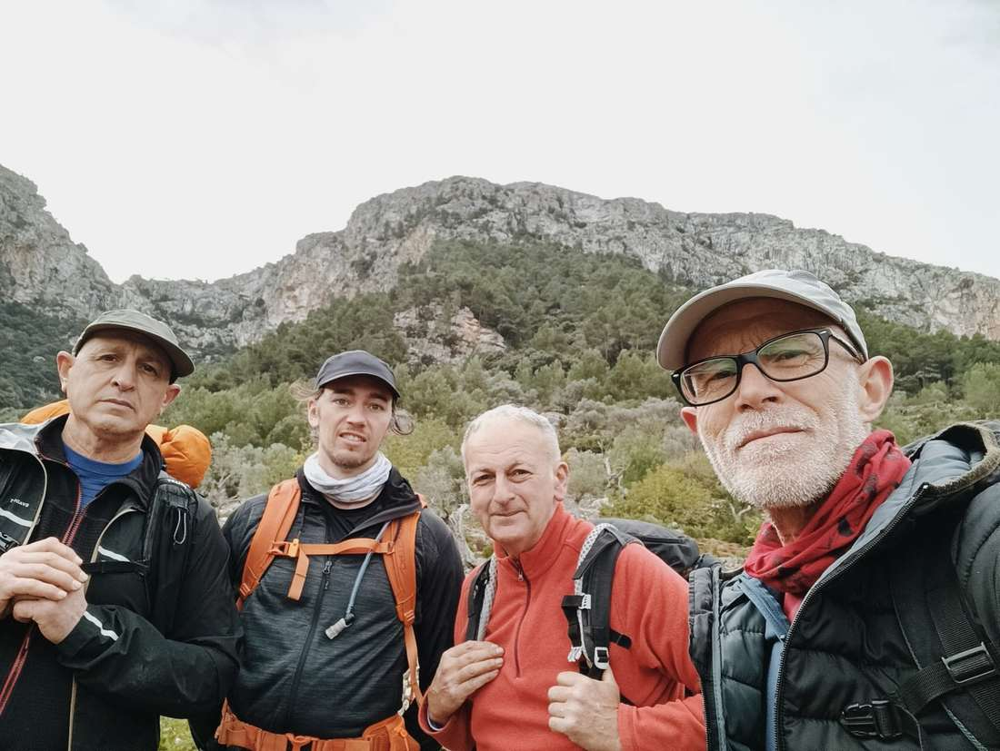
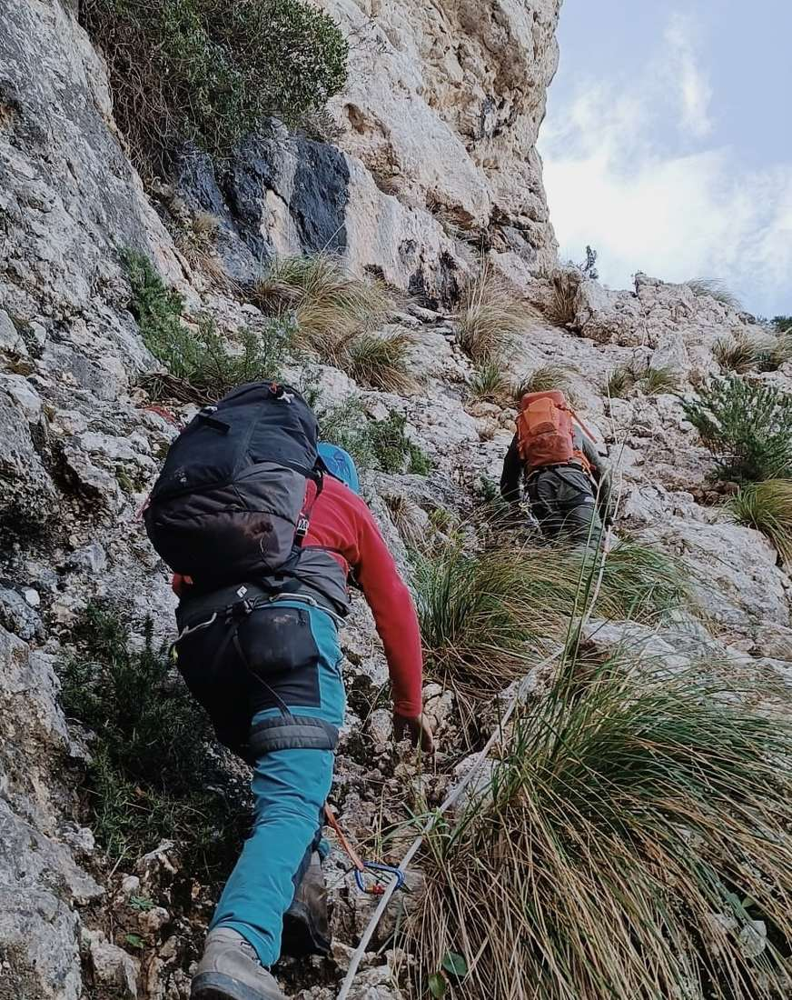
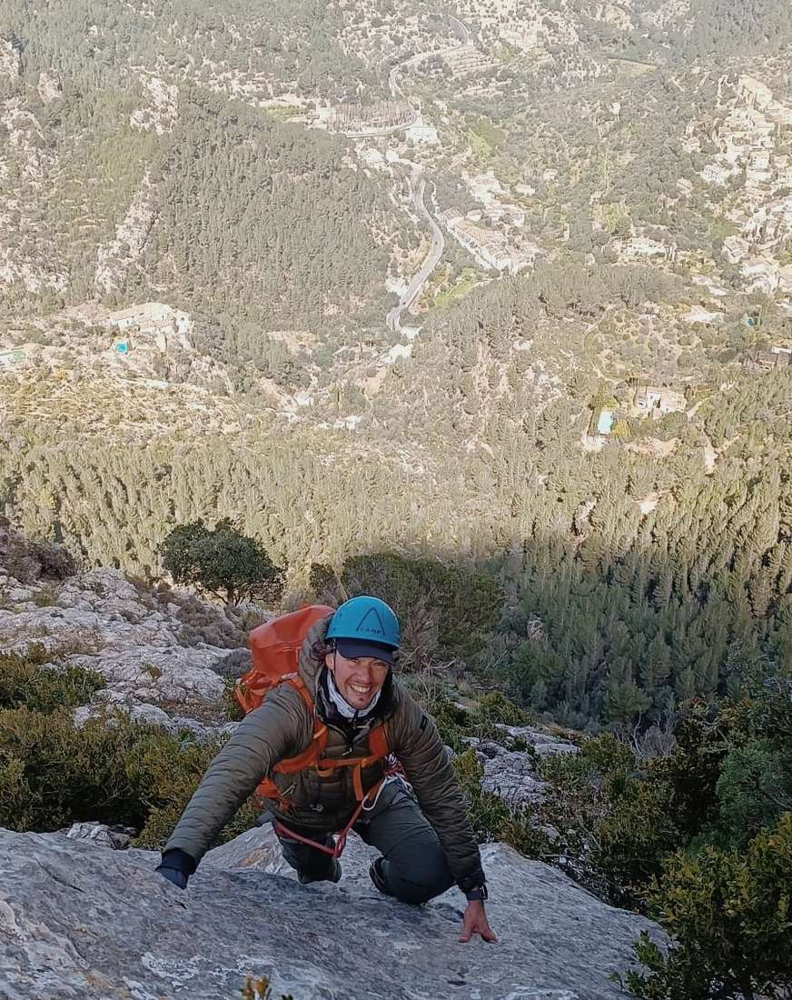
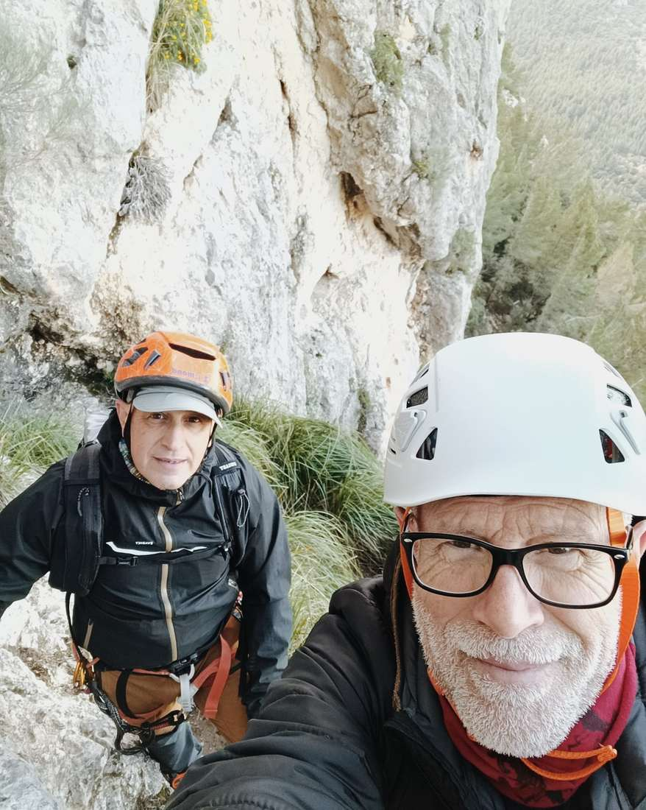

Avui us contam dues de les sortides que han fet aquest mes la secció de Senderisme⛰️

Una sortida cultural pel terme de Valldemossa 🌿

Descobrírem sis ermites i conjunts eremítics, alguns ja en ruïnes, testimoni de la vida solitària i contemplativa dels ermitans mallorquins als boscos que envolten sa Talaia Vella.

Un viatge al passat, entre silenci, natura i història ✨

Sortida tècnica pels passos de Deià📍

Una ruta espectacular recorrent alguns dels passos més emblemàtics de la zona: Es Reco, pas de sa Roseguera, es Salt, pas d’en Caleu (o de sa Pintella) i la cingla de sa Pintella.

Vistes que compensen cada esforç 💪🏻✨

T’agradaria gaudir d’aaquestes sortides?

Us deixam l’enllaç per formar part del club🙌🏻

https://cmesoller.com/

