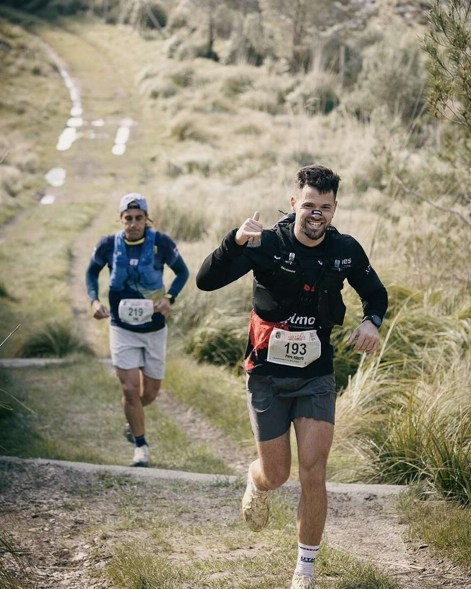
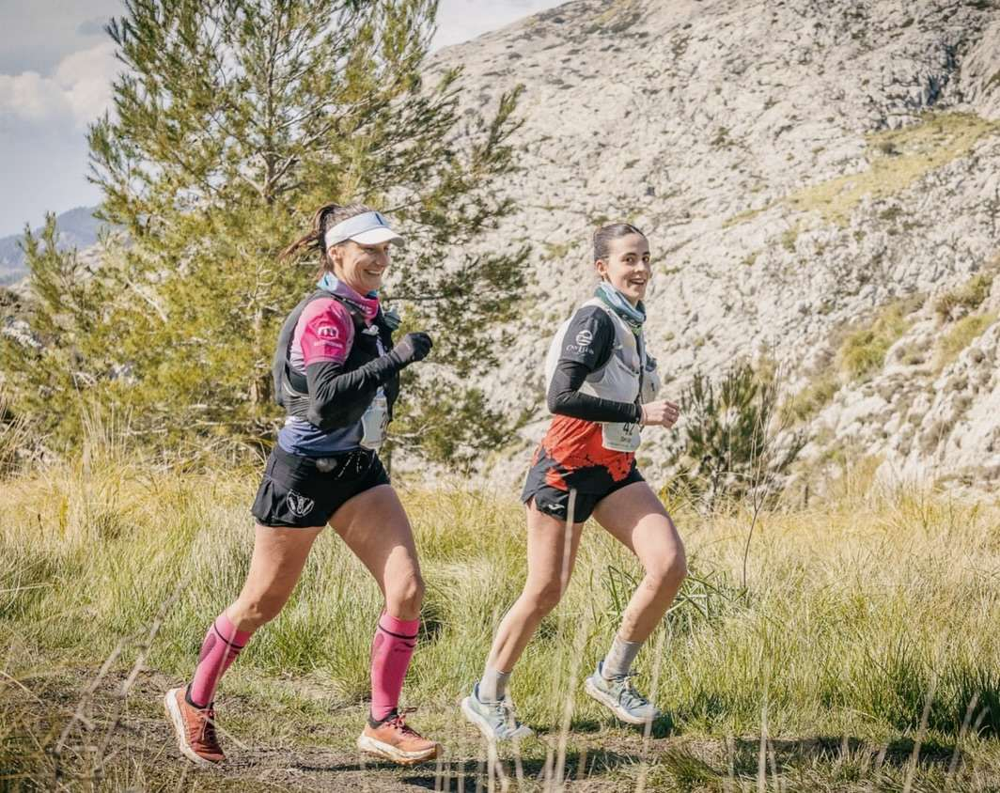
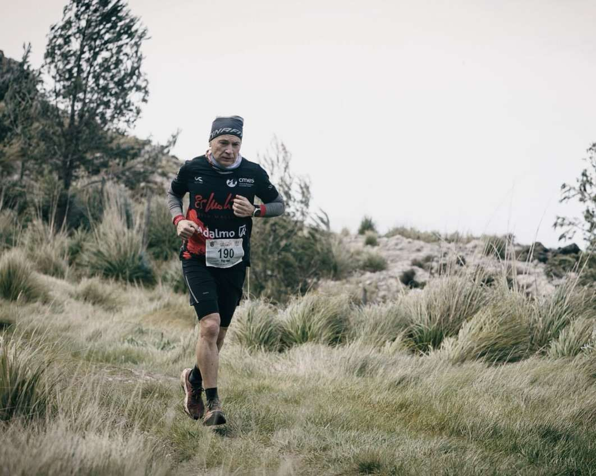
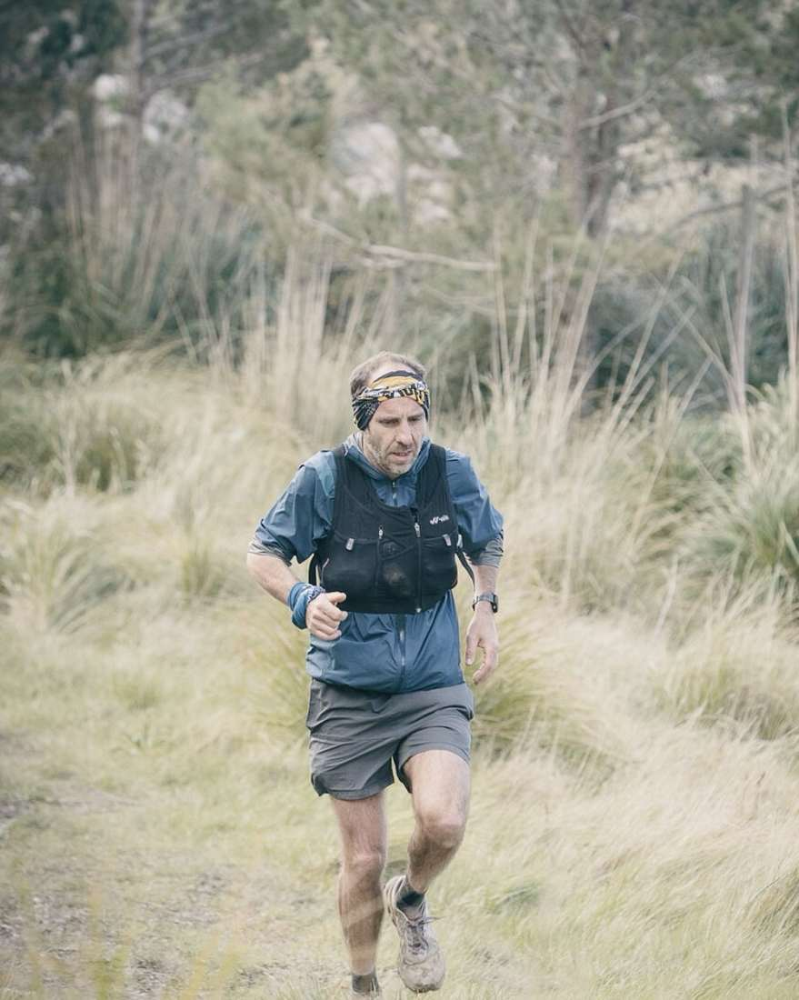
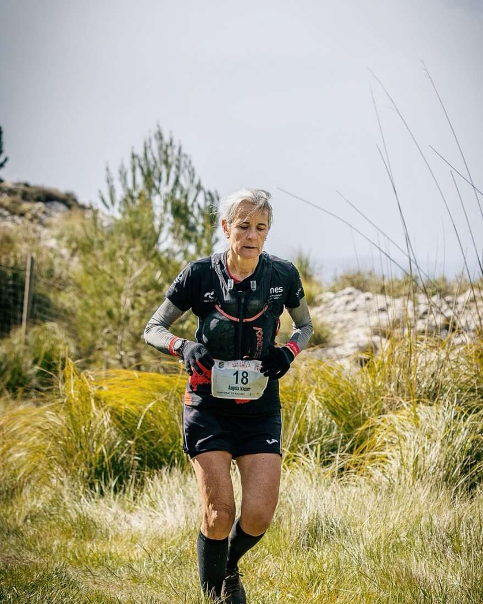
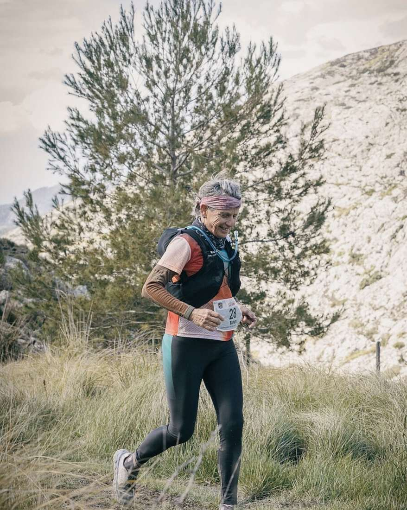
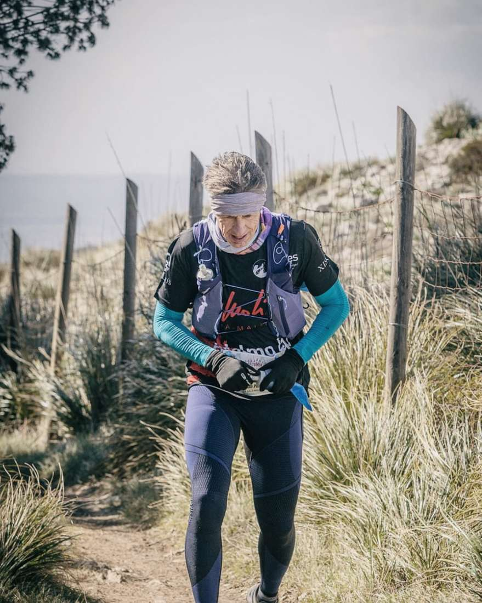
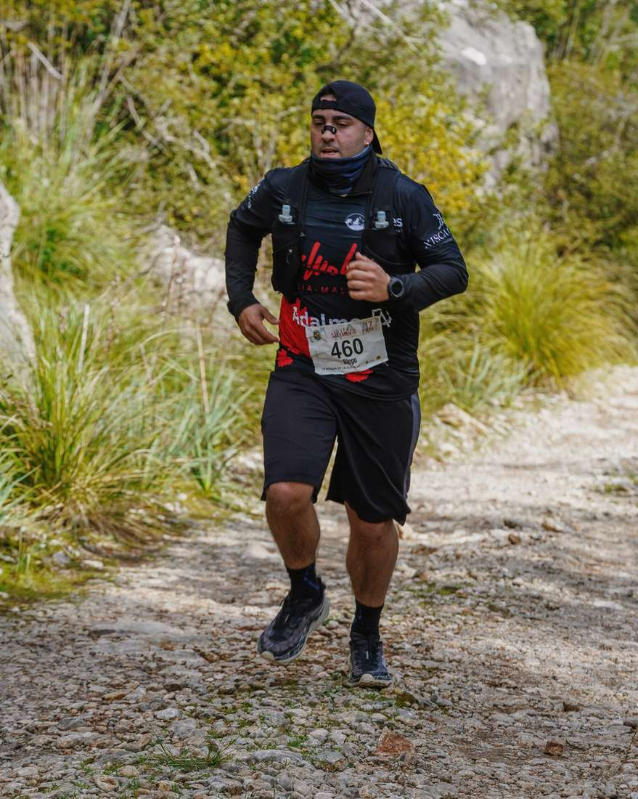

👀Diumenge de Tomir i Ronda de Cuculla.

El que ens agrada més, es veure que, tot i la meteorología, els nostres corredors van amb una bona rialla🤪

🏃🏻‍♂️‍➡️ La cursa Ronda de Cuculla es va dur a terme tal i com estava previst, i el nostre corredor Diego Peña es va posicionar al lloc 138🙌🏻 amb un temps de 2:30:59 als 17km.

🏃🏻‍➡️ La de Tomir, degut a la meteorología es va haver de modificar un poc. Això no li va llevar pes, ja que el recorregut amb la ventada que feia era tot un repte🍃🙌🏻

Aquests van ser el resultats dels nostres corredors:

Posició 14🙌🏻 Dani Vidal amb un temps de 1:56:16

Posició 58🙌🏻 Pere Albertí amb un temps de 2:15:15

Posició 89🙌🏻 Pere Estarellas amb un temps de 2:25:07

Posició 105🙌🏻 Pep Lluís Gómez amb un temps de 2:32:14

Posició 175🙌🏻 Àngels Vaquer amb un temps de 3:02:32

Posició 182🙌🏻 Clara López amb un temps de 3:08:01

Posició 191🙌🏻 Barbara Matt amb un temps de 3:14:20

Posició 201🙌🏻 Juan Pedro Isern amb un temps de 3:21:23

A destacar 4 podis del @cmes\_soller 🪩

Clara López, 2na a la categoria sub23💪🏻

Pep Lluís Gómez, 3r a la categoria V55💪🏻

Àngels Vaquer, 1ra a la categoria V50F💪🏻

Barbara Matt, 1ra a la categoria V60F💪🏻

Volem donar l’enhorabona a tothom!

Seguiu gaudint del que us agrada🫶🏻

