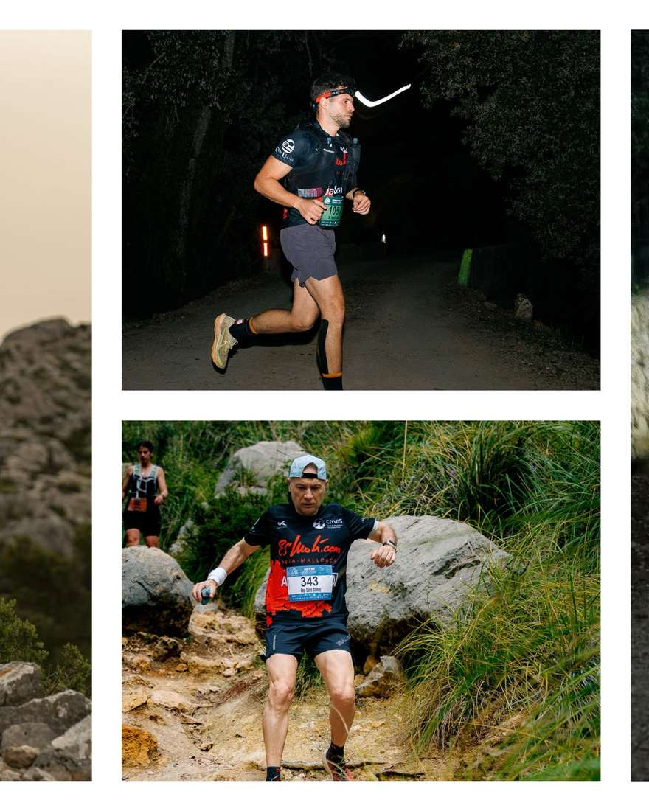
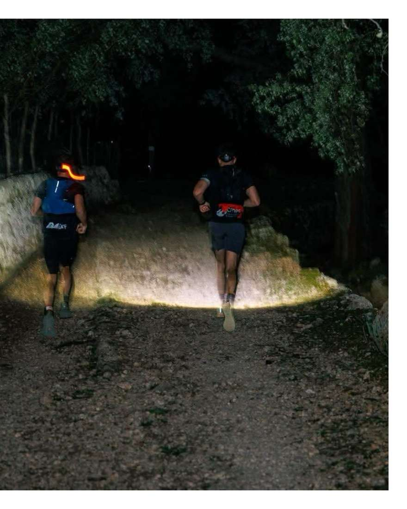
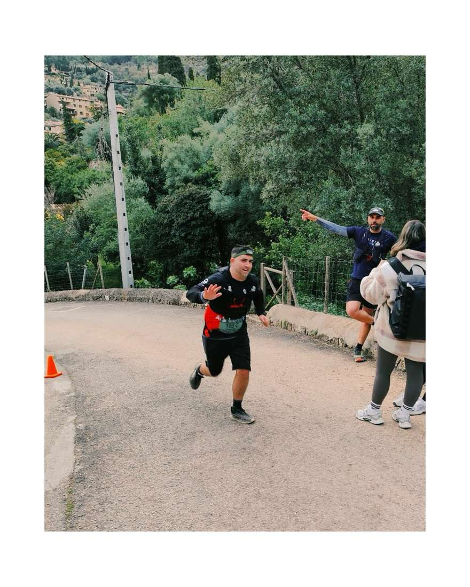
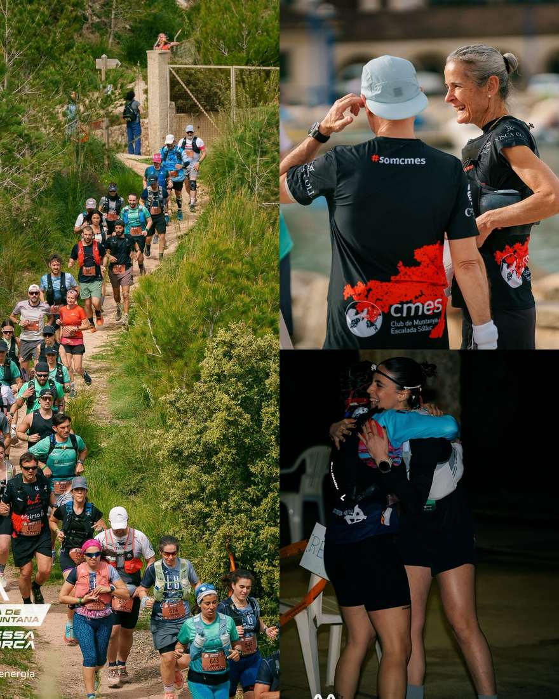
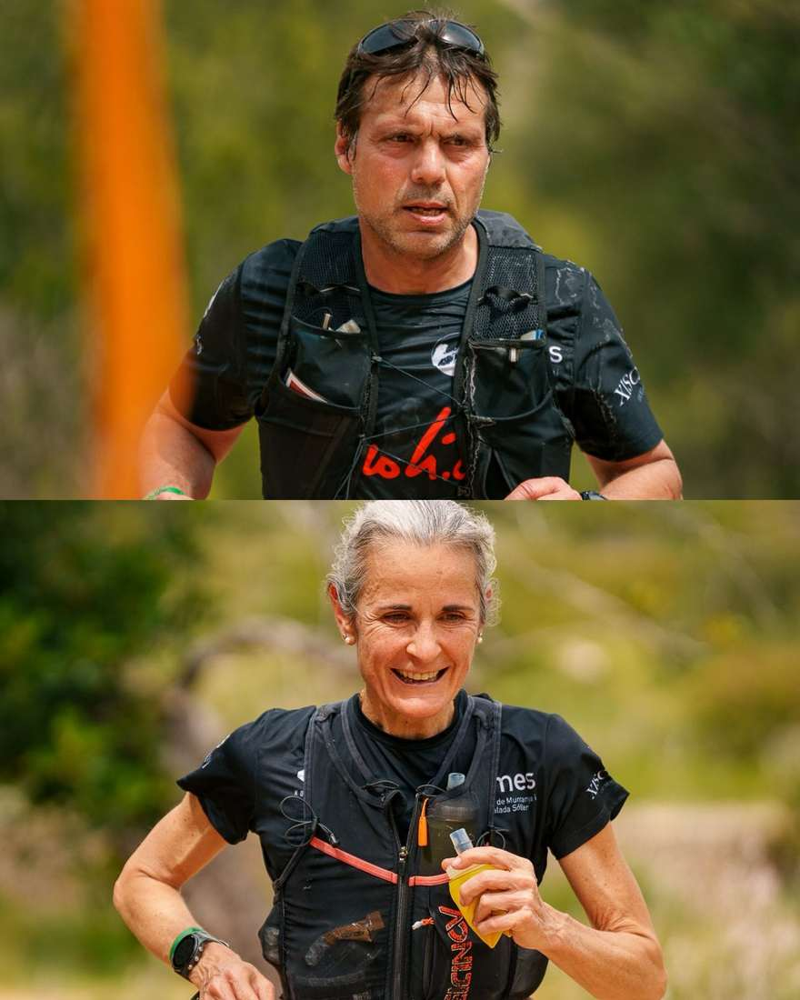
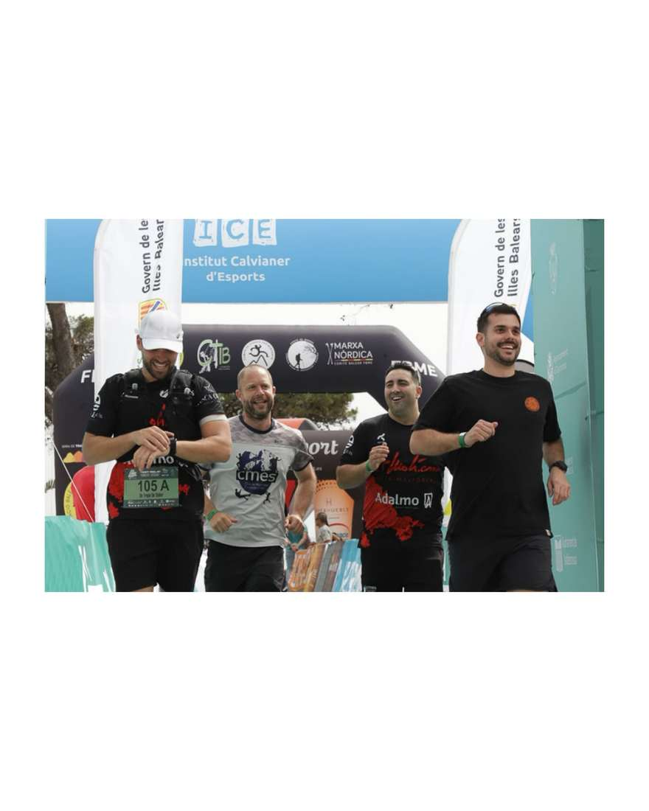
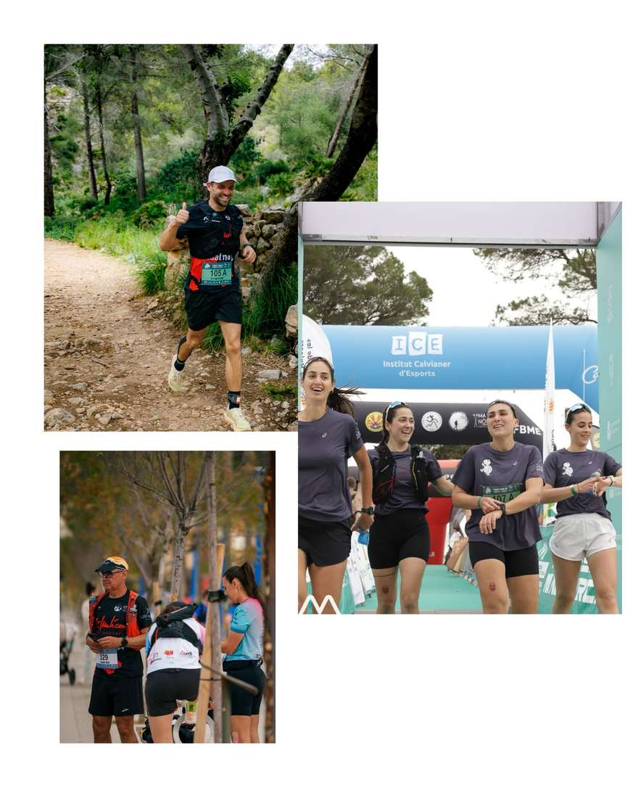

🙌🏻Quina satisfacció complir els objectius que et proposes💪🏻

Aquest cap de setmana els nostres corredors han gaudit de la fantàstica Travessa🏃‍➡️. Una cursa que es du a terme a la nostra Serra de tramuntana⛰️.

Hi hem tingut participació en les diferents modalitats.

A la mitja marató (22 km) hi ha participat  Joan Josep Llompart, amb un temps de 4:00:11.

A la marató (45 km):

Posició 44 - Pep Lluís Gómez amb un temps de 5:30:05.

Posició 69 -  Àngels Vaquer amb un temps de 6:02:48.

Posició 112 - Salvador Martí amb un temps de 6:51:21.

Hi tenim també dos equips a la modalitat dels 120 km.

🙌🏻Posició 11 - Albert Salvà, Pere Albertí, Diego Peña i Pep Mora. Conjuntament amb un temps de 15:00:44.

🙌🏻Posició 12 - Clara López i el seu equip (Maria Antonia Arbona, Neus Galindo i Marina Amorós) amb un temps de 15:41:42.

🏆Als podis hi ha arribat Àngels Vaquer, Pep Lluís Gómez i l’equip de Clara López.

🫂Enhorabona a tots! Tot esforç té la seva recompensa.🤟🏻

A seguir gaudint del que us agrada!

@travessamallorca @federaciobalearmuntanya

