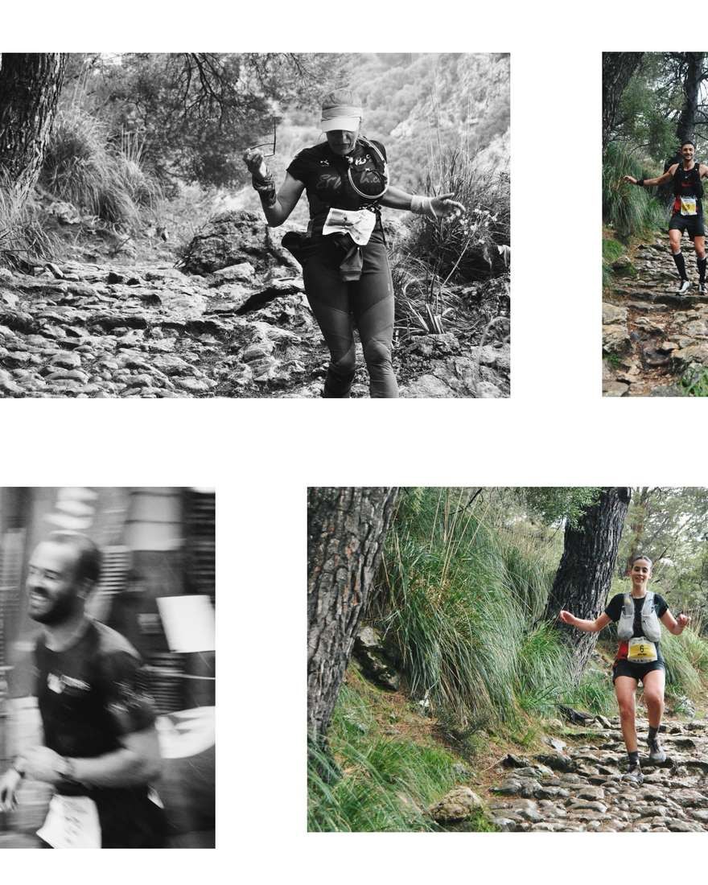
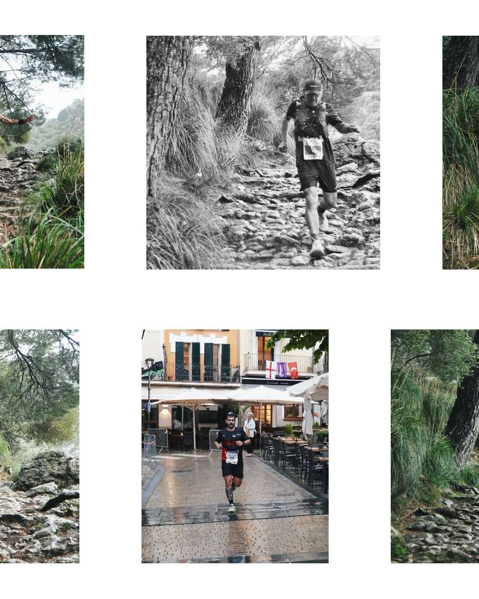
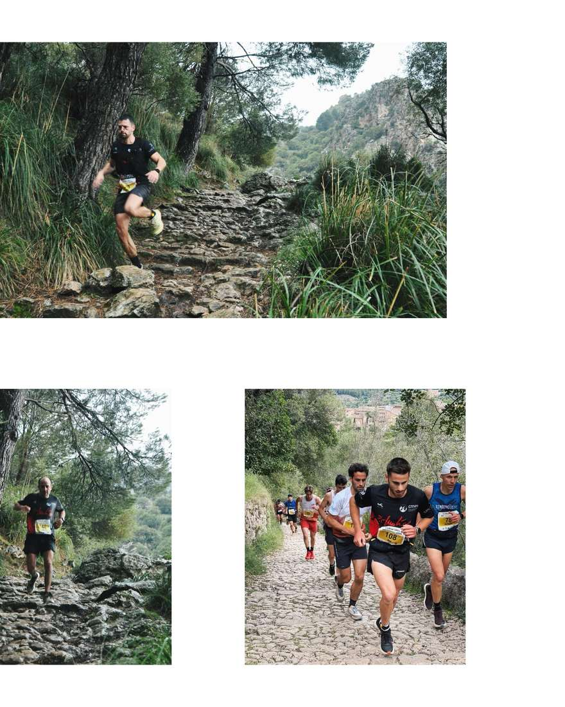

I aquí els resultats de la Vall de Sóller🙌🏻

⛈️🏃🏻‍♀️‍➡️Els nostres corredors van aguantar vent, aigua, calabruix i fred, però això no els va impedir donar bones proves!💪🏻

Vall de Sóller⛰️

4 Dani Vidal 2:03:21

27 Pere Estarellas 2:14:40

42 Pere Albertí 2:26:01

78 Pep Mora 2:46:34

84 Pierre Moriotto 2:50:45

96 Clara Lopez 2:58:06

110 Salvador Marti 3:09:33

129 Xisco Lopez 3:18:29

134 Juan Pedro Isern 3:26:56

137 Fabiana Peña 3:33:32

140 Diego Peña 3:48:19

Mini Vall de Sóller⛰️

21 Pep Pons 53:30

52 Joan Cabrer 1:03:07

61 Albert Salvà 1:08:36

A destacar, alguns dels participants van fer podi🏆

Clara Lopez, 1ra sub23🥇i promesa

Dani Vidal 1r Senior i 1r local🥇

Salvador Marti, 1r M60 🥇

Fabiana Peña, 1ra M55 🥇

Enhorabona a tots! I com sempre, a seguir disfrutant del que us agrada🙌🏻💪🏻🫂🤍

Gràcies @cursa\_valldesoller 💖

