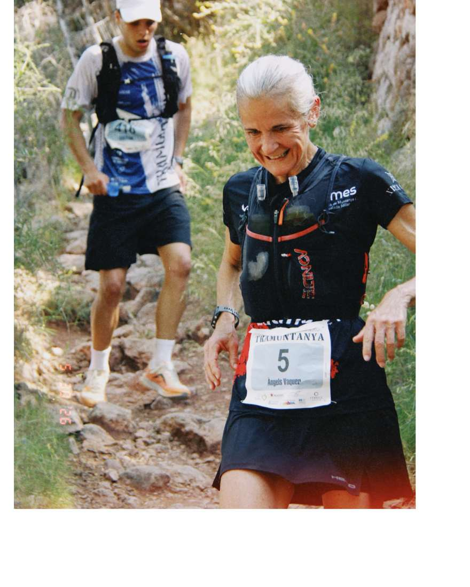
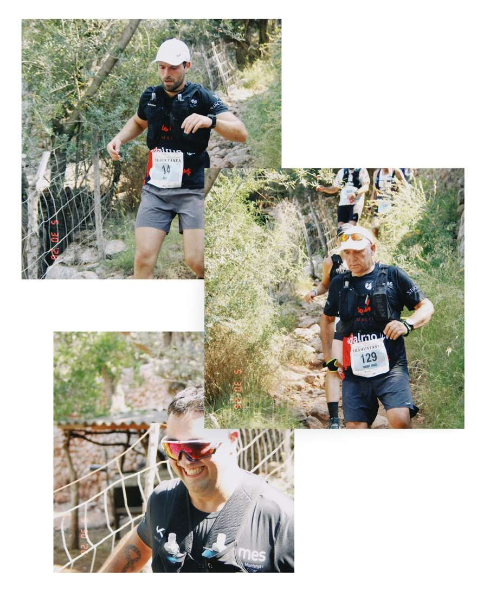
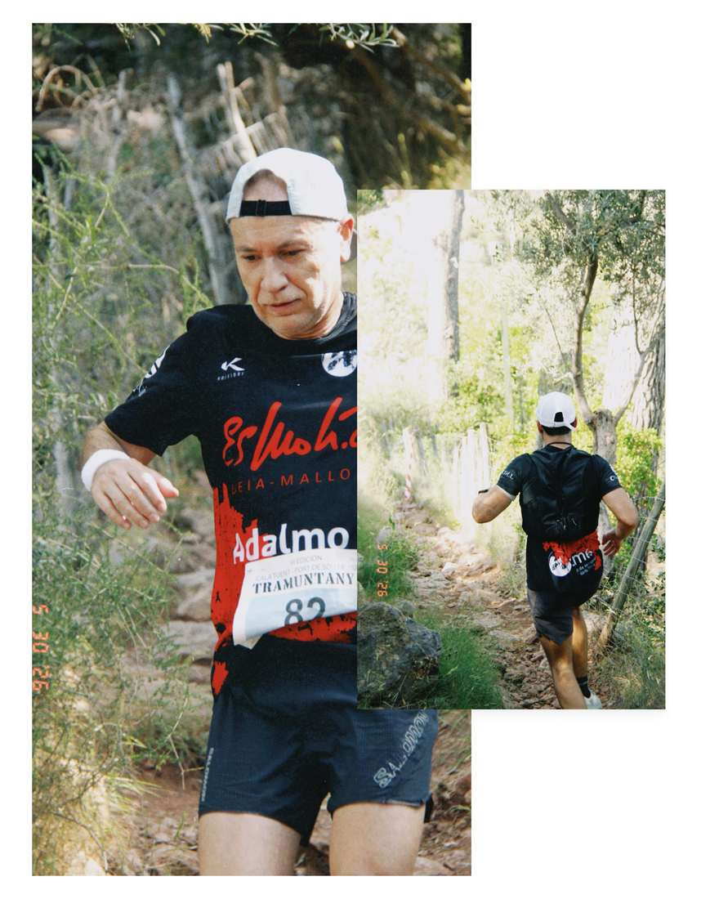
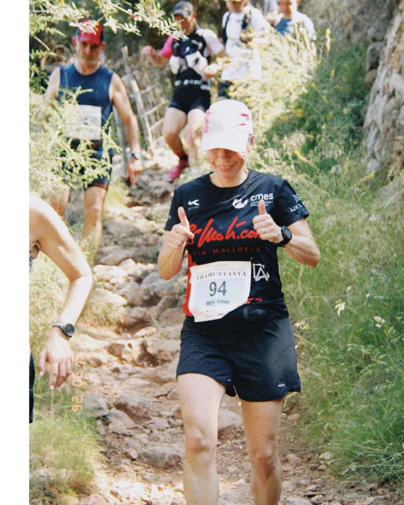
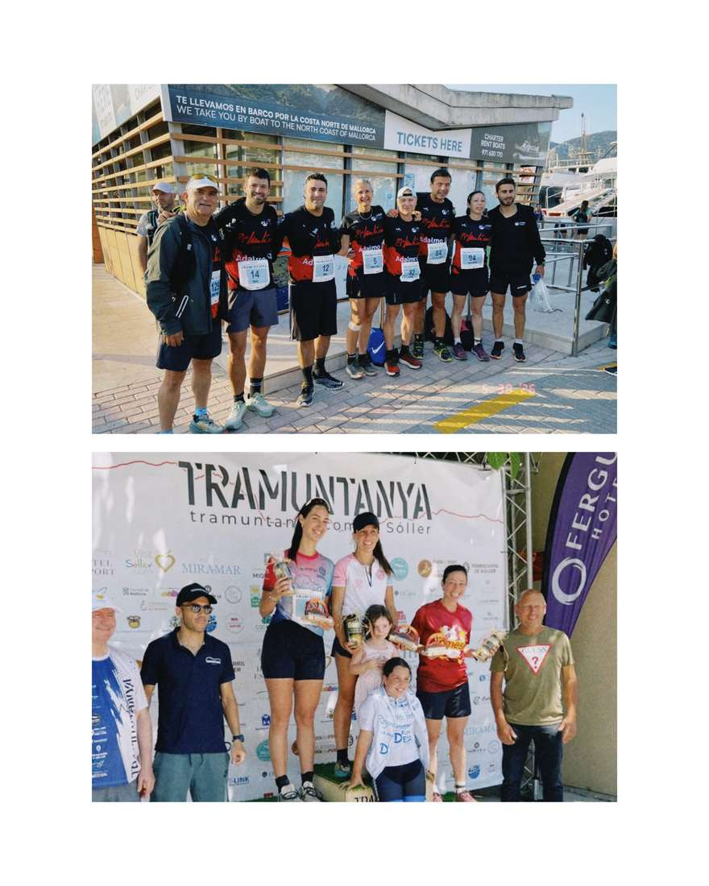
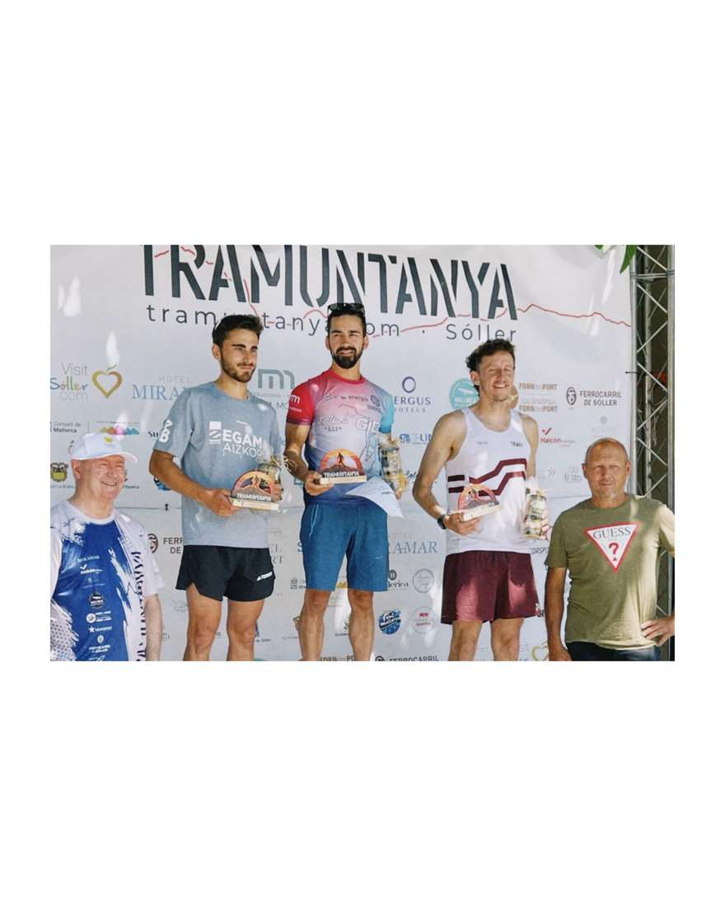
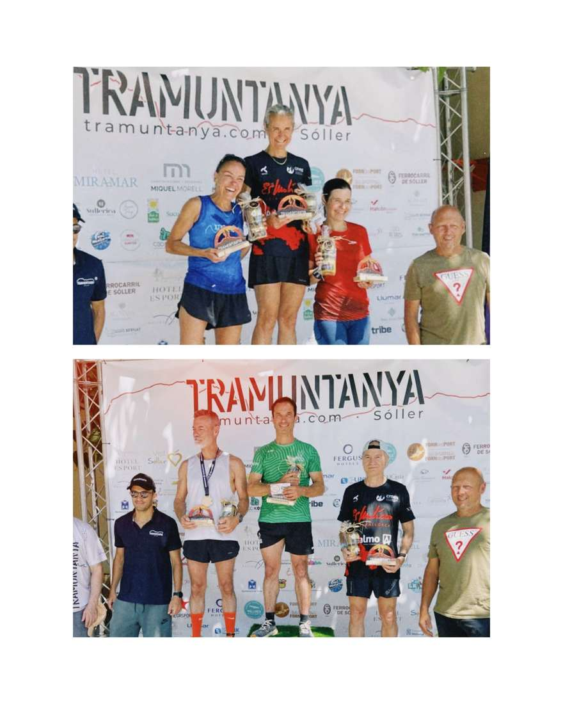

Ahir es va dur a terme la 🌊Tramuntanya Summer III☀️, una cursa que fa tres anys que forma part del calendari dels nostres corredors.

🙌🏻Hi vam tenir la participació d’uns quants membres que varen gaudir cada un dels 15 km.

Els resultats van ser:

Dani Vidal p.2 amb 1:19:17

Pere Albertí p. 19 amb 1:35:26

Pep Lluís Gómez p.55 amb 1:47:32

Àngels Vaquer p.106 amb 1:56:02

Joan Cabrer p.193 amb 2:09:12

Maria Antonia Marroig p.233 amb 2:16:50

Miquel Àngel Rubio p.253 amb 2:20:45

Diego Peña p.323 amb 2:34:06

Joan Josep Llompart p.360 amb 2:39:29

Els nostres corredors van pujar a podi!🥇

Dani Vidal 2n absolut

Àngels Vaquer 1M50

Pep Lluís Gómez 3M50

Maria Antonia Marroig 3ra Local

Enhorabona a tots💪🏻

@cursa\_tramuntanya 🫂

