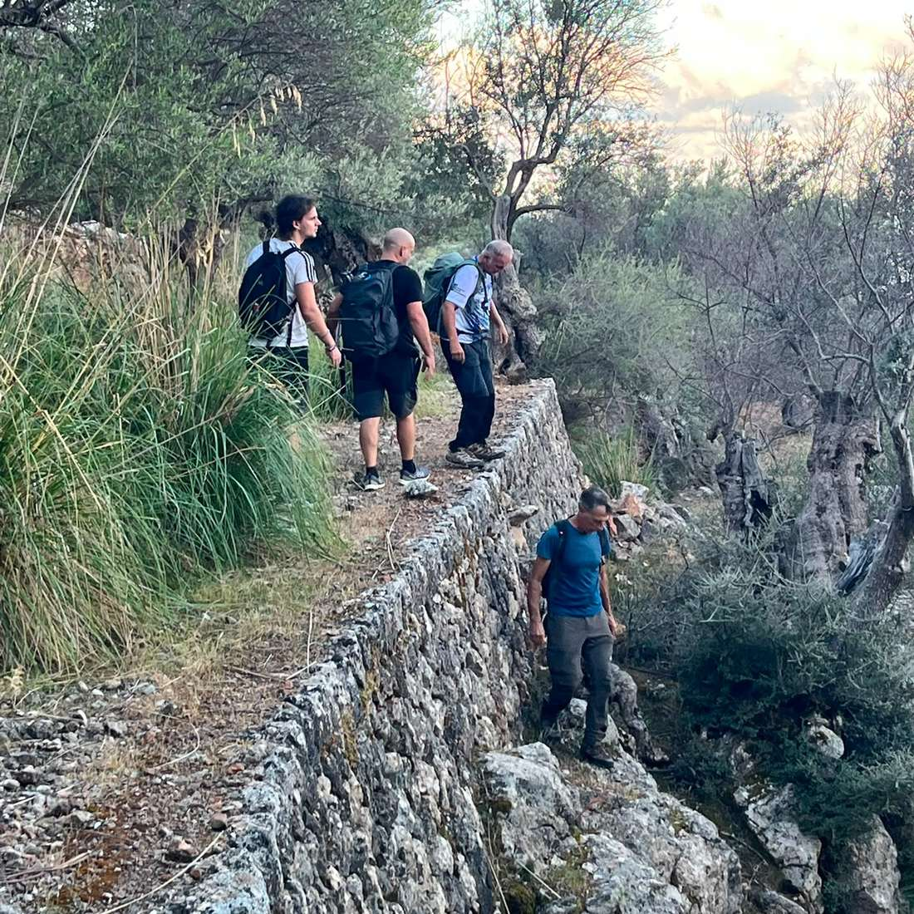
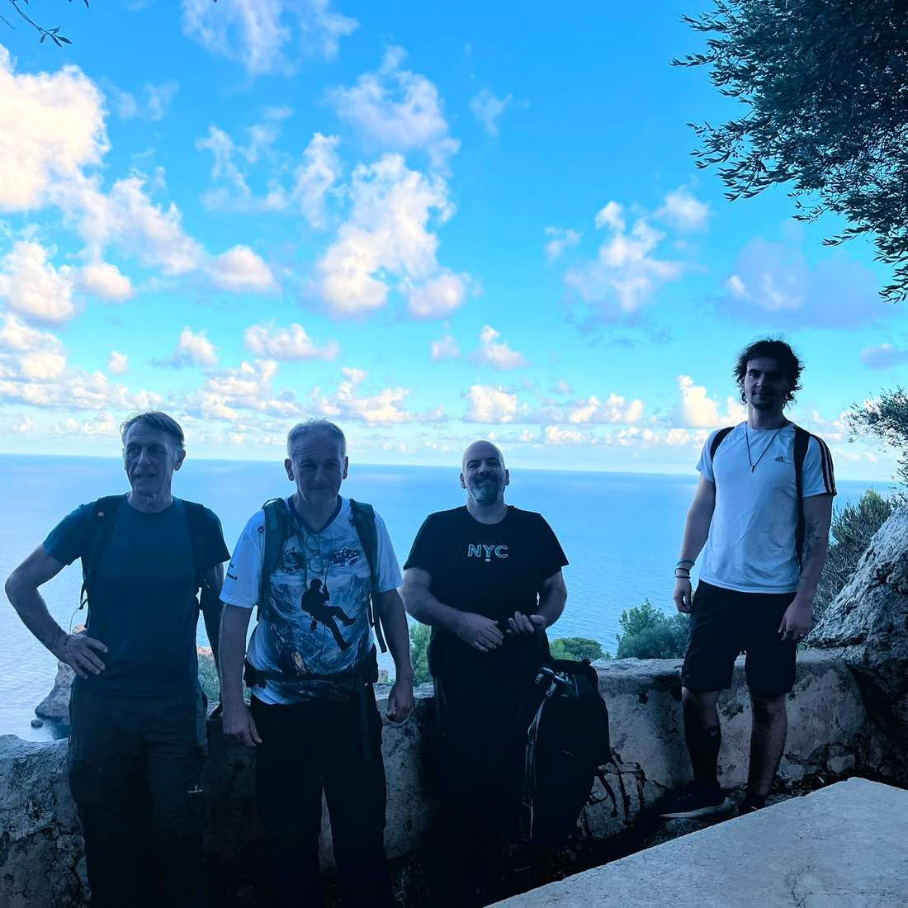
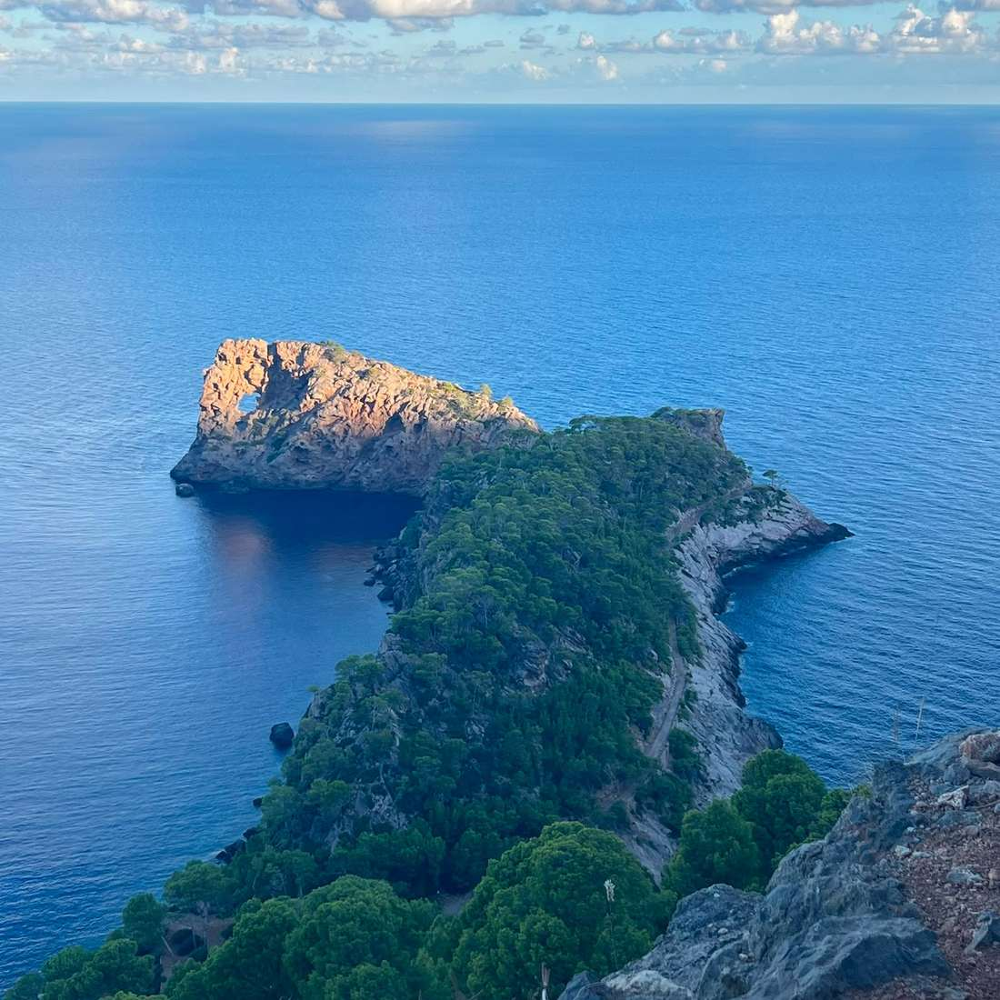
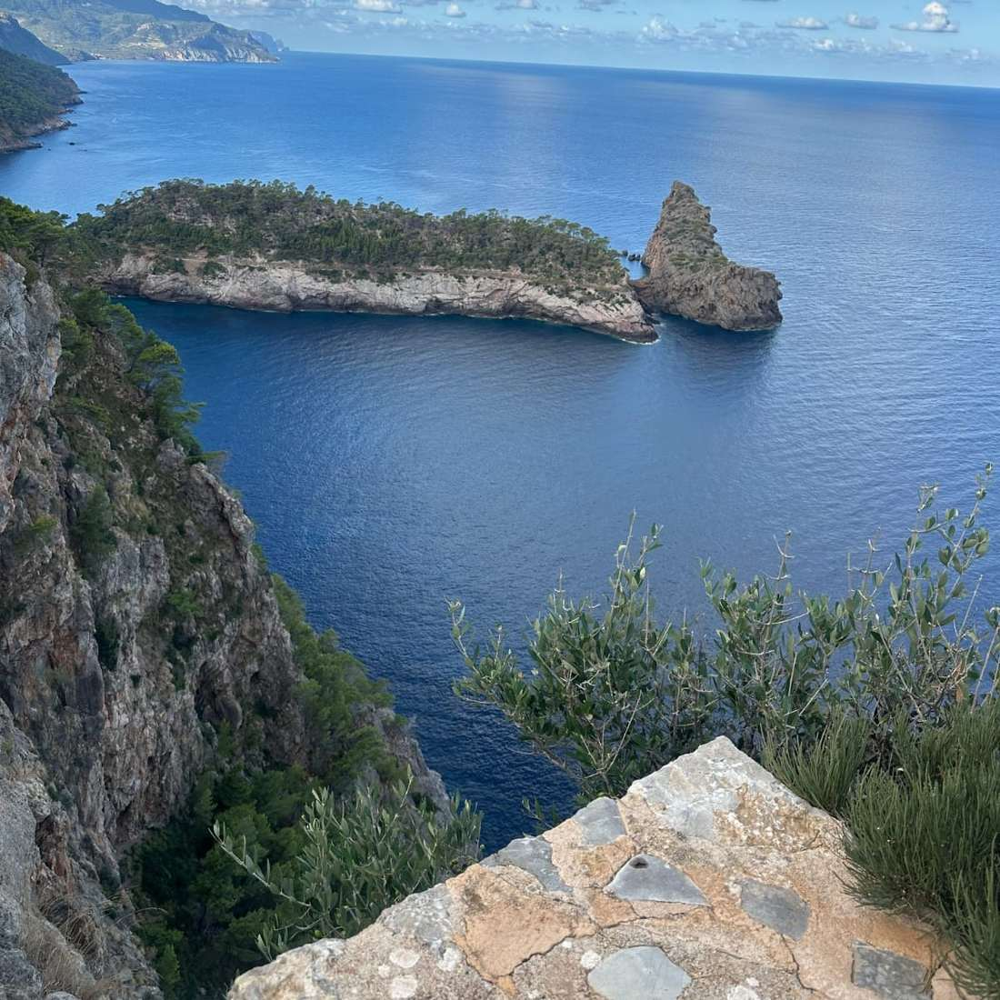
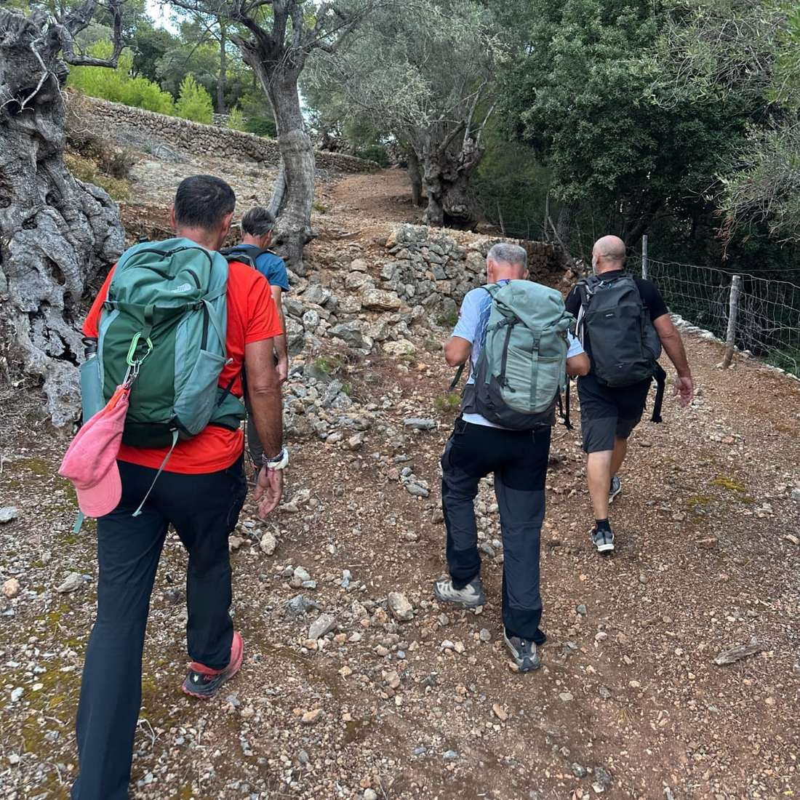
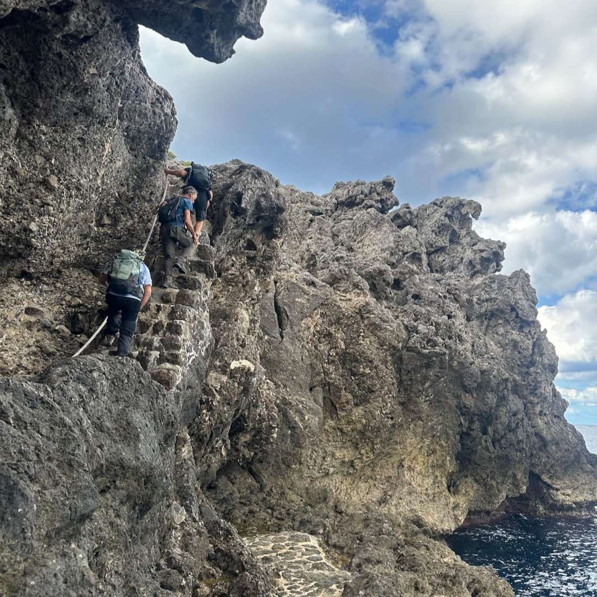
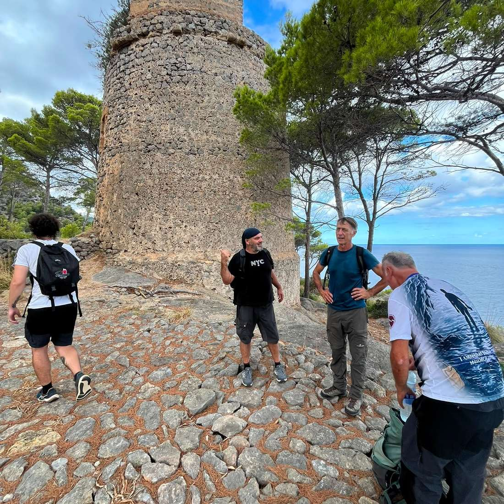
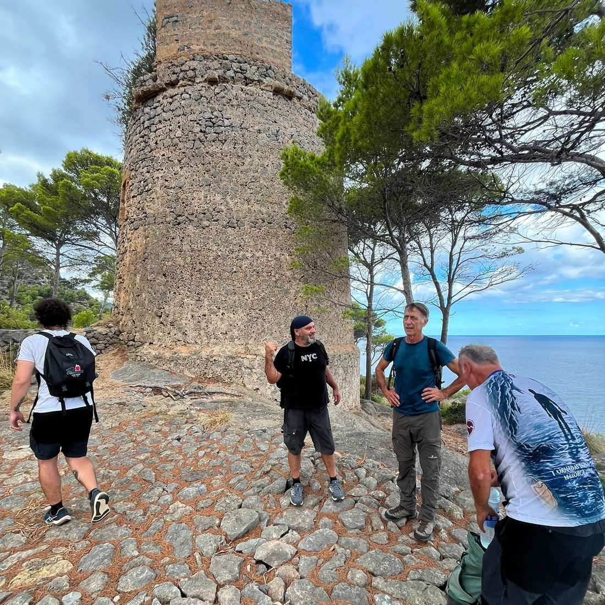

La secció de senderisme va fer una sortida el diumenge; una ruta circular per la costa de Deià, adaptada a l’època de l’any.

L'itinerari passava per Can Quet, camí des Ribassos, torre de sa Pedrissa, pas des Gat, sa Foradada, camí de sa Foradada a Son Marroig i es Castellassos, amb un desnivell aproximat de 400 m

La principal dificultat va ser el pas des Gat, un poc aeri, i alguns trams de camí poc definit.

