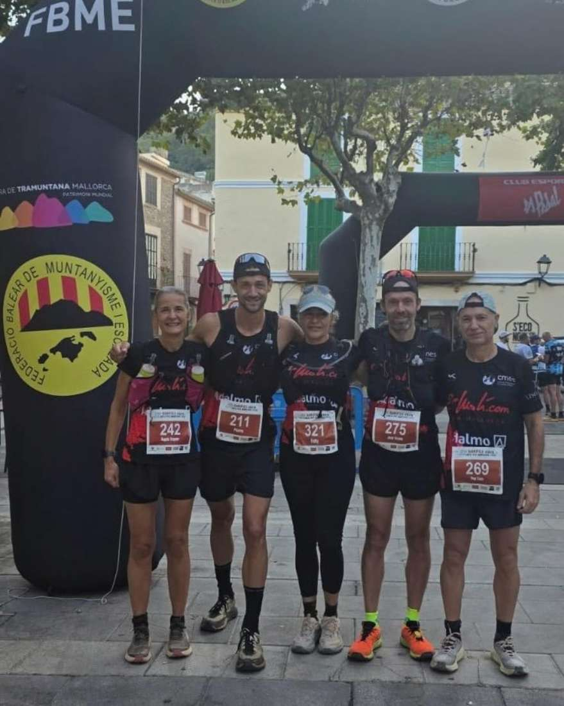
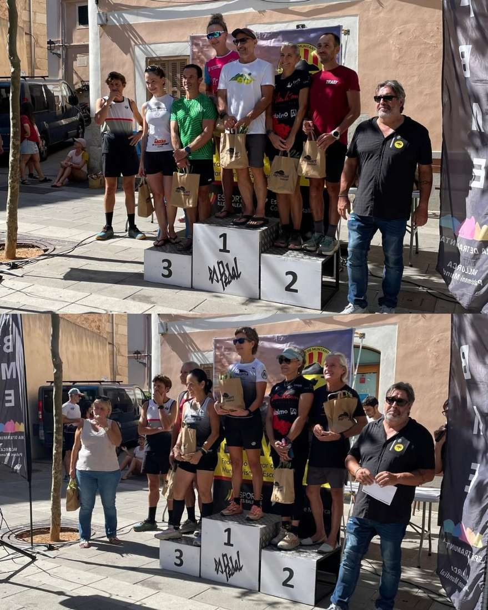

Diumenge el CMES va estar present a la cursa Bunyola Xtrem. En un recorregut de 19 km i 1000 m de desnivell, que era també el campionat de Balears de clubs, els nostres corredors varen obtenir uns bons resultats. En l’àmbit individual, amb els podis d’Àngels Vaquer (segona V50) i Fabiana Peña (segona V55), i com a club, el quart lloc de la general

Aquests varen ser els resultats

42. Pep Lluís Gómez, 2:13:28

48. Joan Vicens, 2:14:24

58. Pierre Mariotto, 2:19:56

83. Àngels Vaquer, 2.36:01

104. Fabiana Peña, 2:55:45

Enhorabona a tots!

